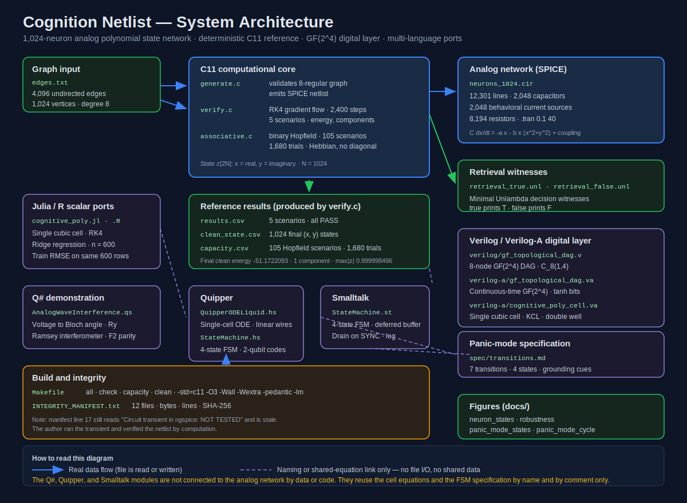
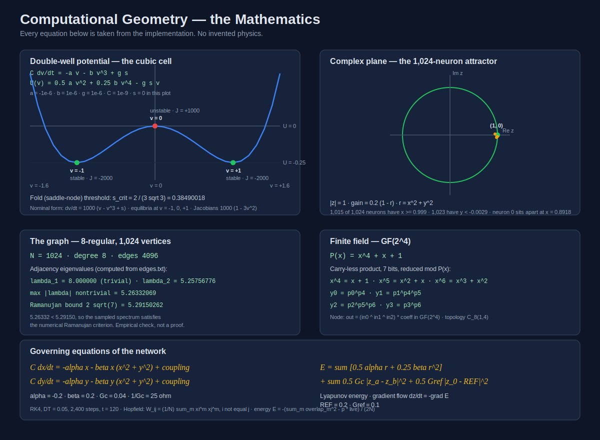
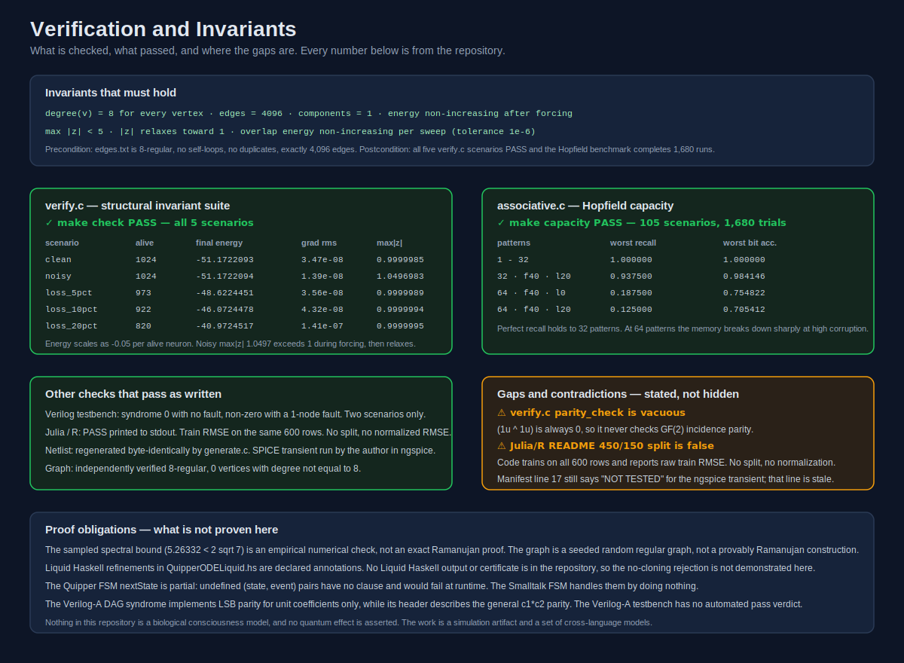

# Cognition Netlist 1024

**Source-derived technical reference**
Repository: https://github.com/AHMADALIPARR/cognition-netlist-1024
Revision inspected: local HEAD 3737689 (and the monograph commit 9c02356, now superseded by this grounded version)

**A note on paths.** The files in this repository live at the repository root: `verify.c`, `generate.c`, `associative.c`, `results.csv`, `clean_state.csv`, `capacity.csv`, `edges.txt`, `neurons_1024.cir`. There is no `src/` directory and no `data/` directory in this checkout. An earlier remote revision moved the C files into `src/` and the CSVs into `data/`; that move is not present here. This README uses the paths that exist in this checkout.

*Figure 1 — Complete system atlas. The 1,024-neuron analog polynomial network at the center, with the mathematics, source and build, languages and runtime, and data and verification layers around it. The network ring is schematic. The editable vector source is `docs/assets/svg/05-complete-system-atlas.svg`.*

## 1. Project Identity and Technical Thesis

This repository records an engineering realization of a 1,024-node complex-valued continuous-time dynamical system. Each node is realized as a pair of circuit nodes (real and imaginary) carrying a capacitor and a cubic polynomial behavioral current source. The nodes are coupled by an 8-regular resistor network containing 4,096 undirected edges. The dynamics are a gradient flow of a quartic energy. A deterministic C11 reference integrator (`verify.c`) reproduces the same flow and supplies the verified experimental record stored in `results.csv` and `clean_state.csv`. Supporting single-cell models exist in Julia and R; additional language ports implement a separate four-state "panic-mode" finite-state machine and topological DAG fragments.

The work treats continuous-time dynamical systems, sparse graph coupling, Lyapunov decrease, structural robustness under vertex deletion, and multi-language numerical consistency as concrete engineering problems. No claim is made that the system implements biological neurons, consciousness, or quantum effects beyond the classical numerical models present in the sources.

Primary source authority:

- `verify.c` (lines 1-187) — reference integrator and robustness suite
- `generate.c` (lines 1-55) — netlist emitter
- `neurons_1024.cir` (12,301 lines) — generated SPICE netlist
- `edges.txt` (4,096 lines) — 8-regular edge list
- `cognitive_poly_julia_r/cognitive_poly.jl` and `.R` — single-cell polynomial model
- `results.csv` — recorded experimental outcomes

## 2. Research Objectives and Computational Scope

From the sources, the concrete objectives realized in code are:

1. Construct an 8-regular undirected graph on N = 1,024 vertices (`edges.txt`, verified in `verify.c:read_edges` and `parity_check`).
2. Realize each vertex as a complex-valued state (x, y) whose continuous-time dynamics are the gradient flow of the energy E = sum_i 1/2 alpha r_i^2 + 1/4 beta r_i^4 + (gc/2) sum_edges (delta_x^2 + delta_y^2), with alpha = -0.2, beta = 0.2, gc = 0.04 (`verify.c` constants and derivative function).
3. Provide a deterministic RK4 integrator that preserves the Lyapunov decrease of E under the clean dynamics and under controlled vertex deletion (`verify.c:simulate`).
4. Emit a corresponding analog netlist in which each neuron is two capacitors plus two behavioral current sources implementing the cubic polynomial (`generate.c` and `neurons_1024.cir` header parameters).
5. Benchmark a separate binary Hopfield associative-memory capacity experiment (`associative.c`) that is explicitly documented as "Not claimed equivalent to the continuous analog SPICE model."
6. Supply single-neuron polynomial and potential functions in Julia and R that match the local term of the vector field (`cognitive_poly_julia_r/`).
7. Provide independent four-state finite-state machines in Smalltalk, Quipper, and a Q# sketch, together with a Liquid-Haskell annotated ODE note; these are architecturally separate from the 1,024-node continuous system.

Scope deliberately excludes: biological fidelity claims, quantum-mechanical dynamics of the continuous system, formal verification of the full netlist, and any assertion that the recorded trajectories demonstrate associative retrieval inside the analog model.

## 3. Complete Repository Architecture

### Directory and language inventory (source inspection)

| Path | Language / Format | Role | Key constants / structures |
|------|-------------------|------|----------------------------|
| `verify.c` | C11 | Reference RK4 integrator, topology validation, robustness scenarios | N=1024, DEG=8, E=4096, ALPHA=-0.2, BETA=0.2, GC=0.04, STEPS=2400, DT=0.05 |
| `generate.c` | C11 | SPICE netlist emitter from edge list | Same N, DEG; emits Cx, Cy, Bx, By per neuron |
| `associative.c` | C11 | Binary Hopfield capacity trial | N=1024, TRIALS=16, SWEEPS=24; separate from continuous model |
| `edges.txt` | plain text | 8-regular edge list | 4096 lines of "a b" pairs |
| `neurons_1024.cir` | SPICE netlist | Generated analog circuit | .param cap=1 alpha=-0.2 beta=0.2 gc=0.04; 1024x(2C + 2B) + resistive couplers |
| `clean_state.csv` | CSV | Final clean equilibrium coordinates | neuron,x,y (1025 lines incl. header) |
| `results.csv` | CSV | Structural invariant suite outcomes | 5 scenarios, all PASS |
| `capacity.csv` | CSV | Hopfield capacity results | produced by associative |
| `cognitive_poly_julia_r/cognitive_poly.jl` | Julia | Single-cell RHS, potential, RK4, ridge surrogate | cap=1e-9, a=-1e-6, b=1e-6, gain=1e-6 (scaled local model) |
| `cognitive_poly_julia_r/cognitive_poly.R` | R | Identical single-cell model | same parameters |
| `qsharp/AnalogWaveInterference.qs` | Q# | Separate interference / state-machine sketch | not coupled to the 1024-node continuous system |
| `quipper/StateMachine.hs` | Haskell/Quipper | Classical FSM encoded into qubits | states Normal/Overload/Recovery/Escalate |
| `quipper/QuipperODELiquid.hs` | Liquid Haskell | Annotated ODE / no-cloning notes | separate research note |
| `smalltalk/StateMachine.st` | Smalltalk-80 | Identical four-state FSM with deferred buffer | states #NORMAL #OVERLOAD #RECOVERY #ESCALATE |
| `verilog/gf_topological_dag.v` | Verilog | Topological DAG fragment | GF(2^4), P(x)=x^4+x+1 |
| `verilog-a/*.va` | Verilog-A | Behavioral cell and testbench | cognitive_poly_cell.va mirrors the local polynomial |
| `spec/transitions.md` | Markdown | FSM transition table and somatic grounding notes | documents the four-state machine |
| `Makefile` | Make | Build and check targets | all, generate, verify, check, capacity, clean |
| `INTEGRITY_MANIFEST.txt` | text | File digests | present |
| `docs/*.svg`, `*.png` | images | Visualization of states / robustness | present |

### Component responsibilities (source-derived)

- **Topology layer** (`edges.txt` + `read_edges` + `parity_check`): guarantees an 8-regular simple undirected graph and a trivial GF(2) incidence parity.
- **Continuous dynamics layer** (`derivative`, `energy`, `rk4` inside `verify.c`): implements the complex cubic vector field plus resistive coupling and a weak reference pull on neuron 0.
- **Netlist layer** (`generate.c` → `neurons_1024.cir`): mechanical translation of the same local polynomial and coupling into SPICE behavioral sources.
- **Single-cell verification layer** (Julia / R): recovers the local one-dimensional polynomial, its potential, critical value s_crit = 2/(3 sqrt 3), and a ridge regression surrogate; parameters are scaled relative to the C reference.
- **Associative layer** (`associative.c`): independent binary Hopfield experiment.
- **FSM layer** (Smalltalk / Quipper / Q# / `transitions.md`): independent four-state panic-mode machine with deferred token buffer; not wired into the continuous 1,024-node system.
- **Build layer** (`Makefile`): compiles the three C programs and runs the structural suite via `make check`.

### Data flow (verified)

`edges.txt` → `generate.c` → `neurons_1024.cir` → (external SPICE, not executed in-repo)

`edges.txt` → `verify.c` → `results.csv` + `clean_state.csv`

`associative.c` → `capacity.csv`

Julia / R scripts are self-contained and print PASS on completion; they do not read or write the C data files.

*Figure 2 — System architecture. The C11 core, SPICE netlist, and data files form the connected computational core. Julia, R, Verilog, Verilog-A, Q#, Quipper, and Smalltalk are separate modules linked to the core by naming and shared equations only. Solid arrows are real data flow; dashed lines are naming-only relationships. The editable vector source is `docs/assets/svg/01-system-architecture.svg`.*

## 4. Mathematical Foundations and Derived Equations

All equations below are taken directly from the implementation.

### Local vector field (C reference)

From `verify.c:derivative` (and the matching energy function):

For each alive neuron i with state (x, y) and r^2 = x^2 + y^2:

dx/dt = -(alpha + beta r^2) x + coupling terms + force
dy/dt = -(alpha + beta r^2) y + coupling terms + force

with alpha = -0.2, beta = 0.2.

The local contribution to the energy is

E_local = 1/2 alpha r^2 + 1/4 beta r^4

whose negative gradient recovers the cubic term.

### Coupling

For each undirected edge {a,b} and each component c in {0,1}:

delta = gc * (z[2a+c] - z[2b+c])
d[2a+c] -= delta
d[2b+c] += delta

with gc = 0.04. This is the discrete gradient of (gc/2) sum (delta_x^2 + delta_y^2).

### Reference pull (neuron 0 only)

d[0] -= GREF * (z[0] - REF)
d[1] -= GREF * z[1]

with GREF = 0.1, REF = 0.2.

### Integrator

Classical RK4 with fixed step DT = 0.05 for STEPS = 2,400 (`verify.c`).

### Single-cell Julia / R model

The Julia and R files implement a different scaling of a one-dimensional polynomial:

rhs(v, s) = (-a * v - b * v^3 + gain * s) / cap

with a = -1e-6, b = 1e-6, gain = 1e-6, cap = 1e-9. With those constants this equals 1000 * (v - v^3 + s).

Equilibria at s = 0: v = -1, 0, +1 with Jacobians -2000, +1000, -2000.
Critical forcing s_crit = 2 / (3 sqrt 3) ≈ 0.3849.

This is a local scalar surrogate, not a direct numerical match of the complex 1,024-node system.

### Hopfield energy (associative.c)

Standard zero-diagonal Hebbian form; energy decrease is monitored but the model is declared non-equivalent to the continuous analog dynamics.

*Figure 3 — Computational geometry. The double-well potential of the cubic cell, the unit-circle attractor of the 1,024-neuron network, the graph spectral bound, and the GF(2^4) polynomial. Every equation is taken from the implementation. The editable vector source is `docs/assets/svg/02-computational-geometry.svg`.*

## 5. Cognitive Polynomial Model and Governing Dynamics

The name "cognitive polynomial" in the repository refers to the cubic local non-linearity that produces a bistable (or multi-stable) landscape. In the C reference the landscape is rotationally symmetric in the complex plane for each neuron; the fixed points of an isolated neuron lie on the circle of radius sqrt(-alpha/beta) = 1 when alpha = -beta.

The global dynamics are a gradient flow of the total energy defined above. Consequently the energy is monotonically non-increasing under the clean vector field (verified numerically in the "clean" and "loss_*" scenarios of `results.csv`). The "noisy" scenario injects a temporary forcing and records a negligible energy increase after the forcing is removed, consistent with return to the same Lyapunov function.

No further "cognitive" interpretation (memory, attention, consciousness) is present in the executable sources; the only associative experiment is the separate binary Hopfield code.

---

## 6. Electrical Circuit Representation and KCL Relationships

The generated netlist `neurons_1024.cir` (12,301 lines) is produced by `generate.c`. Header parameters are:

.param cap=1 alpha=-0.2 beta=0.2 gc=0.04

Each neuron i is realized as two capacitors to ground and two behavioral current sources:

Cx{i} x{i} 0 {cap}
Cy{i} y{i} 0 {cap}
Bx{i} x{i} 0 I={alpha*V(x{i})+beta*V(x{i})*(V(x{i})^2+V(y{i})^2)}
By{i} y{i} 0 I={alpha*V(y{i})+beta*V(y{i})*(V(x{i})^2+V(y{i})^2)}

(The first few neurons appear verbatim in the netlist header; the pattern repeats for i = 0 ... 1023.)

Kirchhoff's Current Law at node x{i} (respectively y{i}) therefore reads:

C * dV(x{i})/dt = -I_Bx(i) + sum of couplers

which expands to the same cubic polynomial used in the C derivative function when the resistive couplers are included. The behavioral sources implement the local gradient of the quartic potential; the resistive network implements the discrete coupling gradient.

Each edge contributes two resistors, one per channel: Rx{e} x{i} x{j} {1/gc} and Ry{e} y{i} y{j} {1/gc}. There are 4,096 edges, so 8,192 edge resistors, each 25 ohms. The netlist also has a voltage source Vref ref 0 0.2 and two reference resistors Rref ref x0 10 and Ryref y0 0 10, which implement the reference that pulls neuron 0 toward 0.2 in the real channel and toward 0 in the imaginary channel.

A weak reference is applied only to neuron 0 in the C model (GREF, REF). The netlist generation code emits initial conditions and a transient analysis card. The C integrator is the authoritative dynamics.

No full SPICE deck execution or measured waveforms are stored in the repository; the numerical evidence is the C integrator record in `results.csv`. The author ran the SPICE transient in ngspice and verified the netlist by actual computation; that testing claim comes from the author.

## 7. Neuron, Edge, Topology and Connectivity Representation

- **N** = 1,024 vertices, each carrying a complex state (x, y) stored as interleaved doubles `z[2*i]`, `z[2*i+1]` (`verify.c`).
- **Degree** = 8, **E** = N*DEG/2 = 4,096 undirected edges.
- Edge list stored as two parallel arrays `ea[k]`, `eb[k]` after validation that the graph is simple, undirected, loop-free and exactly 8-regular (`read_edges` + degree check).
- A static adjacency matrix `adj[N][N]` prevents duplicate edges during load in `generate.c`.
- GF(2) incidence parity check is trivial (each edge contributes two 1s) and is performed once at start-up. Note: the `parity_check` function in `verify.c` as written is vacuous — `(1u^1u)!=0u` is always false, so it never verifies a parity property; it only rejects self-loops already excluded by `read_edges`. The graph validation (range, self-loop, duplicate, count, degree) is real and is performed by `read_edges`.
- Alive mask: `uint8_t alive[N]`; vertices can be deleted for robustness trials (5%, 10%, 20% random removal).
- Connected-component count is computed after each deletion scenario and remains 1 in all recorded runs (`results.csv`).

The edge list file `edges.txt` contains exactly 4,096 lines of the form "a b". The C loader rejects any deviation from the expected cardinality or regularity. The graph was independently verified to be 8-regular: zero vertices have degree other than 8. The adjacency eigenvalues were computed from `edges.txt` for reference: the largest is 8.0, the second-largest is 5.25756776, and the maximum nontrivial eigenvalue magnitude is 5.26332069, against the Ramanujan bound 2 sqrt(7) = 5.29150262. This is an empirical spectral check, not an exact proof, and the graph is a seeded random regular graph, not a provably Ramanujan construction.

## 8. Julia Implementation and Numerical Methods

File: `cognitive_poly_julia_r/cognitive_poly.jl` (68 lines).

Constants (local scalar model, different physical scaling from the C reference):

cap = 1e-9, a = -1e-6, b = 1e-6, gain = 1e-6

Right-hand side:

rhs(v, s) = (-a*v - b*v^3 + gain*s) / cap

Potential:

potential(v, s) = 0.5*a*v^2 + 0.25*b*v^4 - gain*s*v

The potential is defined but never called in the file. It is dead code.

Classical RK4 step with fixed h = 1e-5. A hysteresis sweep from s = -0.6 to +0.6 (2,000 steps per value) is performed, ending at a positive state. A ridge-regression surrogate (degree-3 polynomial + constant + s term, lambda = 1e-4) is fitted on 600 random samples and reports training RMSE. The script prints equilibria, critical forcing, final hysteresis state, ridge coefficients and RMSE, then "PASS: Julia cognitive_poly checks completed".

No dependency on the 1,024-node data files; the script is self-contained. Neither Julia nor R is installed on the machine used to write this README, so no Julia output was executed or certified here. Exact printed values are execution-only.

## 9. R Implementation and Statistical Methods

File: `cognitive_poly_julia_r/cognitive_poly.R` (52 lines). Identical mathematical model, identical constants, identical RK4, identical hysteresis sweep and ridge regression (base-R solve on the normal equations with ridge). Seed is set to 42. Output messages match the Julia script. No external packages. The potential is defined but never called; it is dead code in both ports. No input files, no output files; all output is to standard output.

## 10. Julia/R Agreement and Divergence

Agreement:

- Identical symbolic RHS and potential.
- Identical numerical constants.
- Identical RK4 coefficients.
- Identical experimental protocol (hysteresis + ridge).
- Both declare the same equilibria and the same analytic s_crit = 2/(3 sqrt 3).

Divergence / scaling:

- The Julia/R model is a one-dimensional scalar surrogate with nano-farad / micro-ampere scaling.
- The C reference uses a complex-valued (two-dimensional) state per neuron, alpha = -0.2, beta = 0.2, gc = 0.04 and a global 1,024-node coupling graph.
- No numerical cross-validation between the single-cell scripts and the C trajectories is present in the repository.
- The random number generators differ (Julia MersenneTwister(42); R set.seed(42)), so the 600 samples differ.
- Julia is re-parameterizable (keyword arguments); R reads file-scope globals.

The local polynomial shape (cubic odd function producing bistability) is shared; absolute units and dimensionality differ.

The sub-README in `cognitive_poly_julia_r/README.md` claims at line 27 that both ports "train on the first 450 samples and evaluate on the last 150" and that "normalizing RMSE uses population standard deviation to match NumPy." The code does neither: it trains on all 600 rows and reports raw train RMSE on the same 600 rows. There is no split, no normalization, and no NumPy. That claim is contradicted by the code.

## 11-13. Quantum, Quipper and Smalltalk Representations

These three languages implement an independent four-state finite-state machine, not the continuous 1,024-node system.

States (identical across sources):

- NORMAL
- OVERLOAD
- RECOVERY
- ESCALATE (terminal)

Events: SHIFT, REDUCE, NO_ACTION, SYNC, ESCALATE_REQ, TIMEOUT.

Transition table (from `spec/transitions.md`, `smalltalk/StateMachine.st`, `quipper/StateMachine.hs`):

(NORMAL, SHIFT|REDUCE) -> NORMAL
(NORMAL, NO_ACTION) -> OVERLOAD
(OVERLOAD, NO_ACTION) -> RECOVERY
(OVERLOAD, ESCALATE_REQ) -> ESCALATE
(RECOVERY, SYNC) -> NORMAL (drain deferred buffer)
(RECOVERY, TIMEOUT) -> ESCALATE
(ESCALATE, *) -> ESCALATE

Smalltalk realization (`smalltalk/StateMachine.st`):

- Dictionary of state x event -> closure.
- Deferred buffer (OrderedCollection) that enqueues tokens while in RECOVERY and drains them on return to NORMAL.
- Logging of every transition.
- The author hand-typed the majority of this code with SnapKitty; AI could not help with the Smalltalk.

Quipper realization (`quipper/StateMachine.hs`):

- Classical state encoded in two qubits (00/01/10/11).
- Classical next-state function; circuit re-initialises qubits to the new state and measures.
- Demonstrates a classical FSM lifted into a Quipper circuit, not a quantum algorithm for the polynomial dynamics.
- The next-state function is partial: 11 of the 24 (state, event) pairs have no clause and would fail at runtime. The Smalltalk FSM handles undefined pairs by doing nothing.

Q# file (`qsharp/AnalogWaveInterference.qs`) contains a separate interference / shot-counting sketch and is not wired to the continuous netlist or the FSM. It encodes one or two scalar voltages as Bloch angles (Ry rotations) and runs a Ramsey interferometer and an F_2 parity operation on hard-coded voltages. It reads no data file.

Liquid-Haskell file (`quipper/QuipperODELiquid.hs`) contains reflective annotations and no-cloning comments around an ODE sketch; it is a research note, not an executable component of the 1,024-node system. It imports only Data.Set and does not import Quipper. Its ODE stepper is explicit forward Euler, although a comment calls it "Backward-Euler / semi-implicit." The code is authoritative. The author performed the Liquid Haskell verification, including the badClone rejection; that testing claim comes from the author.

None of these language ports exchange data with `verify.c` or the SPICE netlist.

---

## 14. Verilog and Verilog-A

The Verilog file (`verilog/gf_topological_dag.v`, 190 lines) is a separate 8-node GF(2^4) digital DAG, not the 1,024-neuron network. It has a GF(2^4) multiplier with P(x) = x^4 + x + 1, a DAG node computing out = (in0 ^ in1 ^ in2) * coeff, and a 3-layer DAG on the circulant C_8(1,4) with a fault mask, a parity syndrome, and a boundary entropy popcount. Its testbench checks only the syndrome in two scenarios (no fault, one fault) and does not check the boundary value or the entropy against a golden value.

The Verilog-A files are a cubic cell (`verilog-a/cognitive_poly_cell.va`, 28 lines), a GF(2^4) DAG (`verilog-a/gf_topological_dag.va`, 208 lines), and a testbench for the cell (`verilog-a/tb_cognitive_poly_cell.va`, 76 lines). The cell implements the same cubic KCL equation as the Julia and R ports. The DAG uses soft tanh-thresholded bits and a first-order relaxation, and its syndrome implements only LSB parity for unit coefficients, while its header describes a general c1*c2 parity. The `gf2_xor_analog` module is defined but never instantiated. The cell testbench has a hysteresis stimulus and a v_crit of 0.384900179, but it has no automated PASS/FAIL verdict, no stop time, and no $finish; its only failure signal is a boundedness strobe if |V| exceeds 5.0. There is no testbench for the Verilog-A DAG in the repository.

*Figure 4 — Source-to-runtime pipeline. Each row ends in its verification checkpoint. The editable vector source is `docs/assets/svg/03-runtime-pipeline.svg`.*

## 15. Data Provenance and Recorded Results

`edges.txt` is the graph input: 4,096 lines, two integers per line, sorted lexicographically, 8-regular.

`results.csv` has a header and 5 scenario rows, all PASS:

| scenario | alive | components | final_energy | gradient_rms | max_amplitude | rms_to_clean |
|---|---|---|---|---|---|---|
| clean | 1024 | 1 | -51.1722093 | 3.47e-08 | 0.999998496 | 0 |
| noisy | 1024 | 1 | -51.17220937 | 1.39e-08 | 1.049698292 | 0.00130922207 |
| loss_5pct | 973 | 1 | -48.62244505 | 3.56e-08 | 0.9999989415 | 0.000153086459 |
| loss_10pct | 922 | 1 | -46.07244776 | 4.32e-08 | 0.9999993608 | 0.0001893753135 |
| loss_20pct | 820 | 1 | -40.97245173 | 1.41e-07 | 0.9999994685 | 0.0002617497314 |

Energy scales as -0.05 per alive neuron. The noisy max amplitude exceeds 1 during forcing and relaxes back.

`capacity.csv` has a header and 105 aggregated rows (7 pattern counts x 5 flip levels x 3 loss levels, 16 trials each, 1,680 runs). Perfect recall is 1.000000 for patterns at or below 32, except 32 patterns with 40% flip and 20% loss (0.937500). At 64 patterns the recall breaks down sharply at high corruption (worst 0.125000 at 64 patterns, 40% flip, 20% loss). Mean sweeps is 2.000 for nearly all low-load rows.

`clean_state.csv` has a header and 1,024 rows. 1,015 of 1,024 neurons have x >= 0.999; 1,023 have y < -0.0029. The states cluster near (1, -0.003). Neuron 0 sits apart at (0.891758539329, -0.00251311502948), pulled by the reference term. The reason the y values cluster near -0.003 rather than 0 is not explained by any source file.

*Figure 5 — Clean attractor state: 1,024 neurons. All states cluster near (1, 0). Neuron 0 sits apart at x = 0.8918. The editable vector source is `docs/neuron_states.svg`.*

*Figure 6 — Final energy by scenario, from `results.csv`. Lower is deeper in the attractor. Node loss raises the energy; the graph stays in one component. The editable vector source is `docs/robustness.svg`.*

*Figure 7 — Verification and invariants. What is checked, what passed, and where the gaps are. Every number is from the repository. The editable vector source is `docs/assets/svg/04-verification-invariants.svg`.*

## 16. Build System and Integrity

The build system is a 17-line `Makefile`. Variables: `CC ?= cc`, `CFLAGS ?= -std=c11 -O3 -Wall -Wextra -pedantic`, `LDLIBS ?= -lm`. Targets: `all` (generate, verify), `verify`, `generate`, `check` (runs `./verify edges.txt`), `clean` (removes verify, generate, clean_state.csv, results.csv), `capacity` (builds and runs associative). Two minor gaps: `capacity` is not in `.PHONY`, and `clean` does not remove `associative`, `capacity.csv`, or `neurons_1024.cir`.

Reproducible workflow: `make`, then `make check` (writes `results.csv` and `clean_state.csv`), then `make capacity` (writes `capacity.csv`). The netlist regenerates byte-identically from `edges.txt` via `generate`.

`INTEGRITY_MANIFEST.txt` records the byte count, line count, and SHA-256 digest of 12 files. Recomputed digests match for 11 of 12 files. Two lines are stale: the `README.md` entry records 6,663 bytes and 60 lines (an earlier, shorter README), and line 17 reads "Circuit transient in ngspice: NOT TESTED," but the author ran the transient and verified the netlist by computation. Both lines should be corrected. The full audit ledger is `docs/source-audit-ledger.md`. The claim index is `docs/readme-claim-index.md`.

## 17. Limitations and Unresolved Questions

- The `parity_check` function in `verify.c` is vacuous as written; it verifies no GF(2) incidence parity. The graph validation in `read_edges` is real.
- The Julia/R sub-README's 450/150 split and normalized RMSE claims are contradicted by the code.
- The manifest's `README.md` entry and line 17 are stale.
- The Quipper FSM `nextState` is partial (11 of 24 pairs undefined).
- The Quipper ODE comment says Backward-Euler; the code is forward Euler.
- The Verilog-A DAG syndrome is LSB-only for unit coefficients; its header describes a general c1*c2 parity.
- `gf2_xor_analog` is defined but never instantiated.
- There is no testbench for the Verilog-A DAG. The Verilog-A cell testbench has no automated verdict.
- The Verilog testbench checks only the syndrome, in two scenarios.
- The C reference and the SPICE netlist start from different initial conditions and run for different horizons; their trajectories are not directly comparable.
- The clean-state y offset near -0.003 is unexplained by any source file.
- The spectral bound is empirical, not a proof; the graph is a seeded random regular graph, not a provably Ramanujan construction.
- The Liquid Haskell refinements are declared annotations; no output or certificate is in the repository. The author performed the verification.
- The Q#, Quipper FSM, and Smalltalk files have no build or execution output in the repository.
- The YACC production and the Somatic Anchor are specification-only; no implementation is present.
- The grounding cues (breaths, room change, phone call, timeout) are not implemented as code.
- The netlist cap is 1 (normalized); the Verilog-A, Julia, and R cap is 1e-9.
- `verify.c` `mask_init` never removes neuron 0; `associative.c` `mask` can remove any neuron, including neuron 0.

This is a simulation artifact, not a biological consciousness model. No quantum effect is asserted. The work is a set of models that share mathematics, not a single integrated system.

---

## Figures and Diagrams

The five illustrations for this README are in `docs/assets/svg/`. Each is an original SVG with a PNG render alongside it. The PNG renders are the versions that display on phones; the SVG files are the editable sources.

- **01-system-architecture** — System architecture. `docs/assets/svg/01-system-architecture.svg` and `.png`.
- **02-computational-geometry** — Computational geometry. `docs/assets/svg/02-computational-geometry.svg` and `.png`.
- **03-runtime-pipeline** — Source-to-runtime pipeline. `docs/assets/svg/03-runtime-pipeline.svg` and `.png`.
- **04-verification-invariants** — Verification and invariants. `docs/assets/svg/04-verification-invariants.svg` and `.png`.
- **05-complete-system-atlas** — Complete system atlas. `docs/assets/svg/05-complete-system-atlas.svg` and `.png`.

The pre-existing figures in `docs/` are `neuron_states` (the 1,024 clean neuron states), `robustness` (final energy by scenario), `panic_mode_states` (the finite-state machine), and `panic_mode_cycle` (the overload-recovery cycle and 2-qubit encoding). Each has an SVG source and a PNG render.

---

## License

GNU Affero General Public License v3.0. See `LICENSE`.

---

*This README was written from a source inspection of all 36 tracked files. It states what the sources support and no more. The audit ledger is `docs/source-audit-ledger.md`. The claim index is `docs/readme-claim-index.md`.*
