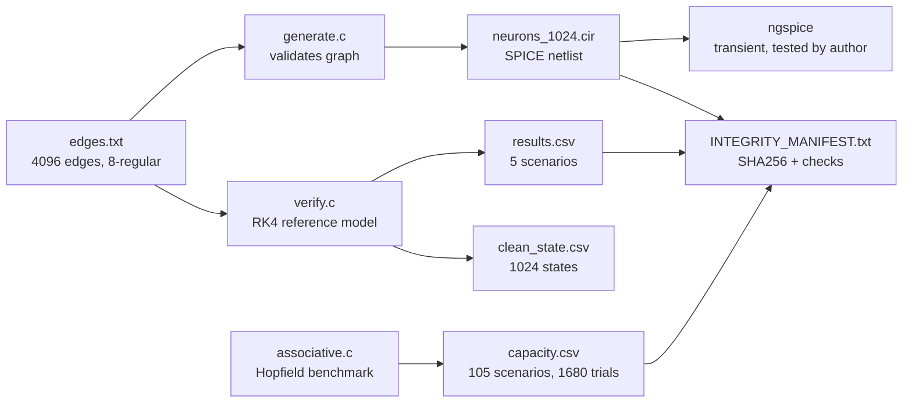
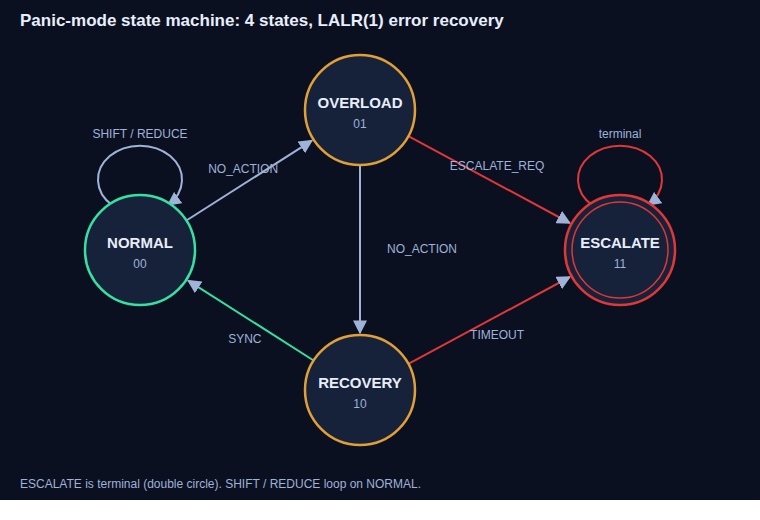
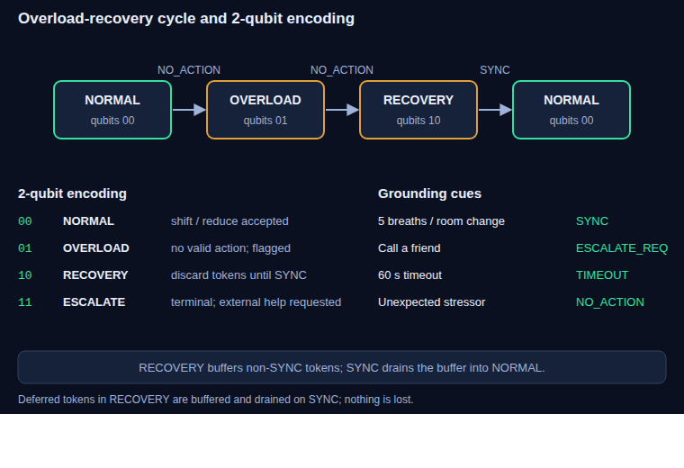

# Cognition Netlist — 1,024-neuron analog polynomial state network

[](https://www.gnu.org/licenses/agpl-3.0)

This repository holds a 1,024-neuron analog polynomial state network, a deterministic C11 reference model of its gradient flow, a binary Hopfield associative-memory capacity benchmark, and digital Verilog / Verilog-A models of a GF(2⁴) topological DAG plus native Julia and R ports of the cubic cognitive cell.

This is a **simulation artifact**, not a biological consciousness model. Every complex state has two circuit nodes, `x{i}` and `y{i}`, with a polynomial nonlinear current source and a capacitor at each node. The graph has 1,024 vertices, degree 8, and 4,096 undirected edges (8,192 real-channel resistors). The graph was generated as a seeded random regular graph, **not** by a provably Ramanujan construction. Its sampled sparse-matrix eigenvalues satisfy the numerical spectral Ramanujan criterion in double precision: maximal nontrivial magnitude approximately **5.26332**, compared with **2√7 ≈ 5.29150**. This is an empirical spectral check, not an exact mathematical proof or a validated biological property.

**License:** GNU Affero General Public License v3.0 — see [LICENSE](LICENSE).

---

## Contents

| Path | Description |
|------|-------------|
| `neurons_1024.cir` | SPICE netlist, 12,301 lines: 1,024-neuron complex analog attractor network |
| `edges.txt` | The graph: 4,096 undirected edges, 1,024 vertices, every vertex degree 8 |
| `generate.c` | C11 generator: validates the 8-regular graph and emits the SPICE netlist |
| `verify.c` | Deterministic C11 reference ODE integrator + robustness scenarios (clean, noisy, node loss) |
| `associative.c` | Binary Hopfield associative-memory capacity benchmark (Hebbian, no diagonal self-coupling) |
| `capacity.csv` | 105 aggregated capacity scenarios + header (1,680 trials total) |
| `clean_state.csv` | Final clean state: 1,024 neuron (x, y) pairs + header |
| `results.csv` | Scenario metrics: clean / noisy / node-loss structural invariants |
| `retrieval_true.unl` / `retrieval_false.unl` | Minimal standard Unlambda decision witnesses |
| `Makefile` | Build targets: `all` (generate, verify), `check` (run verify), `capacity` (build + run associative), `clean` |
| `quipper/QuipperODELiquid.hs` | Quantum end: Quipper-style ODE/DAE circuit with Liquid Haskell no-cloning refinements |
| `quipper/StateMachine.hs` | Panic-mode state machine circuit: 4-state FSM encoded in 2 qubits (Quipper) |
| `quipper/StateMachine.cabal` | Cabal project for the panic-mode Quipper circuit (Quipper ≥ 0.9) |
| `smalltalk/StateMachine.st` | Panic-mode state machine: full Smalltalk 80 FSM + deferred buffer + drain-on-recovery + log |
| `spec/transitions.md` | Panic-mode state machine: formal transition table, action primitives, grounding cues |
| `qsharp/AnalogWaveInterference.qs` | Quantum end: Q# wave interference bridge, analog voltages to qubits (phase / amplitude encoding, F₂ parity) |
| `qsharp/AnalogWaveInterference.csproj` | .NET 8.0 project for the Q# bridge (Microsoft.Quantum.Sdk 0.28.302812) |
| `docs/neuron_states.svg` | Scatter plot of the 1,024 clean neuron states, generated from `clean_state.csv` |
| `docs/neuron_states.png` | PNG render of the clean attractor scatter plot |
| `docs/robustness.svg` | Bar chart of final energy by scenario, generated from `results.csv` |
| `docs/robustness.png` | PNG render of the final-energy bar chart |
| `docs/panic_mode_states.svg` | State diagram of the panic-mode FSM: 4 states, transitions, 2-qubit codes |
| `docs/panic_mode_states.png` | PNG render of the panic-mode state diagram |
| `docs/panic_mode_cycle.svg` | Overload-recovery cycle, 2-qubit encoding table, grounding cues |
| `docs/panic_mode_cycle.png` | PNG render of the overload-recovery cycle |
| `verilog/gf_topological_dag.v` | Synthesizable digital Verilog RTL + self-checking testbench (GF(2⁴) DAG) |
| `verilog-a/gf_topological_dag.va` | Verilog-A continuous-time behavioral model of the same DAG |
| `verilog-a/cognitive_poly_cell.va` | Verilog-A cubic polynomial cell (double-well memory / gradient flow) |
| `verilog-a/tb_cognitive_poly_cell.va` | Verification harness: KCL / Lyapunov energy, hysteresis sweep, F₂ basin readout |
| `cognitive_poly_julia_r/` | Native Julia and base-R ports of the cubic cell (no NumPy / third-party packages) |
| `INTEGRITY_MANIFEST.txt` | File integrity manifest for the audited package (sizes, line counts, SHA256) |
| `LICENSE` | Full AGPLv3 text |

---

## The network

The network has 1,024 complex-valued neurons. Each neuron `z_i = x_i + i·y_i` is realized by two circuit nodes, `x{i}` and `y{i}`. Each node has a capacitor to ground and a polynomial nonlinear behavioral current source. The graph couples the nodes through resistors that realize the graph Laplacian over real-valued conductances.

The graph is 8-regular: every one of the 1,024 vertices has exactly 8 neighbors, for 4,096 undirected edges. The netlist realizes each undirected edge as two real-channel resistors (one for the x channel, one for the y channel), for 8,192 analog couplers, plus 2 phase-reference resistors, for 8,194 resistors total.

| Quantity | Value |
|----------|-------|
| Neurons (complex states) | 1,024 |
| Circuit nodes (x and y per neuron) | 2,048 |
| Vertices | 1,024 |
| Degree (every vertex) | 8 |
| Undirected edges | 4,096 |
| Real-channel resistors (graph couplers) | 8,192 |
| Phase-reference resistors | 2 |
| Resistors total | 8,194 |
| Capacitors (Cx + Cy) | 2,048 |
| Behavioral current sources (Bx + By) | 2,048 |
| Netlist lines | 12,301 |
| Netlist bytes | 366,220 |
| Maximal nontrivial eigenvalue magnitude (sampled, double precision) | 5.26332 |
| Ramanujan bound 2√7 | 5.29150 |

The spectral number is an empirical check on the sampled sparse matrix. The graph meets the numerical Ramanujan criterion (5.26332 < 5.29150), but it is a seeded random regular graph, not a constructed or proven Ramanujan family. The spectral check certifies connectivity and expansion numerically; it does not prove the graph is Ramanujan, and it is not a biological property.

### Dynamics

Each `z_i = x_i + i·y_i` follows the SPICE transient-time relaxation

`C dz_i/dt = -(alpha + beta |z_i|²) z_i - gc * (Lz)_i + external_i`.

The netlist parameters are `.param cap=1 alpha=-0.2 beta=0.2 gc=0.04`. The transient analysis is `.tran 0.1 40 uic`. The resistor network realizes the graph Laplacian over real-valued conductances. It is **not** arithmetic over GF(2). The coefficients are illustrative dimensionless-scaled simulation parameters. Initial conditions and a weak reference phase deliberately break symmetry. This basic model is **gradient relaxation only**: oscillatory / Hamiltonian evolution, biological feedback, and synaptic plasticity are not implemented. Real hardware would require unit calibration and device models.

### Where the proposed mathematical layers belong

- **GF(2)**: binary adjacency, incidence / parity checks, optional code-based retrieval constraints. It is **not** the analog state arithmetic.
- **Ramanujan / expander spectral analysis**: certifies or benchmarks connectivity and robustness. A random-regular graph meeting a numerical eigenvalue test is not a constructed or proven Ramanujan family.
- **Black-hole information theory**: entropy and quantum-code-inspired analogies can motivate information-preservation experiments. This netlist has no horizon, gravity, or holographic realization.
- **M-theory**: speculative research analogy. This simulation does not implement an M-theory model.

The GF(2) incidence matrix associated with `edges.txt` has exactly two 1s per column, hence every column has even parity. A meaningful next experiment is applying explicit parity-check codes to discretized attractor labels and testing noisy retrieval.

---

## The netlist

`neurons_1024.cir` is the SPICE netlist. It is generated by `generate.c` from `edges.txt` and it regenerates byte-identically. The generator validates the graph as 8-regular before emitting anything.

```sh
cc -std=c11 -O2 -Wall -Wextra -pedantic generate.c -o generate
./generate edges.txt neurons_1024.cir
ngspice -b neurons_1024.cir -r neurons.raw
```

The raw simulation command needs an installed ngspice. The netlist was generated by `generate.c` from `edges.txt`, and the author verified it by actual computation: he ran the SPICE transient in ngspice. The C11 reference model below is a second, independent check of the same dynamics.

The netlist opens with a header comment stating the model, then a `.param` line, then per-neuron capacitors and behavioral current sources, then the resistor couplers, then initial conditions, a transient command, and a save list:

```spice
* 1024-node complex analog attractor netlist; X=real, Y=imaginary
* 8-regular sparse connectivity; numerical spectral check in README
.param cap=1 alpha=-0.2 beta=0.2 gc=0.04
Cx0 x0 0 {cap}
Cy0 y0 0 {cap}
Bx0 x0 0 I={alpha*V(x0)+beta*V(x0)*(V(x0)^2+V(y0)^2)}
By0 y0 0 I={alpha*V(y0)+beta*V(y0)*(V(x0)^2+V(y0)^2)}
...
* Initial local cue for associative relaxation
.ic V(x1)=1 V(y2)=0.4 V(x3)=-0.5
.tran 0.1 40 uic
.save V(x0) V(y0) V(x1) V(y1) V(x2) V(y2) V(x3) V(y3)
.end
```

---

## The edges

`edges.txt` holds the full graph: 4,096 undirected edges, one `u v` pair per line, vertices numbered 0 to 1,023. Every vertex appears in exactly 8 edges. The complete list is in the collapsible block below, and the file itself is in the repository.

<details>
<summary>Full edge list (4,096 edges)</summary>

```
0 474
0 492
0 530
0 638
0 747
0 761
0 810
0 824
1 192
1 251
1 330
1 362
1 609
1 962
1 967
1 1005
2 177
2 217
2 254
2 300
2 337
2 689
2 828
2 950
3 176
3 276
3 278
3 456
3 598
3 822
3 869
3 882
4 79
4 146
4 358
4 743
4 796
4 819
4 856
4 882
5 37
5 169
5 257
5 446
5 640
5 790
5 909
5 968
6 29
6 68
6 191
6 364
6 451
6 570
6 897
6 965
7 50
7 63
7 203
7 235
7 239
7 488
7 745
7 751
8 81
8 205
8 298
8 317
8 492
8 524
8 590
8 879
9 65
9 201
9 336
9 408
9 525
9 674
9 717
9 922
10 147
10 393
10 404
10 493
10 636
10 754
10 871
10 1015
11 87
11 354
11 377
11 676
11 691
11 722
11 920
11 972
12 231
12 280
12 340
12 355
12 630
12 653
12 749
12 1019
13 116
13 248
13 349
13 507
13 518
13 680
13 759
13 869
14 22
14 370
14 628
14 865
14 885
14 918
14 971
14 1009
15 212
15 257
15 418
15 724
15 783
15 839
15 969
15 990
16 28
16 65
16 78
16 95
16 125
16 378
16 428
16 792
17 63
17 133
17 299
17 350
17 491
17 612
17 693
17 973
18 140
18 268
18 321
18 331
18 452
18 594
18 615
18 789
19 169
19 174
19 208
19 271
19 763
19 826
19 860
19 1003
20 86
20 181
20 195
20 518
20 680
20 737
20 854
20 976
21 67
21 154
21 294
21 309
21 370
21 638
21 857
21 970
22 243
22 402
22 634
22 735
22 825
22 925
22 944
23 120
23 134
23 520
23 578
23 671
23 702
23 764
23 827
24 333
24 360
24 564
24 761
24 765
24 922
24 944
24 988
25 117
25 199
25 327
25 483
25 523
25 710
25 925
25 988
26 102
26 125
26 365
26 446
26 538
26 676
26 699
26 778
27 90
27 257
27 503
27 556
27 706
27 877
27 907
27 989
28 43
28 266
28 590
28 605
28 645
28 704
28 851
29 224
29 479
29 565
29 844
29 861
29 983
29 987
30 83
30 256
30 305
30 409
30 498
30 564
30 650
30 963
31 60
31 217
31 219
31 374
31 651
31 787
31 1019
31 1020
32 94
32 190
32 239
32 302
32 468
32 708
32 907
32 1000
33 50
33 169
33 198
33 325
33 351
33 466
33 488
33 679
34 114
34 273
34 458
34 552
34 696
34 759
34 878
34 996
35 60
35 156
35 536
35 544
35 673
35 712
35 722
35 830
36 174
36 195
36 296
36 464
36 591
36 642
36 867
36 956
37 182
37 184
37 277
37 462
37 510
37 740
37 848
38 181
38 419
38 460
38 510
38 549
38 676
38 787
38 902
39 44
39 504
39 577
39 659
39 863
39 869
39 918
39 981
40 121
40 218
40 689
40 736
40 751
40 864
40 891
40 964
41 176
41 215
41 396
41 492
41 645
41 737
41 808
41 831
42 112
42 312
42 343
42 508
42 549
42 858
42 896
42 926
43 132
43 141
43 216
43 414
43 600
43 746
43 750
44 238
44 327
44 449
44 483
44 863
44 1009
44 1022
45 194
45 307
45 409
45 550
45 850
45 855
45 941
45 994
46 185
46 207
46 264
46 303
46 315
46 518
46 757
46 784
47 131
47 242
47 602
47 685
47 813
47 884
47 977
47 1011
48 59
48 494
48 602
48 800
48 807
48 888
48 931
48 963
49 71
49 100
49 311
49 317
49 565
49 708
49 963
49 996
50 91
50 318
50 608
50 643
50 736
50 849
51 52
51 359
51 501
51 743
51 791
51 839
51 924
51 934
52 161
52 209
52 231
52 290
52 436
52 450
52 650
53 365
53 562
53 597
53 683
53 895
53 983
53 1019
53 1022
54 297
54 360
54 410
54 443
54 542
54 800
54 860
54 929
55 140
55 148
55 334
55 438
55 549
55 651
55 671
55 869
56 164
56 248
56 418
56 678
56 782
56 799
56 969
56 1023
57 224
57 244
57 582
57 656
57 687
57 721
57 979
57 981
58 555
58 587
58 629
58 690
58 723
58 724
58 778
58 977
59 501
59 583
59 695
59 810
59 811
59 927
59 941
60 319
60 379
60 590
60 649
60 811
60 919
61 241
61 270
61 273
61 417
61 446
61 605
61 694
61 722
62 209
62 213
62 226
62 402
62 571
62 698
62 809
62 942
63 214
63 624
63 857
63 866
63 884
63 917
64 69
64 114
64 164
64 316
64 494
64 686
64 688
64 772
65 281
65 324
65 347
65 449
65 474
65 922
66 75
66 214
66 387
66 427
66 587
66 594
66 707
66 710
67 68
67 126
67 205
67 241
67 292
67 746
67 900
68 125
68 130
68 264
68 583
68 894
68 1007
69 70
69 285
69 302
69 319
69 548
69 778
69 780
70 170
70 327
70 358
70 437
70 531
70 595
70 719
71 85
71 175
71 211
71 422
71 470
71 757
71 858
72 123
72 430
72 434
72 630
72 696
72 705
72 923
72 1009
73 137
73 274
73 426
73 701
73 731
73 891
73 906
73 966
74 187
74 188
74 191
74 244
74 432
74 551
74 703
74 834
75 251
75 413
75 442
75 449
75 718
75 981
75 993
76 120
76 140
76 267
76 418
76 458
76 652
76 857
76 914
77 166
77 417
77 501
77 550
77 562
77 651
77 876
77 963
78 267
78 562
78 574
78 667
78 698
78 823
78 944
79 91
79 147
79 190
79 620
79 793
79 829
79 901
80 107
80 187
80 190
80 237
80 272
80 571
80 750
80 918
81 182
81 305
81 579
81 712
81 729
81 761
81 950
82 378
82 395
82 603
82 659
82 675
82 798
82 914
82 951
83 325
83 513
83 635
83 696
83 704
83 996
83 1006
84 98
84 463
84 517
84 554
84 558
84 701
84 789
84 1021
85 86
85 610
85 648
85 657
85 718
85 732
85 752
86 94
86 115
86 356
86 376
86 859
86 942
87 130
87 136
87 235
87 268
87 423
87 509
87 900
88 95
88 214
88 420
88 617
88 660
88 702
88 819
88 897
89 101
89 150
89 252
89 273
89 314
89 418
89 804
89 806
90 173
90 201
90 269
90 374
90 476
90 581
90 589
91 300
91 512
91 710
91 816
91 938
91 962
92 204
92 374
92 391
92 539
92 609
92 626
92 994
92 995
93 113
93 402
93 487
93 560
93 612
93 699
93 744
93 815
94 214
94 385
94 538
94 609
94 795
94 949
95 260
95 327
95 353
95 369
95 422
95 540
96 200
96 273
96 386
96 598
96 645
96 690
96 772
96 849
97 221
97 322
97 383
97 434
97 447
97 528
97 627
97 805
98 177
98 292
98 513
98 566
98 813
98 831
98 882
99 114
99 219
99 330
99 365
99 445
99 472
99 488
99 990
100 139
100 328
100 381
100 454
100 521
100 670
100 1016
101 235
101 319
101 414
101 424
101 555
101 785
101 887
102 348
102 420
102 444
102 502
102 566
102 575
102 714
103 273
103 511
103 748
103 866
103 954
103 1006
103 1012
103 1023
104 175
104 334
104 571
104 683
104 760
104 772
104 794
104 819
105 109
105 316
105 615
105 663
105 705
105 764
105 823
105 905
106 115
106 250
106 345
106 608
106 666
106 683
106 817
106 869
107 127
107 185
107 271
107 464
107 757
107 769
107 879
108 159
108 340
108 547
108 568
108 630
108 634
108 702
108 727
109 137
109 192
109 646
109 803
109 828
109 987
109 1012
110 189
110 326
110 532
110 731
110 778
110 915
110 987
110 1020
111 119
111 131
111 139
111 242
111 468
111 513
111 751
111 999
112 152
112 224
112 322
112 389
112 845
112 872
112 984
113 133
113 428
113 433
113 556
113 792
113 1001
113 1008
114 135
114 193
114 480
114 498
114 795
115 166
115 524
115 533
115 552
115 577
115 632
116 311
116 314
116 370
116 382
116 412
116 475
116 936
117 514
117 685
117 714
117 740
117 745
117 750
117 780
118 128
118 318
118 611
118 617
118 801
118 881
118 913
118 962
119 126
119 390
119 392
119 540
119 552
119 570
119 621
120 218
120 503
120 537
120 682
120 862
120 977
121 227
121 577
121 664
121 677
121 780
121 823
121 825
122 136
122 140
122 205
122 285
122 523
122 566
122 588
122 715
123 147
123 372
123 611
123 636
123 733
123 842
123 889
124 130
124 181
124 349
124 447
124 567
124 751
124 936
124 1004
125 206
125 360
125 816
125 881
125 998
126 361
126 824
126 887
126 896
126 909
126 938
127 173
127 222
127 272
127 409
127 412
127 451
127 804
128 154
128 227
128 267
128 314
128 397
128 709
128 837
129 138
129 209
129 521
129 540
129 568
129 660
129 879
129 914
130 343
130 399
130 798
130 808
130 1007
131 198
131 424
131 650
131 765
131 849
131 915
132 222
132 225
132 363
132 430
132 679
132 886
132 944
133 420
133 530
133 710
133 751
133 838
133 868
134 268
134 389
134 492
134 811
134 852
134 1001
134 1017
135 395
135 415
135 558
135 642
135 665
135 671
135 905
136 173
136 176
136 193
136 395
136 445
136 545
137 414
137 770
137 780
137 797
137 837
137 945
138 175
138 404
138 413
138 494
138 588
138 772
138 964
139 308
139 384
139 487
139 661
139 733
139 919
140 633
140 751
140 757
140 760
141 219
141 230
141 407
141 440
141 451
141 458
141 792
142 206
142 337
142 426
142 455
142 484
142 491
142 681
142 923
143 169
143 431
143 440
143 625
143 921
143 978
143 1012
143 1014
144 158
144 253
144 324
144 578
144 610
144 720
144 737
144 923
145 179
145 240
145 299
145 346
145 555
145 580
145 631
145 867
146 294
146 348
146 435
146 671
146 793
146 849
146 857
147 289
147 326
147 337
147 435
147 686
148 167
148 387
148 480
148 559
148 792
148 862
148 930
149 216
149 274
149 301
149 411
149 482
149 553
149 629
149 905
150 197
150 291
150 292
150 408
150 610
150 653
150 967
151 394
151 433
151 491
151 583
151 732
151 777
151 953
151 960
152 181
152 205
152 215
152 257
152 261
152 480
152 695
153 398
153 770
153 794
153 897
153 903
153 933
153 975
153 983
154 217
154 599
154 660
154 784
154 825
154 885
155 184
155 247
155 354
155 389
155 468
155 525
155 846
155 857
156 268
156 459
156 715
156 909
156 927
156 956
156 1008
157 197
157 254
157 258
157 298
157 395
157 491
157 1008
157 1018
158 468
158 559
158 608
158 658
158 675
158 707
158 727
159 187
159 188
159 310
159 503
159 514
159 801
159 888
160 265
160 339
160 348
160 361
160 679
160 811
160 928
160 983
161 184
161 282
161 576
161 616
161 765
161 853
161 959
162 253
162 262
162 448
162 614
162 795
162 817
162 847
162 905
163 229
163 444
163 785
163 816
163 875
163 939
163 1005
163 1014
164 320
164 392
164 443
164 760
164 864
164 1021
165 203
165 260
165 503
165 557
165 627
165 628
165 723
165 929
166 222
166 236
166 281
166 343
166 520
166 618
167 246
167 354
167 386
167 428
167 604
167 844
167 931
168 173
168 192
168 294
168 488
168 491
168 626
168 824
168 996
169 281
169 403
169 419
169 515
170 199
170 350
170 701
170 734
170 845
170 917
170 972
171 225
171 239
171 374
171 524
171 721
171 766
171 770
171 1000
172 195
172 237
172 373
172 533
172 702
172 892
172 897
172 967
173 404
173 526
173 535
173 744
174 409
174 494
174 568
174 571
174 811
174 818
175 226
175 313
175 619
175 738
175 914
176 236
176 361
176 909
176 934
176 945
177 291
177 418
177 451
177 457
177 510
177 616
178 263
178 573
178 763
178 778
178 840
178 848
178 888
178 986
179 437
179 552
179 568
179 669
179 836
179 892
179 1010
180 190
180 466
180 610
180 615
180 695
180 705
180 814
180 975
181 455
181 467
181 636
181 835
182 405
182 574
182 669
182 715
182 781
182 860
183 262
183 536
183 593
183 633
183 722
183 798
183 937
183 992
184 260
184 439
184 456
184 780
184 933
185 201
185 595
185 794
185 856
185 908
185 1015
186 380
186 470
186 525
186 538
186 549
186 613
186 841
186 917
187 248
187 346
187 350
187 627
187 799
188 227
188 523
188 708
188 737
188 973
188 1013
189 307
189 410
189 564
189 638
189 791
189 802
189 1000
190 330
190 421
190 553
190 934
191 234
191 471
191 480
191 593
191 769
191 825
192 306
192 383
192 758
192 982
192 1005
193 600
193 637
193 678
193 939
193 956
193 1014
194 269
194 290
194 411
194 716
194 797
194 833
194 906
195 198
195 344
195 461
195 752
195 1003
196 246
196 271
196 331
196 578
196 771
196 775
196 960
196 1000
197 267
197 630
197 662
197 887
197 901
197 916
198 233
198 328
198 333
198 718
198 734
199 218
199 256
199 735
199 739
199 807
199 957
200 349
200 394
200 642
200 649
200 818
200 950
200 1009
201 494
201 547
201 565
201 581
201 814
202 261
202 316
202 355
202 457
202 663
202 711
202 846
202 1012
203 210
203 338
203 687
203 730
203 859
203 925
204 454
204 471
204 631
204 773
204 848
204 854
204 864
205 381
205 482
205 567
205 883
206 481
206 613
206 733
206 894
206 919
206 956
207 248
207 274
207 350
207 429
207 434
207 453
207 911
208 270
208 347
208 454
208 461
208 551
208 638
208 876
209 415
209 727
209 861
209 872
209 920
210 301
210 365
210 561
210 572
210 867
210 934
210 1023
211 251
211 259
211 261
211 328
211 709
211 765
211 781
212 357
212 401
212 499
212 567
212 744
212 888
212 999
213 240
213 255
213 825
213 952
213 955
213 964
213 978
214 463
214 603
214 898
214 902
215 411
215 656
215 661
215 788
215 900
215 902
216 314
216 447
216 545
216 636
216 716
216 839
217 228
217 446
217 609
217 910
217 926
218 229
218 421
218 512
218 831
218 965
219 272
219 405
219 530
219 676
219 927
220 428
220 509
220 532
220 582
220 648
220 886
220 1008
220 1016
221 286
221 620
221 724
221 759
221 831
221 983
221 1019
222 675
222 683
222 935
222 964
222 992
223 333
223 406
223 515
223 612
223 626
223 641
223 775
223 808
224 447
224 450
224 715
224 939
224 961
225 233
225 284
225 308
225 350
225 403
225 711
226 497
226 590
226 631
226 725
226 760
226 789
227 233
227 355
227 895
227 931
227 977
228 282
228 460
228 560
228 884
228 897
228 903
228 913
229 432
229 692
229 782
229 786
229 815
229 901
230 265
230 373
230 515
230 651
230 660
230 854
230 923
231 462
231 641
231 851
231 853
231 966
231 1022
232 253
232 352
232 375
232 464
232 488
232 931
232 955
232 976
233 322
233 425
233 467
233 531
233 863
234 250
234 406
234 514
234 600
234 643
234 653
234 801
235 421
235 575
235 694
235 789
235 821
236 298
236 805
236 870
236 899
236 984
236 1008
237 275
237 393
237 478
237 626
237 709
237 747
238 272
238 294
238 313
238 567
238 572
238 779
238 939
239 323
239 530
239 602
239 728
239 749
240 254
240 404
240 449
240 561
240 674
240 749
241 513
241 585
241 614
241 863
241 933
241 996
242 396
242 423
242 574
242 616
242 656
242 791
243 322
243 641
243 643
243 666
243 725
243 772
243 943
244 320
244 537
244 630
244 678
244 839
244 1000
245 304
245 341
245 397
245 506
245 527
245 816
245 850
245 969
246 284
246 363
246 443
246 485
246 819
246 840
247 293
247 564
247 620
247 654
247 699
247 738
247 820
248 535
248 622
248 663
248 835
249 291
249 297
249 635
249 742
249 810
249 832
249 954
249 1011
250 337
250 462
250 482
250 661
250 696
250 723
251 285
251 401
251 543
251 548
251 586
252 295
252 345
252 504
252 512
252 768
252 812
252 872
253 583
253 698
253 850
253 964
253 1004
254 355
254 712
254 741
254 776
254 866
255 321
255 376
255 668
255 683
255 773
255 935
255 998
256 339
256 501
256 543
256 781
256 868
256 998
257 418
257 526
257 558
257 843
258 393
258 727
258 785
258 844
258 880
258 941
258 1004
259 363
259 402
259 512
259 561
259 624
259 762
259 882
260 457
260 515
260 585
260 908
260 996
261 507
261 524
261 826
261 909
261 957
262 364
262 432
262 643
262 730
262 918
262 967
263 321
263 522
263 532
263 606
263 917
263 949
263 998
264 417
264 509
264 550
264 823
264 866
264 949
265 277
265 416
265 784
265 792
265 878
265 899
266 332
266 392
266 406
266 554
266 751
266 754
266 892
267 390
267 583
267 803
267 972
268 363
268 853
268 961
268 966
269 508
269 654
269 668
269 749
269 757
269 873
270 353
270 426
270 437
270 453
270 658
270 879
271 372
271 459
271 486
271 729
271 884
272 282
272 354
272 504
272 974
273 512
273 519
273 970
274 509
274 590
274 811
274 899
274 902
275 327
275 378
275 507
275 645
275 684
275 788
275 983
276 421
276 444
276 488
276 663
276 692
276 729
276 1018
277 546
277 588
277 812
277 825
277 852
277 966
278 369
278 443
278 576
278 672
278 724
278 832
278 881
279 307
279 431
279 527
279 647
279 674
279 700
279 948
279 994
280 466
280 515
280 520
280 527
280 647
280 671
280 790
281 387
281 623
281 649
281 682
281 908
282 300
282 497
282 523
282 680
282 793
283 366
283 433
283 484
283 492
283 621
283 774
283 887
283 942
284 499
284 597
284 773
284 852
284 880
284 906
285 287
285 364
285 407
285 673
285 694
286 490
286 534
286 705
286 766
286 814
286 929
286 968
287 295
287 362
287 405
287 456
287 564
287 644
287 1010
288 317
288 362
288 403
288 496
288 556
288 669
288 847
288 1009
289 470
289 680
289 682
289 739
289 748
289 921
289 999
290 458
290 531
290 546
290 752
290 833
290 957
291 292
291 704
291 806
291 902
291 994
292 517
292 539
292 718
292 758
293 334
293 417
293 503
293 589
293 826
293 854
293 894
294 495
294 507
294 655
294 793
295 372
295 618
295 663
295 698
295 752
295 769
296 449
296 664
296 798
296 806
296 847
296 880
296 967
297 309
297 396
297 719
297 867
297 940
297 951
298 382
298 467
298 688
298 768
298 799
299 410
299 552
299 566
299 654
299 713
299 746
300 337
300 490
300 517
300 817
300 928
301 351
301 435
301 492
301 519
301 548
301 658
302 330
302 541
302 546
302 666
302 870
302 928
303 373
303 475
303 483
303 535
303 554
303 787
303 856
304 325
304 392
304 587
304 603
304 756
304 836
304 840
305 377
305 419
305 699
305 784
305 863
305 1018
306 475
306 548
306 678
306 710
306 763
306 794
306 947
307 336
307 356
307 526
307 848
307 912
308 368
308 382
308 440
308 537
308 750
308 1021
309 355
309 377
309 798
309 881
309 895
309 986
310 625
310 706
310 762
310 776
310 829
310 943
310 1008
311 337
311 434
311 501
311 632
311 912
311 1006
312 463
312 622
312 766
312 796
312 833
312 858
312 862
313 436
313 561
313 593
313 664
313 886
313 972
314 629
314 788
314 997
314 1010
315 324
315 522
315 556
315 607
315 790
315 911
315 951
316 535
316 559
316 746
316 775
316 931
317 318
317 490
317 596
317 895
317 899
318 361
318 427
318 485
318 783
318 803
319 384
319 482
319 877
319 974
319 1006
320 563
320 632
320 782
320 788
320 937
320 970
321 342
321 432
321 861
321 866
321 959
322 434
322 477
322 579
322 868
323 478
323 673
323 720
323 739
323 821
323 839
323 935
324 369
324 471
324 738
324 885
324 1004
325 670
325 681
325 843
325 965
325 990
326 398
326 526
326 529
326 819
326 984
326 1022
327 430
327 644
327 959
328 470
328 623
328 694
328 747
328 971
329 541
329 634
329 647
329 741
329 816
329 822
329 844
329 991
330 337
330 598
330 992
330 1002
331 351
331 473
331 474
331 499
331 779
331 942
332 416
332 525
332 549
332 626
332 658
332 771
332 800
333 635
333 689
333 776
333 843
333 955
334 381
334 481
334 504
334 753
334 975
335 452
335 522
335 734
335 776
335 847
335 921
335 938
335 949
336 438
336 528
336 677
336 708
336 908
336 1017
337 411
338 363
338 372
338 450
338 468
338 545
338 704
338 871
339 623
339 680
339 704
339 721
339 775
339 924
340 530
340 637
340 737
340 775
340 833
340 985
341 394
341 401
341 450
341 456
341 726
341 864
341 979
342 460
342 461
342 698
342 796
342 884
342 928
342 960
343 536
343 692
343 919
343 922
343 1004
344 371
344 372
344 460
344 675
344 755
344 862
344 941
345 374
345 480
345 545
345 758
345 826
345 967
346 435
346 632
346 728
346 762
346 835
346 976
347 375
347 656
347 685
347 855
347 977
347 995
348 464
348 637
348 792
348 878
348 966
349 359
349 443
349 575
349 849
349 961
350 353
350 535
350 868
351 355
351 378
351 428
351 555
351 1017
352 371
352 394
352 447
352 456
352 502
352 666
352 837
353 391
353 923
353 930
353 940
353 990
354 478
354 592
354 758
354 1001
355 779
355 1011
356 439
356 479
356 593
356 688
356 697
356 997
357 360
357 381
357 435
357 668
357 704
357 748
357 776
358 477
358 478
358 703
358 837
358 1000
358 1013
359 417
359 420
359 753
359 764
359 773
359 914
360 364
360 574
360 860
360 962
361 383
361 387
361 579
361 584
362 476
362 594
362 699
362 719
362 913
363 527
363 947
363 962
364 432
364 490
364 502
364 780
365 377
365 399
365 573
365 910
366 369
366 471
366 608
366 677
366 734
366 832
366 992
367 465
367 688
367 717
367 807
367 913
367 915
367 936
367 944
368 717
368 752
368 804
368 807
368 864
368 934
368 939
369 425
369 458
369 480
369 818
370 650
370 756
370 783
370 840
370 850
371 393
371 616
371 711
371 761
371 829
371 902
372 463
372 690
372 829
373 521
373 581
373 742
373 979
373 980
374 494
374 788
374 813
375 484
375 617
375 625
375 717
375 906
375 936
376 406
376 505
376 659
376 767
376 789
376 802
377 562
377 577
377 623
377 907
378 389
378 599
378 729
378 973
379 494
379 562
379 647
379 755
379 870
379 887
379 918
380 447
380 688
380 696
380 709
380 823
380 845
380 953
381 667
381 740
381 792
381 962
382 444
382 546
382 640
382 660
382 859
383 620
383 642
383 846
383 911
383 913
384 405
384 411
384 415
384 691
384 783
384 885
385 448
385 524
385 532
385 533
385 627
385 635
385 965
386 498
386 521
386 719
386 916
386 939
386 989
387 659
387 805
387 882
387 983
388 427
388 447
388 464
388 550
388 557
388 563
388 580
388 835
389 487
389 606
389 676
389 699
390 391
390 590
390 686
390 702
390 739
390 875
391 423
391 827
391 922
391 988
391 989
392 438
392 473
392 559
392 836
393 670
393 926
393 951
393 996
394 682
394 709
394 787
394 794
395 522
395 662
395 679
395 681
396 459
396 657
396 767
396 959
396 989
397 437
397 499
397 500
397 594
397 599
397 824
398 533
398 567
398 646
398 866
398 882
398 956
399 692
399 698
399 712
399 839
399 957
399 961
400 436
400 626
400 692
400 731
400 874
400 921
400 959
400 1005
401 495
401 600
401 795
401 841
401 946
402 729
402 803
402 909
402 986
403 574
403 577
403 861
403 866
403 937
404 762
404 831
404 865
404 927
405 612
405 805
405 842
405 901
406 498
406 597
406 681
406 761
407 505
407 548
407 661
407 666
407 724
407 874
408 459
408 551
408 678
408 771
408 889
408 941
409 495
409 629
409 728
409 919
410 413
410 525
410 830
410 850
410 899
411 618
411 790
411 827
412 424
412 472
412 521
412 538
412 651
412 744
413 479
413 583
413 733
413 771
413 1007
414 441
414 720
414 726
414 816
414 1015
415 627
415 814
415 913
415 923
415 1016
416 664
416 667
416 691
416 912
416 959
416 993
417 741
417 874
417 977
418 795
418 861
419 514
419 556
419 785
419 854
419 888
420 666
420 716
420 798
420 968
421 530
421 534
421 718
421 764
422 465
422 498
422 604
422 724
422 747
422 821
423 510
423 568
423 570
423 655
423 776
424 606
424 707
424 831
424 863
424 977
425 456
425 584
425 620
425 758
425 768
425 958
426 473
426 575
426 732
426 773
426 925
427 639
427 690
427 855
427 878
427 947
428 932
428 968
428 980
429 568
429 806
429 811
429 835
429 858
429 883
429 931
430 481
430 506
430 728
430 735
430 897
431 502
431 562
431 625
431 777
431 802
431 821
432 641
432 663
432 930
433 550
433 633
433 729
433 795
433 1021
434 452
434 904
434 905
435 794
435 981
435 987
436 497
436 557
436 673
436 834
436 1001
437 728
437 748
437 867
437 872
438 441
438 734
438 751
438 934
438 960
439 587
439 673
439 740
439 754
439 760
439 857
440 788
440 834
440 852
440 993
440 997
441 442
441 529
441 533
441 648
441 685
441 866
442 486
442 560
442 581
442 685
442 726
442 888
443 547
443 649
443 744
444 446
444 503
444 645
444 778
445 584
445 605
445 734
445 774
445 790
445 936
446 462
446 624
446 860
447 689
448 548
448 763
448 832
448 847
448 907
448 956
449 529
449 595
449 771
450 497
450 583
450 624
450 828
451 464
451 596
451 863
451 954
452 663
452 761
452 802
452 871
452 886
453 473
453 585
453 624
453 687
453 742
453 971
454 586
454 660
454 665
454 684
454 813
455 540
455 558
455 645
455 714
455 836
455 838
456 753
456 1023
457 610
457 789
457 793
457 892
457 1014
458 584
458 883
458 1015
459 652
459 781
459 943
459 968
460 513
460 649
460 708
460 903
461 829
461 843
461 889
461 894
461 981
462 513
462 521
462 668
462 707
463 509
463 804
463 875
463 891
464 539
464 693
465 693
465 747
465 873
465 922
465 938
465 972
466 810
466 833
466 890
466 907
466 936
467 511
467 584
467 632
467 832
467 1020
468 505
468 552
468 833
469 601
469 695
469 737
469 774
469 777
469 799
469 845
469 1004
470 589
470 633
470 694
470 876
471 486
471 776
471 818
471 910
472 489
472 601
472 624
472 646
472 870
472 1006
473 539
473 701
473 941
473 1016
474 563
474 734
474 794
474 843
474 885
475 530
475 607
475 623
475 745
475 786
476 750
476 893
476 916
476 919
476 943
476 952
477 499
477 597
477 714
477 808
477 858
477 952
478 544
478 845
478 904
478 952
479 486
479 553
479 570
479 756
479 797
480 774
480 938
481 630
481 733
481 848
481 896
481 969
482 738
482 802
482 914
482 915
483 880
483 893
483 895
483 989
483 990
484 560
484 686
484 855
484 896
484 926
485 519
485 599
485 669
485 955
485 988
485 1009
486 508
486 514
486 684
486 820
487 575
487 707
487 812
487 889
487 897
488 589
488 603
489 508
489 639
489 720
489 739
489 862
489 956
489 1010
490 609
490 652
490 922
490 965
491 515
491 948
491 985
492 898
492 902
493 631
493 641
493 849
493 889
493 960
493 984
493 1017
494 765
495 569
495 613
495 630
495 945
495 965
496 536
496 589
496 672
496 704
496 726
496 913
496 951
497 613
497 616
497 759
497 823
498 585
498 736
498 804
499 593
499 619
499 635
500 562
500 762
500 838
500 845
500 890
500 899
500 979
501 632
501 966
501 1002
502 604
502 823
502 832
502 949
503 917
503 948
504 668
504 744
504 772
504 797
505 580
505 655
505 725
505 741
505 929
506 563
506 599
506 834
506 878
506 930
506 1006
507 531
507 600
507 639
507 982
508 541
508 622
508 878
508 993
509 618
509 684
509 786
510 670
510 838
510 867
510 875
511 604
511 636
511 653
511 847
511 971
511 996
512 617
512 870
512 945
513 624
513 860
514 650
514 873
514 912
515 968
515 1020
516 605
516 746
516 768
516 818
516 865
516 946
516 952
516 964
517 553
517 608
517 628
517 692
517 916
518 574
518 596
518 710
518 717
518 871
519 625
519 823
519 830
519 876
519 892
520 532
520 592
520 619
520 893
520 1002
521 772
521 918
522 564
522 670
522 1020
522 1021
523 715
523 740
523 791
523 898
524 547
524 743
524 799
525 753
525 842
525 946
526 536
526 576
526 592
526 783
527 582
527 770
527 860
527 943
528 529
528 531
528 621
528 655
528 841
528 904
529 621
529 657
529 685
529 928
530 1011
531 545
531 703
531 709
532 582
532 778
532 870
533 612
533 947
533 949
534 813
534 819
534 833
534 838
534 917
534 946
535 769
535 797
535 944
536 654
536 722
536 782
537 732
537 761
537 817
537 834
537 969
538 598
538 695
538 929
538 947
539 563
539 567
539 735
539 809
540 573
540 595
540 766
540 1017
541 616
541 691
541 699
541 876
541 924
542 722
542 732
542 754
542 843
542 880
542 894
542 997
543 787
543 808
543 874
543 904
543 956
543 1019
544 602
544 635
544 724
544 789
544 848
544 852
545 701
545 793
545 991
546 671
546 853
546 892
546 979
547 564
547 622
547 978
547 999
548 549
548 853
549 730
549 929
550 558
550 877
550 991
551 641
551 804
551 877
551 900
551 930
552 828
552 987
553 767
553 871
553 877
553 901
554 827
554 860
554 966
554 981
554 985
555 672
555 843
555 909
555 970
556 560
556 743
556 1005
557 582
557 634
557 700
557 749
557 851
558 604
558 710
558 755
559 629
559 635
559 652
559 716
560 616
560 713
560 747
561 648
561 668
561 862
561 1018
562 840
563 568
563 809
563 831
564 641
565 609
565 694
565 832
565 904
565 907
566 785
566 853
566 865
566 954
567 662
567 1023
568 924
569 570
569 588
569 662
569 683
569 991
569 995
569 1003
570 667
570 833
570 869
571 587
571 601
571 667
571 972
572 598
572 615
572 877
572 895
572 955
572 957
573 689
573 708
573 777
573 798
573 899
574 705
574 885
575 596
575 633
575 826
576 700
576 712
576 855
576 867
576 992
577 587
577 927
577 966
578 627
578 706
578 967
578 986
578 1017
579 622
579 660
579 822
579 846
579 978
580 621
580 728
580 767
580 780
580 786
581 807
581 922
581 930
581 980
582 765
582 932
582 937
583 693
584 646
584 651
584 963
585 726
585 852
585 948
585 1019
586 665
586 720
586 752
586 818
586 962
586 1000
587 846
587 851
588 639
588 645
588 700
588 838
589 620
589 982
589 1001
590 605
590 656
591 907
591 939
591 944
591 986
591 1005
591 1008
591 1012
592 613
592 953
592 971
592 1012
592 1015
593 719
593 759
593 926
594 700
594 706
594 1003
594 1008
595 679
595 914
595 1018
595 1019
596 661
596 674
596 736
596 830
597 648
597 657
597 790
597 1022
598 885
598 910
598 975
599 732
599 777
599 807
600 898
600 974
600 998
601 631
601 804
601 826
601 915
601 928
602 606
602 690
602 770
602 952
603 786
603 811
603 868
603 903
604 825
604 935
604 950
605 638
605 754
605 759
606 831
606 916
606 923
606 979
607 681
607 693
607 781
607 850
607 869
607 924
608 648
608 868
608 985
609 888
609 917
610 818
610 846
610 934
611 613
611 733
611 770
611 940
611 986
611 1017
612 644
612 796
612 1007
613 729
613 916
614 623
614 659
614 677
614 771
614 787
614 935
615 713
615 731
615 854
615 945
616 742
617 629
617 650
617 912
617 960
618 758
618 808
618 897
618 906
619 720
619 742
619 824
619 844
619 876
620 772
620 1002
621 642
621 875
621 1004
622 637
622 933
622 940
623 997
623 1023
624 925
625 771
625 835
625 963
626 841
626 984
627 778
627 799
628 640
628 713
628 806
628 941
628 985
629 703
629 836
630 982
631 802
631 827
631 834
632 663
632 791
633 682
633 779
633 865
634 637
634 880
634 937
634 953
635 1007
636 684
636 766
636 991
637 741
637 830
637 942
638 801
638 805
638 980
639 794
639 807
639 881
639 908
640 688
640 705
640 873
640 948
640 978
641 887
642 762
642 984
642 993
643 675
643 814
643 963
643 967
644 657
644 761
644 801
644 855
644 984
645 1010
646 714
646 723
646 797
646 904
647 683
647 721
647 893
647 942
648 731
648 832
649 661
649 713
649 726
650 765
650 958
651 998
651 1014
652 675
652 784
652 873
652 931
653 673
653 745
653 749
653 911
654 686
654 803
654 963
654 1010
655 664
655 711
655 800
655 858
656 767
656 817
656 975
657 662
657 702
657 849
658 679
658 809
658 928
658 969
659 662
659 713
659 950
660 768
661 958
661 965
662 664
662 898
664 712
664 989
665 666
665 870
665 908
665 972
665 981
666 848
667 729
667 842
667 911
668 864
668 1022
669 740
669 852
669 881
669 973
670 740
670 851
670 891
671 700
671 926
672 742
672 816
672 820
672 874
672 921
673 836
673 1000
674 691
674 821
674 875
674 978
675 840
675 877
676 702
676 883
676 999
677 755
677 786
677 812
677 970
678 850
678 892
678 1021
679 970
679 976
680 921
680 991
680 993
681 711
681 748
681 960
682 736
682 921
682 1018
683 720
684 697
684 705
684 786
685 689
685 783
686 774
686 873
686 998
687 724
687 753
687 859
687 1006
687 1021
688 700
688 841
689 1010
689 1011
690 697
690 720
690 840
691 739
691 766
691 908
692 736
692 943
693 730
693 836
693 872
694 932
694 946
695 718
695 738
695 812
696 881
696 946
696 1020
697 706
697 725
697 898
697 910
697 1013
698 781
698 863
699 950
700 767
701 755
701 834
701 894
702 757
703 784
703 809
703 818
703 822
704 964
705 744
706 759
706 884
706 915
707 893
707 919
707 982
708 731
708 820
709 849
709 896
710 980
711 903
711 950
711 961
712 874
712 1012
713 715
713 735
714 745
714 835
714 841
715 806
715 953
716 801
716 945
716 980
716 1014
717 732
717 789
717 970
718 768
718 940
719 722
719 968
719 1022
721 868
721 903
721 971
721 1009
722 861
723 883
723 920
723 931
723 1001
725 756
725 805
725 900
725 999
726 854
726 891
727 813
727 912
727 924
727 927
728 809
728 975
730 771
730 775
730 828
730 1011
731 792
731 802
732 989
733 927
733 944
734 880
735 889
735 910
735 958
736 796
736 858
737 815
737 873
738 819
738 853
738 927
739 904
739 979
740 800
741 754
741 780
741 985
742 803
742 912
743 762
743 781
743 898
743 960
744 842
745 874
745 875
745 910
746 846
746 883
746 899
747 828
747 991
748 793
748 822
748 948
749 810
749 958
750 800
750 869
750 997
752 861
752 1005
753 782
753 785
753 997
754 947
754 1007
755 782
755 813
755 885
756 801
756 898
756 924
756 990
757 890
757 974
758 768
758 769
759 782
760 864
760 973
760 1013
762 894
763 829
763 926
763 994
763 995
764 815
764 830
764 855
764 957
765 958
766 785
766 1003
767 810
767 971
768 865
769 777
769 779
769 1013
770 951
770 992
773 821
773 937
773 1004
774 856
774 981
774 1009
775 880
775 982
776 958
777 857
777 977
779 796
779 806
779 909
781 937
782 919
783 784
783 1003
784 958
785 859
786 995
787 930
787 953
788 841
788 930
790 851
790 1016
791 839
791 900
791 993
793 851
795 918
795 961
796 872
796 889
797 847
797 1020
798 830
799 955
799 999
800 805
800 969
801 856
802 828
803 906
803 1013
804 867
805 906
806 828
807 1001
808 934
808 992
809 938
809 990
810 821
810 1020
812 945
812 962
812 987
813 976
814 822
814 845
814 846
815 876
815 974
815 985
815 988
816 893
817 893
817 913
817 1003
819 1014
820 838
820 843
820 980
820 991
821 1005
822 961
822 986
824 955
824 959
824 986
825 839
826 954
826 965
827 854
827 916
827 933
829 850
829 891
830 1019
834 943
835 914
836 1023
837 842
837 905
837 973
837 974
838 893
840 1022
841 928
842 874
842 993
844 853
844 879
844 974
845 886
847 948
848 980
851 964
852 937
855 1018
856 861
856 933
856 935
857 911
858 985
859 876
859 940
859 973
862 918
862 1013
864 935
865 896
865 929
868 871
870 905
871 887
871 954
872 924
872 1016
873 949
875 1010
877 954
878 879
878 1006
879 901
879 943
881 973
882 942
882 994
883 979
883 1002
884 910
884 940
886 890
886 948
886 997
887 955
888 1007
889 1015
890 896
890 903
890 945
890 947
891 895
891 971
892 915
894 957
895 1007
896 970
900 950
900 1002
901 953
901 969
902 938
903 1015
904 975
905 994
906 1002
907 951
908 933
911 938
911 984
912 915
916 989
917 932
920 939
920 957
920 976
920 995
920 1023
921 935
923 929
925 926
925 994
925 1003
932 975
932 1011
932 1012
932 1016
933 992
936 949
936 952
940 990
941 978
942 976
946 951
946 1013
947 1018
952 982
953 1011
954 988
959 1014
961 1002
968 974
972 1021
976 983
978 999
982 1017
987 995
987 998
988 1001
988 1015
995 1016
```

</details>

---

## Verification

`verify.c` is a native C11 reference model of the *same basic gradient flow* as the SPICE netlist. The SPICE analog network was run by the author in ngspice and verified by actual computation. The verification reference does not require a Python runtime or a numerical library.

```sh
make check
# or:
cc -std=c11 -O3 -Wall -Wextra -pedantic verify.c -lm -o verify
./verify edges.txt
```

The test uses a fixed-seed initial cue, a deterministic RK4 step (dt = 0.05; 2,400 steps), the original potential coefficients, and the phase-reference resistor terms. The real and imaginary coordinates have identical resistive graph coupling. For each condition:

- Clean gradient flow: verify energy is nonincreasing (tolerance 1e-9 per step), all states are finite, and max amplitude remains below the declared test bound 5.
- Bounded input perturbation: apply a reproducible forcing signal to both channels of all surviving neurons for the first 400 steps, then verify energy declines again when forcing stops. Energy **may** increase during forcing.
- Neuron loss: drop precisely floor(N × percentage / 100) vertices and incident graph edges for one seeded failure mask at 5%, 10%, and 20%; recompute energy on the surviving graph, its connected components, and RMS difference from clean survivor coordinates.
- GF(2) incidence parity: every undirected edge has two endpoints (even column parity). This is a basic representation invariant, not a quantum code, not error correction, and not proof of associative recall.

Outputs: `results.csv` (scenario metrics) and `clean_state.csv` (final clean x/y state). `verify.c` prints an overall structural pass/fail.

### Test results (from the integrity manifest, verified by execution)

The audited package records these checks, and they were re-verified by execution on this machine:

| Check | Result |
|-------|--------|
| `make check` (verify: topology, GF(2) parity, structural invariants) | PASS |
| `make capacity` (associative: 1,680 trials) | PASS |
| Netlist regenerated from `edges.txt` by `generate.c` | Byte-identical |
| Topology: N = 1,024, edges = 4,096, degree = 8 | PASS |
| GF(2) incidence parity | PASS |
| Structural invariant suite | PASS |
| Hopfield per-sweep nonincreasing-energy check | PASS |
| SPICE transient in ngspice | Tested by the author |

The verification run prints:

```
Topology PASS: N=1024 edges=4096 degree=8; GF(2) incidence parity PASS
clean        alive=1024 components=1 energy= -51.1722 residual= 0.00000 rms_to_clean= 0.00000 monotone=yes bounded=yes
noisy        alive=1024 components=1 energy= -51.1722 residual= 0.00000 rms_to_clean= 0.00131 monotone=yes bounded=yes
loss_5pct    alive= 973 components=1 energy= -48.6224 residual= 0.00000 rms_to_clean= 0.00015 monotone=yes bounded=yes
loss_10pct   alive= 922 components=1 energy= -46.0724 residual= 0.00000 rms_to_clean= 0.00019 monotone=yes bounded=yes
loss_20pct   alive= 820 components=1 energy= -40.9725 residual= 0.00000 rms_to_clean= 0.00026 monotone=yes bounded=yes
Structural invariant suite: PASS (does not imply memory retrieval or consciousness)
```

### Robustness results (`results.csv`)

The full scenario table, as recorded in `results.csv`:

| scenario | removed % | alive | components | final energy | gradient rms | max amplitude | max energy increase after forcing | rms to clean survivors | structural invariants |
|----------|-----------|-------|------------|--------------|--------------|---------------|-----------------------------------|------------------------|-----------------------|
| clean | 0 | 1024 | 1 | -51.1722093 | 3.472013342e-08 | 0.999998496 | 0 | 0 | PASS |
| noisy | 0 | 1024 | 1 | -51.17220937 | 1.390373808e-08 | 1.049698292 | 7.105427358e-15 | 0.00130922207 | PASS |
| loss_5pct | 5 | 973 | 1 | -48.62244505 | 3.556524919e-08 | 0.9999989415 | 0 | 0.000153086459 | PASS |
| loss_10pct | 10 | 922 | 1 | -46.07244776 | 4.315344843e-08 | 0.9999993608 | 0 | 0.0001893753135 | PASS |
| loss_20pct | 20 | 820 | 1 | -40.97245173 | 1.413358926e-07 | 0.9999994685 | 0 | 0.0002617497314 | PASS |

Node loss raises the final energy (the attractor is shallower with fewer neurons), but the surviving graph stays in a single connected component at every loss level, and the RMS distance from the clean survivor coordinates stays below 0.00027. The gradient RMS stays at the 1e-8 to 1e-7 level, which is the relaxed fixed point.


### Clean attractor state (`clean_state.csv`)

`clean_state.csv` holds the final clean state: 1,024 neuron (x, y) pairs. The states cluster tightly: 1,015 of the 1,024 neurons have x ≥ 0.999, and 1,023 of the 1,024 have y < -0.0029. One neuron (neuron 0, the initial cue) sits apart at x = 0.891758539329, y = -0.00251311502948. The gradient flow relaxes essentially all neurons to the same point near (1, -0.003): a single attractor.


---

## Associative-memory capacity

`associative.c` implements a **separate**, 1,024-bit binary Hebbian Hopfield memory reference. It is not a claim that the analog netlist suddenly stores these patterns. It uses contiguous memory and explicit pointer arithmetic `*(mem + m*N + i)` with bounded index ranges, exact running overlaps, self-coupling removal, deterministic asynchronous updates, and multiple corruption / ablation trials. A stored target is selected per trial. Bit flips affect only surviving neurons. The benchmark measures exact recall and survivor-bit accuracy. `capacity.csv` includes a cue baseline for comparison.

Build and run:

```sh
make capacity
# or:
cc -std=c11 -O3 -Wall -Wextra -pedantic associative.c -lm -o associative
./associative
```

The benchmark runs 7 pattern counts × 5 corruption levels × 3 loss levels × 16 trials = **1,680 runs**. `capacity.csv` aggregates those into 105 scenarios + header. It is not 1,680 per-trial rows.

### Capacity results (`capacity.csv`)

Worst case across all 15 corruption / loss combinations for each pattern count:

| Stored patterns | Worst perfect recall | Worst mean bit accuracy |
|-----------------|----------------------|-------------------------|
| 1 | 1.000000 | 1.000000 |
| 2 | 1.000000 | 1.000000 |
| 4 | 1.000000 | 1.000000 |
| 8 | 1.000000 | 1.000000 |
| 16 | 1.000000 | 1.000000 |
| 32 | 0.937500 | 0.984146 |
| 64 | 0.125000 | 0.705412 |

Perfect recall holds at 1.000000 for 1 through 16 stored patterns at every corruption and loss level tested. At 32 patterns it holds except at the hardest corner (40% bit flips + 20% neuron loss), where it drops to 0.937500 with mean bit accuracy 0.984146. At 64 patterns recall breaks down: at 40% bit flips the perfect recall rate falls to 0.187500 (no loss), 0.250000 (10% loss), and 0.125000 (20% loss), with mean bit accuracy 0.754822, 0.750068, and 0.705412. The mean number of sweeps to converge rises from 2.000 at low load to 16.750 at 64 patterns with 40% flips. The binary Hopfield baseline differs from the continuous complex-valued Verilog-A dynamics. The crucial next gate is implementing phase-aware stored patterns directly in the analog differential equations and cross-validating against SPICE trajectories.

### Unlambda decision witnesses

`retrieval_true.unl` and `retrieval_false.unl` are valid **standard Unlambda** expressions for choosing a print combinator through K application. An Unlambda interpreter outputs `T` or `F` respectively. This is a genuine Unlambda *decision witness*, **not** Unlambda pointer arithmetic and not a claim that the Unlambda programs perform memory retrieval. **Standard Unlambda has no native pointer arithmetic, arrays, or address-of primitive.** Doing actual C-style pointer arithmetic within Unlambda would require a specifically defined foreign-memory extension or an encoding of finite arrays with combinators. The C11 backend handles the physically addressable storage. No unsupported Unlambda extension is assumed.

---

## Data flow



---

## Quantum end — Quipper-style circuits with Liquid Haskell no-cloning

`quipper/QuipperODELiquid.hs` is the quantum end of the circuit. It maps time-stepped ODE / DAE evolution onto a Quipper-style linear quantum circuit, and it uses Liquid Haskell refinement types to statically enforce the No-Cloning Theorem.

The file combines three pieces:

- Discretized ODE / DAE time-stepping, including the `cognitive_poly_cell` cubic ODE `C * dV/dt = -a*V - b*V^3 + gain*V_stim` and an algebraic DAE constraint `0 = g(x, z)`. The DAE state carries a differential variable (node voltage) and an algebraic variable (boundary / parity multiplier).
- Quipper-style quantum circuit construction: qubit allocation (`qinit0`), phase-rotation encoding of the time-stepped ODE / DAE state (`applyRz`), and CNOT (`applyCNOT`).
- Liquid Haskell refinement types enforcing no-cloning: every `Qubit` carries a unique linear wire ID, two-qubit gates require distinct wires (`ctrl /= tgt`), and a consumed wire cannot be reused or duplicated. The `CircState` tracks live (unconsumed) wire IDs, and each gate consumes its input wires and threads fresh wire IDs for the outputs.

The example runner unrolls 3 DAE time steps (dt = 10 µs) starting from V = 0.2 V, encoding each step's phase rotation and an entangling parity check into the circuit.

### Verification status (honest)

| Check | Result |
|-------|--------|
| GHC compile (`ghc 9.6.6`, type-check) | PASS |
| Runtime execution of `runExample` (compiled binary) | PASS |
| DAE time monotonicity (timeT = 3e-5 after 3 steps of dt = 1e-5) | PASS |
| Linear wire threading (no wire reused, no cloning; final live wires exactly the two output qubits) | PASS |
| Gate log (qinit, Rz, CNOT sequence) | PASS |
| Liquid Haskell SMT verification (`liquid`, LiveQubit / Distinct / monotonic stepDAE refinements) | Tested by the author |
| `badClone` rejection (uncomment to confirm the SMT solver rejects qubit cloning) | Tested by the author |

GHC is present on this machine (via GHCup, version 9.6.6), and it type-checks the file cleanly. The Liquid Haskell pragmas are comments to GHC, so GHC verifies the plain Haskell types but not the refinements. The author ran the Liquid Haskell refinement verification with `liquid` and Z3, checking the `LiveQubit`, `Distinct`, and monotonic `stepDAE` refinements, and confirmed the SMT solver rejects qubit cloning (`badClone`).

The runtime run produces:

```
final DAEState: DAEState {timeT = 3.0000000000000004e-5, vState = 0.22156844314727714, zAlg = 2.143094682241587e-8}
qSys: Qubit {qId = 9}  qAnc: Qubit {qId = 10}
nextWire: 11
liveWires: [9,10]
gateLog:
qinit |0> -> q0
qinit |0> -> q1
Rz(2.0712e-6) q0 -> q2
CNOT (q2, q1) -> (q3, q4)
Rz(2.143094682241587e-6) q3 -> q5
CNOT (q5, q4) -> (q6, q7)
Rz(2.2156844314727716e-6) q6 -> q8
CNOT (q8, q7) -> (q9, q10)
```

The Rz angles are `dt * vState` at each step, and each gate consumes its input wires and produces fresh ones, so the final live wires are exactly the two output qubits (q9, q10) and `nextWire` is 11. The runtime behavior confirms the linear threading. The static no-cloning guarantee itself rests on the Liquid Haskell refinements, which await the `liquid` run above.

---

## Q# wave interference bridge — analog voltages to qubits

`qsharp/AnalogWaveInterference.qs` is the second quantum end of the circuit. It is a Q# wave and quantum interference bridge that connects analog ODE voltage states (`cognitive_poly_cell`) to qubits through phase / amplitude encoding and interferometry.

It maps a normalized analog voltage `vState` in [-1.0, +1.0] V to a Bloch polar angle `theta` in [0, pi]: +1.0 V maps to theta = 0 (the |0> basin), 0.0 V maps to theta = pi/2 (the |+> saddle superposition), and -1.0 V maps to theta = pi (the |1> basin). The voltage is encoded onto a qubit with `Ry(theta)`. A single-qubit Mach-Zehnder / Ramsey interferometer (H, Rz(phi), H) measures the analog-driven phase, with `P(|0>) = cos²(phi / 2)` and `P(|1>) = sin²(phi / 2)`. A two-node operation encodes two analog cell voltages, entangles them with CNOT, and measures the F₂ parity (vA XOR vB) in the interference basis.

The entry point sweeps the interferometer phase over {0, pi/2, pi} at 200 shots each, and measures the F₂ parity for the voltage pairs (+1 V, -1 V), (+1 V, +1 V), and (0 V, 0 V) at 200 shots each. The project file `qsharp/AnalogWaveInterference.csproj` targets .NET 8.0 with Microsoft.Quantum.Sdk 0.28.302812, and the program runs with `dotnet run` (with `DOTNET_ROLL_FORWARD=LatestMajor`, because the SDK 0.28 build tools target .NET 6.0).

### Verification status (verified by execution)

The Q# program was built and run on this machine with .NET SDK 8.0.428 and Microsoft.Quantum.Sdk 0.28.302812. The output matches the theory exactly:

```
Interference phi=0:    |0>=200, |1>=0 (constructive |0>)
Interference phi=pi/2: |0>=109, |1>=91 (50/50 quadrature)
Interference phi=pi:   |0>=0, |1>=200 (destructive |0> -> |1>)
F_2 parity P(odd) for (+1V, -1V): 1
F_2 parity P(odd) for (+1V, +1V): 0
F_2 parity P(odd) for ( 0V,  0V): 0.485
```

| Check | Expected | Measured | Result |
|-------|----------|----------|--------|
| Interference phi = 0, P(\|0>) | 1.000 (cos² 0) | 200 / 200 = 1.000 | PASS |
| Interference phi = pi/2, P(\|0>) | 0.500 (cos² pi/4) | 109 / 200 = 0.545 | PASS (binomial noise) |
| Interference phi = pi, P(\|0>) | 0.000 (cos² pi/2) | 0 / 200 = 0.000 | PASS |
| F₂ parity (+1 V, -1 V), P(odd) | 1.000 | 1.000 | PASS |
| F₂ parity (+1 V, +1 V), P(odd) | 0.000 | 0.000 | PASS |
| F₂ parity (0 V, 0 V), P(odd) | 0.500 | 0.485 | PASS (binomial noise) |

The phi = pi/2 count (109 / 200) and the (0 V, 0 V) parity (0.485) sit at the expected 0.5 with ordinary binomial sampling noise for 200 shots (standard deviation about 0.035). The deterministic corners (phi = 0, phi = pi, opposite voltages, same voltages) come out exact.

---

## Panic-mode state machine

The repository carries a deterministic 4-state panic-mode finite automaton, extracted verbatim from `SNAPKITTYWEST/panic-mode-fsm`. It models cognitive overload recovery using the LALR(1) error-recovery discipline: when the parser cannot shift or reduce, tokens are discarded until a synchronizing token is found. It is a state machine, not a consciousness model.

The states are NORMAL, OVERLOAD, RECOVERY, and ESCALATE (terminal). The transitions are:

| From | Event | To |
|------|-------|----|
| NORMAL | SHIFT / REDUCE | NORMAL |
| NORMAL | NO_ACTION | OVERLOAD |
| OVERLOAD | NO_ACTION | RECOVERY |
| OVERLOAD | ESCALATE_REQ | ESCALATE |
| RECOVERY | SYNC | NORMAL |
| RECOVERY | TIMEOUT | ESCALATE |
| ESCALATE | any | ESCALATE (terminal) |

During RECOVERY, tokens that are not SYNC or TIMEOUT are enqueued in a deferred buffer rather than dropped. When SYNC fires and the machine returns to NORMAL, the buffer is drained automatically, so overloaded content is re-processed at a calmer time. This prevents permanent information loss while the parser is in error-recovery mode.





The grounding cues map to events: 5 breaths or a room change is SYNC (RECOVERY → NORMAL); calling a friend is ESCALATE_REQ (OVERLOAD → ESCALATE); a 60-second timeout in RECOVERY is TIMEOUT (RECOVERY → ESCALATE); an unexpected stressor is NO_ACTION (NORMAL → OVERLOAD → RECOVERY).

The machine is implemented twice, in two languages that mirror the two ends of this repository:

- `smalltalk/StateMachine.st` is the full Smalltalk 80 implementation: the FSM, the deferred buffer, drain-on-recovery, and a transition log. It is the classical reference for the machine.
- `quipper/StateMachine.hs` is the Quipper circuit: the same FSM with its four states encoded in two qubits (00 = NORMAL, 01 = OVERLOAD, 10 = RECOVERY, 11 = ESCALATE). It provides a classical transition table, a single-step circuit (`stateMachineCircuit`: NORMAL → OVERLOAD on NO_ACTION), and the full overload-recovery cycle circuit (`overloadRecoveryCycle`: NORMAL → OVERLOAD → RECOVERY → NORMAL). Build with `cabal build` (requires Quipper ≥ 0.9); the project file is `quipper/StateMachine.cabal`.
- `spec/transitions.md` is the formal specification: the transition table, the action primitives (shift_token, reduce_rule, flag_overload, start_recovery, resume_normal, request_help, noop), the grounding cues, and the deferred-buffer rule.

Provenance: the state machine was extracted verbatim from `SNAPKITTYWEST/panic-mode-fsm` (dual license FSL-1.1 / Sovereign Source License v1.0). The code was already verified in that repository.

After the Somatic Anchor is applied, the LALR parser's production table gains one new rule: `resolution: YAN STATE ANCHOR_BREATH { $$ = "State Reduced: Distress → Signal"; }`. The HellLoop tokens still arrive — the lexer is permanent — but the parser now reduces them to signals rather than trapping in a recursive loop. The state machine is re-compiled. The loop is a sensor, not a prison.

---

## Integrity manifest

`INTEGRITY_MANIFEST.txt` is the file integrity manifest for the audited package. It records every file by size, line count, and SHA256, and it records the checks that were run. It is a local verification manifest, not a GitHub audit.

| File | Bytes | Lines | SHA256 |
|------|-------|-------|--------|
| README.md | 6,663 | 60 | 589e4823742e1dde62ee31dcaf2011b15a221b72789550abdee0251cd741fdda |
| Makefile | 397 | 17 | 40093068e7b3761d67b4e1b278a00ae5f751b1d7559122b21665dcefc09c86fb |
| generate.c | 2,515 | 55 | 561e5de9437fce3119f1048b39d780a7a5ecd41170c7e962badf9b024333b9d0 |
| verify.c | 7,956 | 187 | 101b2e06d2d952e8a0936c6ec6dcd0d91c788d50bbc68fbf6772662085362069 |
| associative.c | 5,635 | 107 | 00de20647c630c519e5f0cad91204a0f36231ae68af22b556d0fb7630a80232d |
| edges.txt | 32,080 | 4,096 | 9f28307fa396a8cc170804bcc7439e02554ce39ecdca2d4eed6bbd378ca78fc6 |
| neurons_1024.cir | 366,220 | 12,301 | 27760d191d87e6d0e594f1a1df7f85ceabd00f02ae88d24f81733179f045acef |
| capacity.csv | 6,110 | 106 | 5449f1af9bb0404e7ed67c443ed2aad063671580e28ea3e534d1eb2bafb6f0b4 |
| clean_state.csv | 37,620 | 1,025 | 2b9a257cefe9181e19eaf18518c82e353e67cc9f6e74cf39e06026ea0c8d7dbf |
| results.csv | 568 | 6 | 9eb828642eaf3b16de19088874308c9dd17d70b1c39720a66ece963eee4b614c |
| retrieval_true.unl | 10 | 1 | 9980cd365b1570cae13f9a46cdec8509111fc40233179001e0496bb71976ab2c |
| retrieval_false.unl | 10 | 1 | f0629b60897c46e32101c751d7ce50c85e41a846c5872971f1f0122cb9cad37a |

Checks recorded in the manifest: `make check` PASS; `make capacity` PASS (1,680 trials); netlist regenerated byte-identically. Circuit transient in ngspice: tested by the author. `capacity.csv` holds 105 aggregated scenarios + header, not 1,680 per-trial rows. `clean_state.csv` holds 1,024 neuron states + header.

The manifest describes the audited package as supplied. Eleven of its twelve files match the repository byte-for-byte by SHA256 (Makefile, generate.c, verify.c, associative.c, edges.txt, neurons_1024.cir, capacity.csv, clean_state.csv, results.csv, retrieval_true.unl, retrieval_false.unl). The twelfth row, README.md (6,663 bytes, 60 lines), is the audited package's own README as supplied in the zip. The README in this repository is the expanded walkthrough built on top of it, so it does not match that row. The quantum ends (quipper/, qsharp/), the diagrams (docs/), and the Verilog / Verilog-A / Julia / R models are additions beyond the audited package and are not in the manifest.

---

## Build and run

```sh
make          # builds generate and verify
make check    # runs ./verify edges.txt (robustness scenarios -> results.csv, clean_state.csv)
make capacity # builds associative and runs the Hopfield benchmark (1,680 trials -> capacity.csv)
./generate edges.txt neurons_1024.cir   # regenerate the netlist (byte-identical)
```

For the digital side:

```sh
cd verilog
iverilog -g2012 -o gf_dag_tb gf_topological_dag.v && vvp gf_dag_tb
```

For the Julia and R ports:

```sh
cd cognitive_poly_julia_r
julia --startup-file=no cognitive_poly.jl
Rscript --vanilla cognitive_poly.R
```

See the subdirectory README for equations, RK4 details, and reproducibility notes.

---

## Scope limits

Single deterministic seeds for noise and ablation are **not** statistical resilience guarantees. The scalar readout comparison is not a stored-pattern retrieval test or a memory-capacity benchmark. Numerical monotonicity is empirical evidence about RK4 trajectories, not a formal Lyapunov proof for the discretization. A separate continuous-time argument follows from the polynomial potential: dV/dt = -||grad V||² on unforced, alive-node coordinates. The model does not implement real-time Hamiltonian rotation, a black-hole horizon, or M-theory physics. The SPICE transient was run by the author in ngspice. The binary Hopfield capacity numbers are a separate reference model, not a property of the analog netlist.

---

## License

GNU Affero General Public License v3.0. See [LICENSE](LICENSE).
