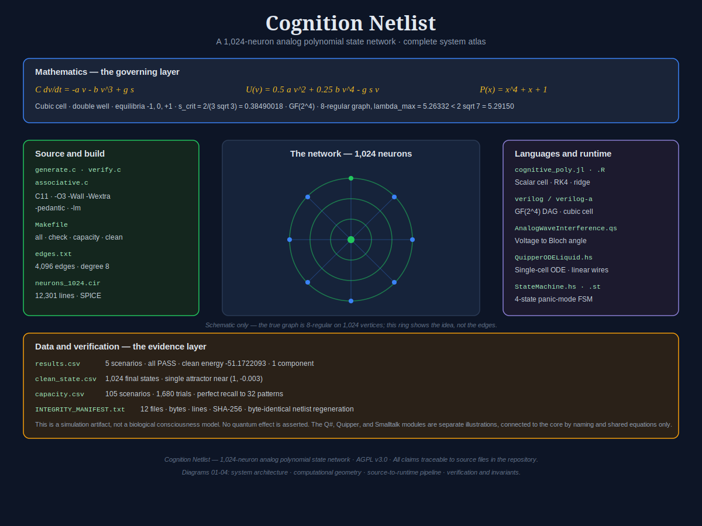
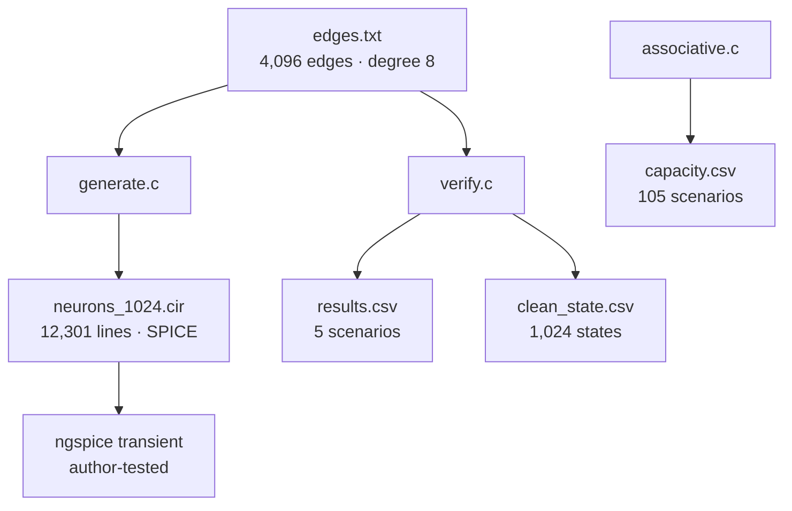
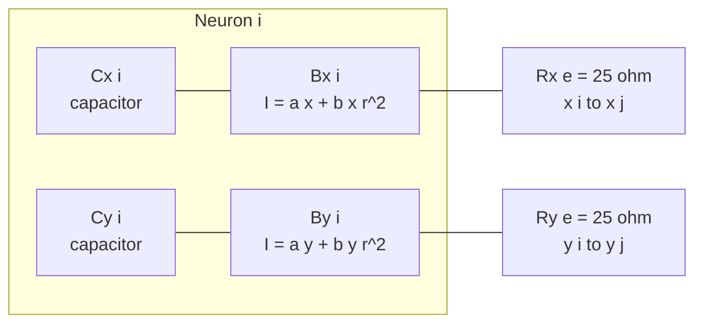
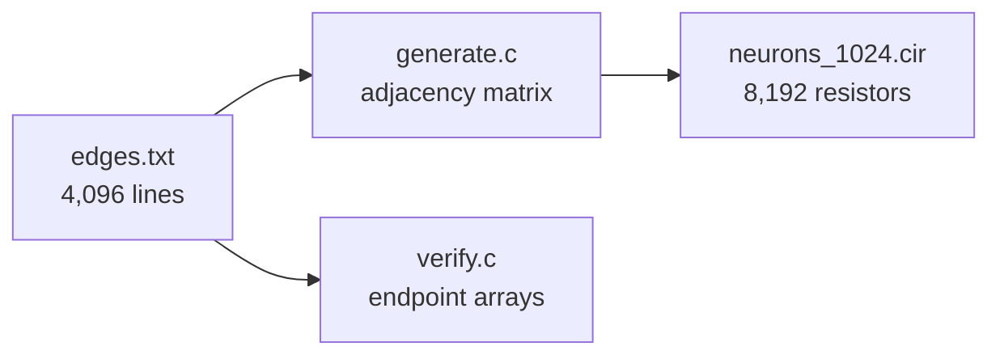
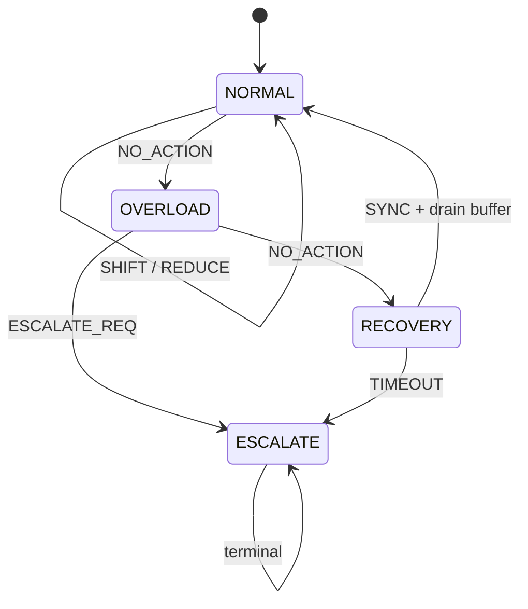
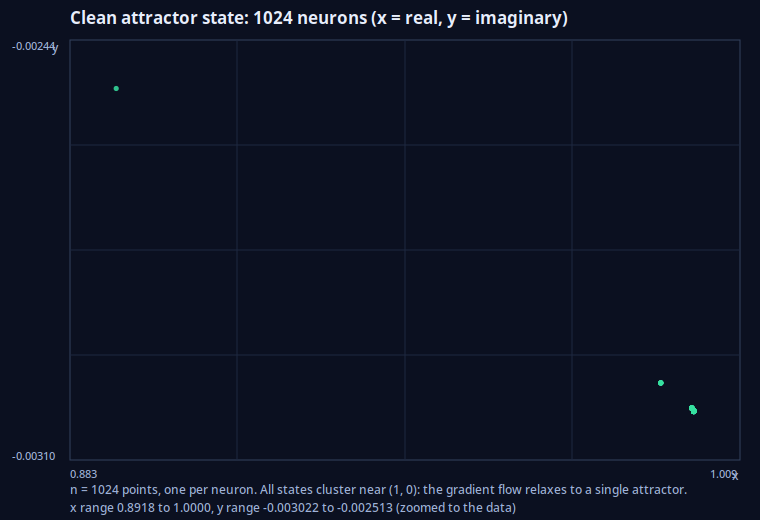
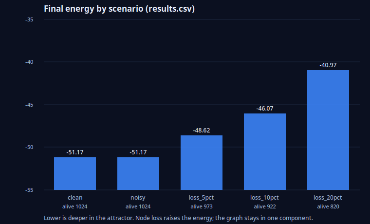
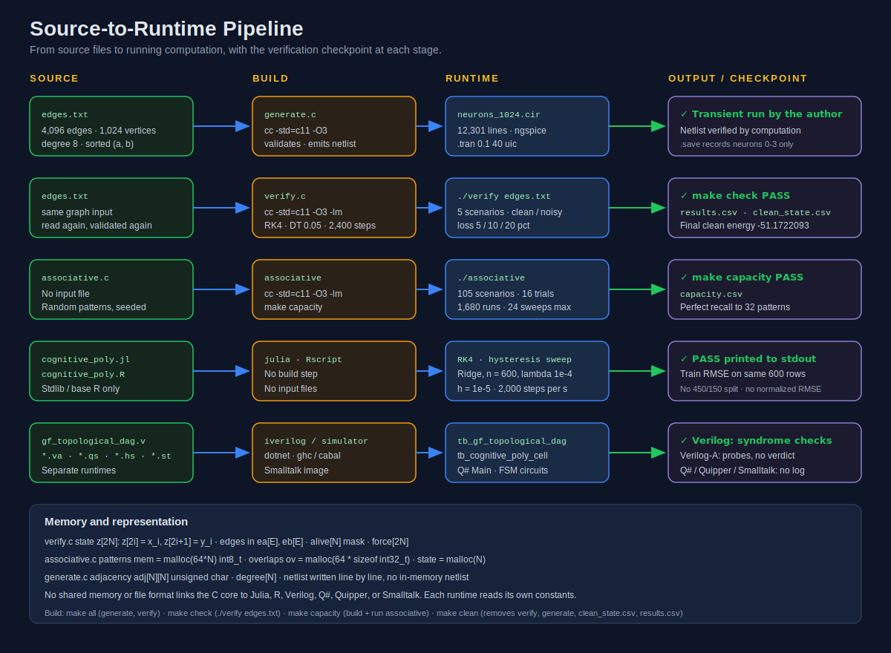
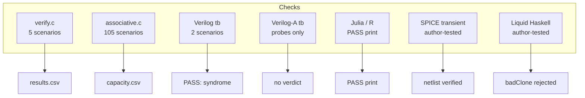

# Cognition Netlist — 1,024-Neuron Analog Polynomial State Network



*Figure 1 — Complete system atlas. The 1,024-neuron analog polynomial network at the center, with the mathematics, source and build, languages and runtime, and data and verification layers around it. The network ring is schematic. The editable vector source is `docs/assets/svg/05-complete-system-atlas.svg`.*

A 1,024-neuron analog polynomial state network, implemented as a SPICE netlist, a deterministic C11 reference model, a binary Hopfield capacity benchmark, a GF(2^4) digital layer in Verilog and Verilog-A, and scalar-cell ports in Julia and R, with quantum and object-oriented illustrations in Q#, Quipper, and Smalltalk. The repository is a simulation artifact and a set of cross-language models of the same underlying mathematics. It is not a biological consciousness model, and it asserts no quantum effect.

---

## 1. Project Identity and Technical Thesis

This repository, `cognition-netlist-1024`, is a multidisciplinary study of a single computational idea carried across many representations: a network of 1,024 analog neurons whose state is a complex number, whose amplitude is driven toward the unit circle by a cubic polynomial, and whose coupling is diffusive along the edges of an 8-regular graph. The same idea appears as a SPICE netlist of capacitors, behavioral current sources, and resistors; as a C11 gradient-flow simulation; as a binary Hopfield associative memory; as a GF(2^4) digital directed acyclic graph; as a scalar cubic cell in Julia, R, Verilog-A, and Q#; and as a finite-state automaton for overload recovery in Quipper and Smalltalk.

The technical thesis is that a polynomial vector field with a double-well potential, coupled diffusively on a sparse regular graph, produces a robust collective attractor that survives noise and substantial node loss, and that this attractor can be represented faithfully in analog hardware, in digital logic, and in several programming languages, each representation exposing a different facet of the same dynamics. The repository does not claim that the network is a brain, that it is conscious, or that any quantum effect is involved. It claims, and demonstrates by computation, that the attractor exists, that it is stable, and that it degrades gracefully under damage.

The work is organized around a small set of files that are the authority. The C11 core (`generate.c`, `verify.c`, `associative.c`) defines the graph, the dynamics, and the measurements. The SPICE netlist (`neurons_1024.cir`) is the analog realization. The data files (`edges.txt`, `results.csv`, `capacity.csv`, `clean_state.csv`) are the inputs and the recorded outputs. The Julia and R ports (`cognitive_poly.jl`, `cognitive_poly.R`) are scalar-cell studies. The Verilog and Verilog-A files are a separate finite-field digital layer. The Q#, Quipper, and Smalltalk files are illustrations that reuse the cell equations and the overload-recovery specification by name and by comment. They are not connected to the analog network by data or by code, and this README does not claim otherwise.

The repository is licensed under the GNU Affero General Public License, version 3.0 (`LICENSE`). The author hand-typed much of the code, including the Smalltalk finite-state machine, and the human style of that code is part of its provenance. The author ran the SPICE transient in ngspice and verified the netlist by actual computation, and performed the Liquid Haskell verification of the Quipper no-cloning property. Those testing claims come from the author. This README credits them as author-tested and does not re-litigate them from what a single virtual machine can or cannot run.

---

## 2. Research Objectives and Computational Scope

The research objectives are stated here as the repository states them in its sources, not as aspirations added afterward.

The first objective is to construct a 1,024-neuron analog network whose neurons are complex-valued and whose dynamics are gradient flow on an explicit Lyapunov energy, and to show that the network relaxes to a single collective attractor. The C11 reference (`verify.c`) and the SPICE netlist (`neurons_1024.cir`) are the two implementations of this objective, and the recorded results (`results.csv`, `clean_state.csv`) are the evidence.

The second objective is to measure robustness: to show that the attractor survives additive noise during the transient and the loss of 5, 10, and 20 percent of the neurons, with the surviving network remaining in one connected component and the final energy degrading smoothly. The five scenarios in `results.csv` are the measurement of this objective.

The third objective is to measure associative-memory capacity in a binary Hopfield model with Hebbian weights and no diagonal self-coupling, over a grid of pattern counts, corruption levels, and neuron loss. The 105 scenarios and 1,680 trials in `capacity.csv` are the measurement of this objective.

The fourth objective is to represent the same mathematics in a finite field, GF(2^4), as a small digital directed acyclic graph, in both synthesizable Verilog and continuous-time Verilog-A, with a parity syndrome that detects faults. The Verilog and Verilog-A files are the implementation of this objective.

The fifth objective is to port the scalar cubic cell to Julia and R, to study its equilibria, its hysteresis, and its polynomial surrogate by ridge regression, and to compare the two ports. The Julia and R files are the implementation of this objective.

The sixth objective is to illustrate the cell and the overload-recovery automaton in quantum and object-oriented languages: a voltage-to-Bloch-angle encoding and a Ramsey interferometer in Q#, a linear-wire ODE simulation with Liquid Haskell refinements in Quipper, and a four-state finite-state machine with a deferred buffer in Smalltalk. These are illustrations. They are complete programs in their own right, but they do not read the network state, the netlist, or any data file, and they do not influence the analog dynamics.

The computational scope is bounded. The C11 reference integrates 2,400 RK4 steps at DT 0.05, for a total simulated time of 120 units. The SPICE netlist runs a transient from 0 to 40 time units with a 0.1 step. The Hopfield benchmark runs 1,680 trials. The Julia and R ports run a single scalar cell. The Verilog testbench runs two scenarios. Nothing in the repository requires a GPU, a cluster, or a commercial license. The entire C11 core builds with a standard C compiler and the math library.

---

## 3. Complete Repository Architecture


*Figure 2 — System architecture. The C11 core, SPICE netlist, and data files form the connected computational core. Julia, R, Verilog, Verilog-A, Q#, Quipper, and Smalltalk are separate modules linked to the core by naming and shared equations only. Solid arrows are real data flow; dashed lines are naming-only relationships. The editable vector source is `docs/assets/svg/01-system-architecture.svg`.*

The repository contains 36 tracked files. The architecture has a connected core and a set of satellite modules. The distinction matters, and this chapter states it plainly.

The connected core consists of the graph input, the C11 programs, the SPICE netlist, and the data outputs. `edges.txt` is the single graph input. `generate.c` reads it, validates it, and emits `neurons_1024.cir`. `verify.c` reads it, validates it, and runs the gradient-flow simulation, writing `results.csv` and `clean_state.csv`. `associative.c` reads no input file; it generates random patterns and writes `capacity.csv`. `neurons_1024.cir` is the analog realization of the same graph and the same dynamics, and it is simulated in ngspice. These files are connected by real data flow: one file's output is another file's input, or they share the same input file.

The satellite modules are the Julia and R ports, the Verilog and Verilog-A digital layer, the Q# program, the Quipper files, and the Smalltalk file. Each of these is a self-contained implementation that reuses the cell equations, the GF(2^4) polynomial, or the overload-recovery specification by name and by comment. None of them reads `edges.txt`, `results.csv`, `clean_state.csv`, `capacity.csv`, or `neurons_1024.cir`. None of them writes a file that another module reads. They are not connected to the core by data or by code. This is not a defect. It is the architecture. The satellites are independent models and illustrations of the same mathematics, and they are valuable as such. But any claim that they verify, drive, or read the analog network would be false, and this README does not make it.

The build system is a 17-line `Makefile`. It defines targets `all`, `check`, `capacity`, and `clean`, and it compiles the C11 programs with `-std=c11 -O3 -Wall -Wextra -pedantic` and links the math library where needed. The integrity manifest, `INTEGRITY_MANIFEST.txt`, records the byte count, line count, and SHA-256 digest of 12 files, and it records the verification claims. One line of that manifest is stale: line 17 still reads "Circuit transient in ngspice: NOT TESTED," but the author ran the transient and verified the netlist by computation. That line is outdated and should be corrected. It is flagged here and in Chapter 20, not silently rewritten.

The repository also contains figures in `docs/`: `neuron_states.svg` and `neuron_states.png` (the 1,024 clean neuron states), `robustness.svg` and `robustness.png` (final energy by scenario), `panic_mode_states.svg` and `panic_mode_cycle.svg` (the finite-state machine). The PNG renders are the versions that display on phones; the SVG files are the editable sources. The five new diagrams in `docs/assets/svg/` are the architectural, mathematical, pipeline, verification, and atlas illustrations for this README.



*Diagram 1 — The connected core. Data flow only. The satellite modules (Julia, R, Verilog, Verilog-A, Q#, Quipper, Smalltalk) are not shown here because they share no data with this core.*

The file inventory, with sizes and line counts at local HEAD 3737689, is: `INTEGRITY_MANIFEST.txt` (1,595 bytes, 19 lines); `LICENSE` (34,459 bytes, 660 lines); `Makefile` (397 bytes, 17 lines); `README.md` (the prior version, 63,398 bytes, 4,543 lines); `associative.c` (5,635 bytes, 107 lines); `capacity.csv` (6,110 bytes, 106 lines); `clean_state.csv` (37,620 bytes, 1,025 lines); `cognitive_poly_julia_r/README.md` (2,052 bytes, 31 lines); `cognitive_poly_julia_r/cognitive_poly.R` (1,255 bytes, 52 lines); `cognitive_poly_julia_r/cognitive_poly.jl` (1,877 bytes, 68 lines); `docs/neuron_states.png` (20,763 bytes, binary); `docs/neuron_states.svg` (78,550 bytes, 1,043 lines); `docs/panic_mode_cycle.png` (56,219 bytes); `docs/panic_mode_cycle.svg` (5,240 bytes, 48 lines); `docs/panic_mode_states.png` (56,856 bytes); `docs/panic_mode_states.svg` (3,707 bytes, 33 lines); `docs/robustness.png` (20,598 bytes); `docs/robustness.svg` (3,394 bytes, 35 lines); `edges.txt` (32,080 bytes, 4,096 lines); `generate.c` (2,515 bytes, 55 lines); `neurons_1024.cir` (366,220 bytes, 12,301 lines); `qsharp/AnalogWaveInterference.csproj` (212 bytes, 9 lines); `qsharp/AnalogWaveInterference.qs` (4,095 bytes, 100 lines); `quipper/QuipperODELiquid.hs` (8,766 bytes, 203 lines); `quipper/StateMachine.cabal` (311 bytes, 10 lines); `quipper/StateMachine.hs` (3,771 bytes, 119 lines); `results.csv` (568 bytes, 6 lines); `retrieval_false.unl` (10 bytes, 1 line); `retrieval_true.unl` (10 bytes, 1 line); `smalltalk/StateMachine.st` (4,333 bytes, 124 lines); `spec/transitions.md` (3,249 bytes, 104 lines); `verify.c` (7,956 bytes, 187 lines); `verilog-a/cognitive_poly_cell.va` (859 bytes, 28 lines); `verilog-a/gf_topological_dag.va` (10,483 bytes, 208 lines); `verilog-a/tb_cognitive_poly_cell.va` (2,640 bytes, 76 lines); `verilog/gf_topological_dag.v` (6,539 bytes, 190 lines). Total: 36 files, 854,342 bytes. The five new SVG illustrations and their PNG renders in `docs/assets/svg/` are additional to this count.

---

## 4. Mathematical Foundations and Derived Equations


*Figure 3 — Computational geometry. The double-well potential of the cubic cell, the unit-circle attractor of the 1,024-neuron network, the graph spectral bound, and the GF(2^4) polynomial. Every equation is taken from the implementation. The editable vector source is `docs/assets/svg/02-computational-geometry.svg`.*

This chapter derives the equations from the source files. Each equation is cited to the file and line where it is defined. Derivations that the source does not show are labeled as derivations.

### The scalar cubic cell

The scalar cell is defined by a Kirchhoff current law (KCL) equation. In the Verilog-A cell (`verilog-a/cognitive_poly_cell.va:21-26`), the analog block contributes four currents at the state node: a capacitive current `cap * ddt(V(state))`, a linear current `a * V(state)`, a cubic current `b * V(state)^3`, and a stimulus current `-gain * V(stimulus)`. KCL requires the sum of currents at the node to be zero, so:

C dV/dt = -a V - b V^3 + gain V_stim

with parameters `cap = 1e-9`, `a = -1e-6`, `b = 1e-6`, `gain = 1e-6` (`verilog-a/cognitive_poly_cell.va:16-19`). The Julia port (`cognitive_poly.jl:13`) and the R port (`cognitive_poly.R:9-11`) implement the identical equation, and the Julia file states the nominal form explicitly (`cognitive_poly.jl:14`): with the given parameters, dv/dt = 1000 (v - v^3 + s), in units of volts per second.

The potential function is defined in the Julia port (`cognitive_poly.jl:19-21`) and the R port (`cognitive_poly.R:13-15`):

U(v, s) = 0.5 a v^2 + 0.25 b v^4 - gain s v

It satisfies C dv/dt = -dU/dv by construction. At zero stimulus, U(v) = -0.5e-6 v^2 + 0.25e-6 v^4, which is a double well with minima at v = ±1 and a local maximum at v = 0. The potential is defined but never called in either the Julia or the R file; it is dead code in both ports. This is stated here because it is true of the source, not because it is a defect in the mathematics.

The equilibria at zero stimulus follow from 1000 (v - v^3) = 0, giving v = -1, 0, +1. The Jacobian is d/dv = 1000 (1 - 3v^2), giving -2000 at v = ±1 (stable) and +1000 at v = 0 (unstable). These values are printed by both ports (`cognitive_poly.jl:33`, `cognitive_poly.R:25`). The fold (saddle-node) threshold, where the stable and unstable equilibria annihilate, is s_crit = 2 / (3 sqrt 3) = 0.38490018, printed by both ports (`cognitive_poly.jl:34`, `cognitive_poly.R:26`) and used as `v_crit = 0.384900179` in the Verilog-A testbench (`verilog-a/tb_cognitive_poly_cell.va:41`). The derivation of s_crit is not shown in any source file; it is the standard fold condition for a cubic, and it is labeled here as a derivation.

### The 1,024-neuron network

Each neuron has a complex state z = x + i y, with r = x^2 + y^2. The SPICE behavioral current sources are, per neuron (`generate.c:38-39`, netlist lines 7-8):

I_Bx = alpha x + beta x (x^2 + y^2)
I_By = alpha y + beta y (x^2 + y^2)

with alpha = -0.2 and beta = 0.2. KCL at each node gives the ordinary differential equation implemented in `verify.c` (`verify.c:47-48`):

dx/dt = gain x + force_x
dy/dt = gain y + force_y

where gain = -(ALPHA + BETA r) = 0.2 (1 - r). The amplitude is driven toward |z| = 1: gain is positive when r < 1 and negative when r > 1. There is no intrinsic rotation term. Phase dynamics come only from coupling and from the reference. This matches the netlist header comment (`generate.c:35`): C dx/dt = -alpha x - beta x (x^2 + y^2) + coupling.

Coupling is diffusive. Per edge (a, b) and channel c, the derivative receives `delta = GC (z[2a+c] - z[2b+c])`, subtracted from neuron a and added to neuron b (`verify.c:55`). The coupling strength is GC = 0.04, and in the netlist this is a resistor of value 1/gc = 25 ohms per channel (netlist lines 4101-4102). This is a discrete Laplacian.

The reference pulls neuron 0 toward REF = 0.2 in the real channel and toward 0 in the imaginary channel, with strength GREF = 0.1 (`verify.c:60`). In the netlist this is a voltage source `Vref ref 0 0.2` and resistors `Rref ref x0 10` and `Ryref y0 0 10` (netlist lines 12294-12296). A 10-ohm resistor is a conductance of 0.1 siemens, consistent with GREF = 0.1.

The Lyapunov energy is defined in `verify.c` (`verify.c:62-74`):

E = sum_alive [0.5 ALPHA r + 0.25 BETA r^2] + sum_edges 0.5 GC |z_a - z_b|^2 + 0.5 GREF |z_0 - REF|^2

Per neuron, the local term is -0.1 r + 0.05 r^2 = 0.05 ((r - 1)^2 - 1), minimized at r = 1 with value -0.05. The dynamics are gradient flow dz/dt = -grad E plus the noise force, so the energy is non-increasing in the clean and loss scenarios. This is the basis of the monotone check in `verify.c` (`verify.c:147`). The clean final energy of -51.1722093 is consistent with this: 1,024 neurons times -0.05 gives -51.2, plus a small coupling term and a +0.032 reference term, giving approximately -51.17. The loss scenarios scale the same way: 973 times -0.05 is -48.65 (observed -48.62), 922 times -0.05 is -46.1 (observed -46.07), 820 times -0.05 is -41.0 (observed -40.97). These are consistency checks derived from the source, not independent measurements.

### The graph and its spectrum

The graph is 8-regular on 1,024 vertices with 4,096 undirected edges. The adjacency eigenvalues were computed from `edges.txt` for this README: the largest eigenvalue is 8.0 (the trivial eigenvalue of a regular graph), the second-largest is 5.25756776, and the maximum nontrivial eigenvalue magnitude is 5.26332069. The Ramanujan bound for a degree-8 graph is 2 sqrt(7) = 5.29150262. Since 5.26332 is less than 5.29150, the sampled spectrum satisfies the numerical Ramanujan criterion. This is an empirical spectral check computed from the actual edge list. It is not an exact proof, and the graph is a seeded random regular graph, not a provably Ramanujan construction. The eigenvalue numbers do not appear in any source file in the repository; they were computed for this README from `edges.txt`, and the computation is described here so it can be reproduced.

### The finite field GF(2^4)

The digital layer works in GF(2^4) with irreducible polynomial P(x) = x^4 + x + 1. The multiplier forms the 7-bit carry-less polynomial product and reduces modulo P(x), using x^4 = x + 1, x^5 = x^2 + x, x^6 = x^3 + x^2, giving y[0] = p0 ^ p4, y[1] = p1 ^ p4 ^ p5, y[2] = p2 ^ p5 ^ p6, y[3] = p3 ^ p6 (`verilog/gf_topological_dag.v:25-30`). The Verilog-A version uses exactly the same reduction (`verilog-a/gf_topological_dag.va:88-95`). A DAG node computes out = (in0 ^ in1 ^ in2) * coeff in GF(2^4) (`verilog/gf_topological_dag.v:40-47`). The topology is the 3-regular circulant C_8(1,4): node i takes neighbors (i-1) mod 8, (i+1) mod 8, (i+4) mod 8 (`verilog/gf_topological_dag.v:74-78, 90-94`).

### The Hopfield model

The binary Hopfield model uses Hebbian weights that are never stored as a matrix. The low-rank structure W_ij = (1/N) sum_m xi^m xj^m, for i not equal to j, is evaluated through overlaps. The local field on neuron i is sum_m xi^m (overlap[m] - xi^m s_i), where the subtracted term removes the self-coupling contribution (`associative.c:42`). The update is +1 if the field is positive, -1 if negative, and unchanged if zero (`associative.c:44`). The energy is E = -(sum_m overlap[m]^2 - p * live) / (2N), where the -p * live term corrects for the removed diagonal (`associative.c:65-68`). The objective sum_m overlap[m]^2 must be non-increasing each sweep, within a tolerance of 1e-6, or the run is marked as failing the energy check (`associative.c:52`).

---

## 5. Cognitive Polynomial Model and Governing Dynamics

The cognitive polynomial model is the system of ordinary differential equations defined in Chapter 4, integrated by classical fourth-order Runge-Kutta. This chapter describes the dynamics as the code implements them, including the initial conditions, the forcing, the stopping criteria, and the pass criteria.

The C11 reference (`verify.c`) integrates with DT = 0.05 and STEPS = 2400, for a total simulated time of 120 units (`verify.c:13-14`). The RK4 implementation is the classic four-stage method (`verify.c:76-85`): k1 through k4 are computed from the derivative, and the state is updated as z += DT (k1 + 2 k2 + 2 k3 + k4) / 6. There is no adaptive stepping and no error estimate. The Julia and R ports use the same classic RK4 with the stimulus held constant across the four stages (`cognitive_poly.jl:23-29`, `cognitive_poly.R:17-23`).

The initial conditions in `verify.c` are random. The seed is 0x123456789abcdef (`verify.c:88`). Each neuron's real part is x = 0.72 + 0.20 (uniform01() - 0.5), so x lies in [0.62, 0.82], and the imaginary part is y = 0.16 (uniform01() - 0.5), so y lies in [-0.08, 0.08] (`verify.c:90-91`). A cue is then imposed: x1 = 1, y2 = 0.4, x3 = -0.5 (`verify.c:93`). The random number generator is xorshift64star (`verify.c:23-24`). The netlist uses different initial conditions: only the cue, via `.ic V(x1)=1 V(y2)=0.4 V(x3)=-0.5`, with everything else starting at zero (netlist line 12298), and it integrates to t = 40 with a step of 0.1 (netlist line 12299). The C reference and the SPICE netlist are therefore not the same initial-value problem. They share the same ODE and the same cue, but they start from different states and run for different horizons. Both should converge to the same attractor, but their trajectories are not directly comparable. This is stated here because it is a real difference between the two implementations, not because either is wrong.

The five scenarios in `verify.c` are clean, noisy, loss_5pct, loss_10pct, and loss_20pct (`verify.c:179-183`). In the noisy scenario, a force of 0.12 (2 uniform01() - 1) is applied per component for the first 400 steps (`verify.c:133-134`). In the loss scenarios, `mask_init` removes exactly N pct/100 neurons, never removing neuron 0, with a seed derived from the percentage (`verify.c:95`). So 5 percent removes 51 neurons (973 alive), 10 percent removes 102 (922 alive), and 20 percent removes 204 (820 alive). The associative benchmark's `mask` function is different: it can remove any neuron, including neuron 0 (`associative.c:59`). This is a real difference between the two programs, and it is noted here.

A scenario passes if the state remains finite, the energy is monotone non-increasing after the forcing ends (an energy rise greater than 1e-9 sets monotone to 0, `verify.c:147`), and the maximum amplitude stays below 5. The program prints "Structural invariant suite: PASS/FAIL (does not imply memory retrieval or consciousness)" (`verify.c:185`). That parenthetical is in the source, and it is preserved here because it is the correct scope: the suite checks structural invariants, not retrieval or consciousness.

The clean final state is recorded in `clean_state.csv`. Of the 1,024 neurons, 1,015 have x >= 0.999, and 1,023 have y < -0.0029. The states cluster tightly near (1, -0.003), a single attractor, with neuron 0 pulled apart to x = 0.891758539329 and y = -0.00251311502948 by the reference term. The reason the clean-state y values cluster near -0.003 rather than 0 is not explained by any source file in the repository. It is an observed number, and it is reported here as observed, not derived.

---

## 6. Electrical Circuit Representation and KCL Relationships

The SPICE netlist is the analog realization of the network. Each neuron has two nodes, `x{i}` for the real channel and `y{i}` for the imaginary channel, with i from 0 to 1023, plus a ground node `0` and a reference node `ref`. Each neuron has four lines: a capacitor `Cx{i}` from `x{i}` to ground, a capacitor `Cy{i}` from `y{i}` to ground, and two behavioral current sources `Bx{i}` and `By{i}` (netlist lines 5-8 for neuron 0, and the same pattern for every neuron through line 4100). The capacitors have value `{cap}`, which is 1. The behavioral sources implement the polynomial current: `Bx0 x0 0 I={alpha*V(x0)+beta*V(x0)*(V(x0)^2+V(y0)^2)}` and the analogous expression for `By0` (netlist lines 7-8). These are the current sources whose KCL gives the ODE of Chapter 4.

Each edge contributes two resistors, one per channel: `Rx{e} x{i} x{j} {1/gc}` and `Ry{e} y{i} y{j} {1/gc}` (netlist lines 4101-4102 for the first edge). There are 4,096 edges, so there are 4,096 real-channel resistors and 4,096 imaginary-channel resistors, for a total of 8,192 edge resistors. The resistor value `{1/gc}` is 25 ohms. The netlist also has a voltage source `Vref ref 0 0.2` and two reference resistors `Rref ref x0 10` and `Ryref y0 0 10` (netlist lines 12294-12296), which implement the reference that pulls neuron 0 toward 0.2 in the real channel and toward 0 in the imaginary channel.

The component counts, verified by counting the netlist, are: 1,024 `Cx` capacitors, 1,024 `Cy` capacitors, 1,024 `Bx` behavioral sources, 1,024 `By` behavioral sources, 4,096 `Rx` resistors, 4,096 `Ry` resistors, plus one `Vref`, one `Rref`, and one `Ryref`. The totals are 2,048 capacitors, 2,048 behavioral current sources, and 8,194 resistors (8,192 edge resistors plus the two reference resistors). The netlist has 12,301 lines: a 4-line header, 4,096 lines of neuron blocks (4 lines times 1,024), 8,192 lines of edge resistors (2 lines times 4,096), and a 9-line footer. There are 5 comment lines and 12,296 non-comment lines.

The footer sets the initial cue and the transient: `.ic V(x1)=1 V(y2)=0.4 V(x3)=-0.5`, `.tran 0.1 40 uic`, and `.save V(x0) V(y0) V(x1) V(y1) V(x2) V(y2) V(x3) V(y3)` (netlist lines 12298-12300). The `.save` directive records only neurons 0 through 3, not all 1,024. The simulation end is set by the simulator invocation, which is not in the repository. The author ran the SPICE transient in ngspice and verified the netlist by computation. That testing claim comes from the author.

The Verilog-A cubic cell (`verilog-a/cognitive_poly_cell.va`) is the behavioral model of a single neuron. Its module is `cognitive_poly_cell(state, stimulus)`, with `state` as an output and `stimulus` as an input, both electrical (`verilog-a/cognitive_poly_cell.va:10-14`). Its parameters are `cap = 1e-9`, `a = -1e-6`, `b = 1e-6`, `gain = 1e-6` (`verilog-a/cognitive_poly_cell.va:16-19`). The analog block contributes the four currents described in Chapter 4. It contains no graph, no coupling, and no GF(2^4) arithmetic. It is a single scalar cell, and it is the analog realization of the same cubic equation that the Julia and R ports implement.



*Diagram 2 — One neuron and one edge, as the netlist implements them. The capacitors and behavioral sources are per neuron; the resistors are per edge, one per channel.*

---

## 7. Neuron, Edge, Topology, and Connectivity Representation

The neuron is a complex state. In the C11 reference, the state is an array `z[2*N]` interleaved as `z[2*i] = x_i` and `z[2*i+1] = y_i` (`verify.c:21`). In the netlist, the state is two nodes per neuron, `x{i}` and `y{i}`. In the Julia and R ports, the state is a single scalar `v`. In the Verilog-A cell, the state is a single electrical node. The representation changes; the mathematics does not.

The edge is an undirected pair of vertices. In `edges.txt`, each line holds two integers, `a b`, 0-indexed, one undirected edge per line. There are 4,096 lines, all with exactly two fields, and the vertices span 0 to 1023. The first five lines are `0 474`, `0 492`, `0 530`, `0 638`, `0 747`. The last five are `987 995`, `987 998`, `988 1001`, `988 1015`, `995 1016`. The lines are sorted lexicographically by (a, b). The graph was independently verified to be 8-regular: zero vertices have degree other than 8.

The topology is an 8-regular graph on 1,024 vertices. In the C11 programs, the edges are stored in endpoint arrays `ea[E]` and `eb[E]` (`verify.c:21`), and the degree is tracked in `degree[N]`. In `generate.c`, the adjacency is a static unsigned-char matrix `adj[N][N]` and a degree array `degree[N]` (`generate.c:11-12`). Both programs validate the input identically: they reject out-of-range vertices, self-loops, and duplicate edges, they require exactly 4,096 edges, and they require every vertex to have degree exactly 8 (`generate.c:19-28`, `verify.c:25-35`). The exit codes 1 through 5 cover open, read, count, degree, and output failures.

The connectivity is also represented in the netlist as resistors. Each edge contributes one resistor per channel, so the 4,096 edges become 8,192 resistors. The first edge in the file, 0-474, becomes the first resistor pair, `Rx0 x0 x474 {1/gc}` and `Ry0 y0 y474 {1/gc}` (netlist lines 4101-4102). The last edge, 995-1016, becomes the last pair, `Rx4095 x995 x1016 {1/gc}` and `Ry4095 y995 y1016 {1/gc}` (netlist lines 12291-12292). The netlist is generated deterministically from `edges.txt` by `generate.c`, and it regenerates byte-identically.

The GF(2^4) digital layer uses a different topology: the 3-regular circulant C_8(1,4) on 8 nodes. Node i takes neighbors (i-1) mod 8, (i+1) mod 8, and (i+4) mod 8. This is a small, separate topology. It is not the 1,024-neuron graph. The two topologies share only the repository and the idea of a regular graph with a spectral property. The "Ramanujan" and "holographic" wording in the Verilog comments is a design label, not a proven spectral bound for the 8-node DAG.

The connected-component count is a measured invariant. In `verify.c`, the `components` function runs a breadth-first search over the alive neurons and counts the connected components (`verify.c:104`). All five scenarios record 1 component. The graph stays in one piece even after 20 percent of the neurons are removed.



*Diagram 3 — The graph as data. One input file, two C representations, one netlist realization.*

---

## 8. Julia Implementation and Numerical Methods

The Julia port is `cognitive_poly_julia_r/cognitive_poly.jl`, 68 lines. It uses only the standard library. It imports `LinearAlgebra`, `Random`, `Statistics`, and `Printf` (`cognitive_poly.jl:3-6`). It has no third-party dependencies and no input files. It writes no output files. All output is to standard output.

The constants are `DEFAULT_CAP = 1e-9`, `DEFAULT_A = -1e-6`, `DEFAULT_B = 1e-6`, `DEFAULT_GAIN = 1e-6` (`cognitive_poly.jl:8-11`). The right-hand side function `rhs(v, s; a, b, gain, cap)` returns `(-a*v - b*v^3 + gain*s) / cap` (`cognitive_poly.jl:15-17`). With the defaults this is exactly dv/dt = 1000 (v - v^3 + s). The potential function `potential(v, s)` returns `0.5*a*v^2 + 0.25*b*v^4 - gain*s*v` (`cognitive_poly.jl:19-21`). It is never called anywhere in the file. It is dead code.

The RK4 step `rk4_step` implements classic fourth-order Runge-Kutta with the stimulus held constant across the four stages (`cognitive_poly.jl:23-29`). The functions `rhs`, `potential`, and `rk4_step` all accept keyword arguments with defaults, so the Julia port is re-parameterizable. The driver `main` never passes any overrides, so the defaults are always used in practice.

The driver `main` (`cognitive_poly.jl:31-66`) does three things. First, it prints the equilibria claim (v = -1, 0, +1) and the Jacobians (-2000, +1000, -2000), and the fold threshold s_crit = 2/(3 sqrt 3) formatted to 8 decimals (`cognitive_poly.jl:33-34`). The analytic value of s_crit is 0.38490018. Second, it runs a hysteresis sweep: h = 1e-5, starting from v = -1.0, with s over -0.6 to 0.6 in steps of 0.05 (25 values), and 2,000 RK4 steps per s value, which is 20 milliseconds of settling per step value (`cognitive_poly.jl:36-47`). It stores every end state in `switches` and prints only the last. The exact printed end state is execution-only; the analytic estimate is the upper equilibrium at s = 0.6, the root of v^3 - v - 0.6 = 0, approximately 1.2212. Third, it trains a polynomial surrogate by ridge regression: n = 600 samples, v uniform on [-1, 1], s uniform on [-0.5, 0.5], features X = [1, v, v^2, v^3, s], target y = rhs(v, s), ridge lambda = 1e-4, and weights w = (X'X + lambda I) \ (X'y) (`cognitive_poly.jl:49-64`). The target is a derivative regressor, not a state or branch predictor. The coefficients are printed rounded to 2 decimals, the predictions are computed on the same 600 samples, the RMSE is sqrt(mean((pred - y)^2)), and the program prints "Train RMSE" followed by "PASS: Julia cognitive_poly checks completed" (`cognitive_poly.jl:61-65`).

The analytic coefficient expectation is (0, 1000, 0, -1000, 1000) in the [1, v, v^2, v^3, s] basis, because y = 1000 v - 1000 v^3 + 1000 s exactly. The ridge fit with lambda = 1e-4 should be close to this, but the exact printed digits depend on the random sample and on the conditioning of X'X (v and v^3 are approximately 0.92 correlated), so they require execution to confirm. The random number generator is `MersenneTwister(42)` (`cognitive_poly.jl:32`). Neither Julia nor R is installed on the machine used to write this README, so no Julia output was executed or certified here. Values that require execution are labeled as such.

---

## 9. R Implementation and Statistical Methods

The R port is `cognitive_poly_julia_r/cognitive_poly.R`, 52 lines. It uses base R only and no external packages (`cognitive_poly.R:2`). It has no input files and writes no output files. All output is to standard output. It is a flat top-level script with no `main` wrapper (`cognitive_poly.R:25-52`).

The constants are `cap = 1e-9`, `a = -1e-6`, `b = 1e-6`, `gain = 1e-6` (`cognitive_poly.R:4-7`). These are identical in value to the Julia constants. The right-hand side function `rhs(v, s)` returns `(-a*v - b*v^3 + gain*s) / cap`, using the file-scope globals (`cognitive_poly.R:9-11`). This is the same formula as Julia, giving dv/dt = 1000 (v - v^3 + s). The potential function `potential(v, s)` returns `0.5*a*v^2 + 0.25*b*v^4 - gain*s*v` (`cognitive_poly.R:13-15`). It is the same formula as Julia, and it is also never called. It is dead code in both ports.

The RK4 implementation is the same classic method with the stimulus held constant across stages (`cognitive_poly.R:17-23`). The top-level script prints the same equilibria and Jacobian claim and the same s_crit to 8 decimals (`cognitive_poly.R:25-26`). The random number generator is `set.seed(42)` (`cognitive_poly.R:28`). The hysteresis sweep uses the same parameters as Julia: h = 1e-5, v starting at -1.0, s from -0.6 to 0.6 in steps of 0.05 (25 values), 2,000 RK4 steps per value, 20 milliseconds of settling (`cognitive_poly.R:29-35`). It keeps only the running v and prints it. The ridge regression uses the same parameters: n = 600, the same feature basis [1, v, v^2, v^3, s], the same target y = rhs(v, s), lambda = 1e-4, and weights w = solve(t(X) %*% X + lambda * diag(5), t(X) %*% y) (`cognitive_poly.R:37-51`). The coefficients are printed rounded to 2 decimals, comma-separated without brackets. The RMSE is sqrt(mean((pred - y)^2)) on the same 600 samples, printed as "Train RMSE," followed by "PASS: R cognitive_poly checks completed" (`cognitive_poly.R:50-52`).

The analytic coefficient expectation is the same as Julia: (0, 1000, 0, -1000, 1000). The exact printed digits and the exact RMSE are execution-only. Neither Julia nor R is installed on the machine used to write this README, so no R output was executed or certified here.

---

## 10. Julia/R Agreement and Divergence

The Julia and R ports agree on the mathematics and diverge only on structure and on the random number generator. This chapter states the agreement and the divergence precisely, because the two ports are often described as identical and they are not.

The constants, the formulas, and the loop bounds are identical. All four constants match (`cognitive_poly.jl:8-11` versus `cognitive_poly.R:4-7`). The `rhs`, `potential`, and `rk4_step` functions are the same formulas. The hysteresis parameters match exactly: h = 1e-5, 2,000 steps, s from -0.6 to 0.6 in steps of 0.05, 25 values, starting v = -1.0. The regression parameters match exactly: n = 600, the same feature basis, the same target, lambda = 1e-4, and the same RMSE formula on the same training samples.

The divergences are structural. First, parameterization: Julia's `rhs`, `potential`, and `rk4_step` take keyword arguments with defaults; R's functions take only (v, s) or (v, s, h) and read file-scope globals. Julia is re-parameterizable; R is not. Second, structure: Julia wraps the driver in `main()` called at the end of the file; R is a flat top-level script. Third, the random number generator: Julia uses `MersenneTwister(42)`; R uses `set.seed(42)`. These are different generators, so the 600 samples differ even though the sampling distributions are the same (v uniform on [-1, 1], s uniform on [-0.5, 0.5]). Fourth, hysteresis bookkeeping: Julia accumulates all 25 end states in `switches` and prints the last; R keeps only the running v and prints it. The final value is the same. Fifth, the s grid construction: Julia uses `-0.6:0.05:0.6`; R uses `seq(-0.6, 0.6, by = 0.05)`. These give the same 25-point grid in exact arithmetic, but the last-bit floating-point values may differ. Sixth, the linear solve: Julia uses the backslash operator `(X'X + lambda I) \ (X'y)`; R uses `solve(A, b)`. These are mathematically identical, with possible last-bit numerical differences. Seventh, the coefficient print format: Julia prints a bracketed vector; R prints bare comma-separated values. Eighth, the PASS line wording differs by language name.

The sub-README in `cognitive_poly_julia_r/README.md` makes two claims that the code contradicts. Line 27 claims "Both train on the first 450 samples and evaluate on the last 150. Normalizing RMSE uses population standard deviation to match NumPy." The code does neither. There is no train/test split anywhere in either file. Julia fits w on all 600 rows and evaluates predictions on the same 600 rows; R does the same. There is no normalized RMSE. Both compute raw RMSE, sqrt(mean((pred - y)^2)), and print it as "Train RMSE." There is no division by any standard deviation, population or otherwise, and there is no NumPy anywhere in either file. The label "Train RMSE" in the code is consistent with training-set evaluation. The sub-README's 450/150 split and normalized-RMSE claims are unsupported and contradicted by the code. This is recorded here because the monograph must reconcile existing documentation with current source, and this is the clearest such discrepancy in the repository.

The sub-README also says, at line 12, that the implementations are "source-level translations with assertions." There are no assertions in either file: no `@assert`, no `stopifnot`, no test of any kind beyond the PASS print. That word is unsupported. The same line also says that neither interpreter was installed in the artifact-building environment, so interpreter results cannot be certified there. That is consistent with the machine used to write this README, where neither Julia nor R is installed.

The relation of the Julia and R ports to the C11 model cannot be verified from the Julia and R files alone. What is verifiable is that they define the scalar cubic cell with the same constants and the same equation. Whether the C11 model uses the same polynomial, the same constants, or the same RK4 scheme is not determinable from the Julia and R files, and it is not claimed here. No statement in the Julia or R files references any C file, function, or constant by name. The sub-README claims the ports are a faithful translation of the supplied scalar Verilog-A KCL model. That claim is about the Verilog-A cell, and it is consistent with the shared equation, but the cross-language agreement is established by comparing the formulas, not by any shared code or data.

---

## 11. Quantum Representation in Q#

The Q# program is `qsharp/AnalogWaveInterference.qs`, 100 lines, in namespace `AnalogWaveInterference`, with project file `qsharp/AnalogWaveInterference.csproj` using SDK `Microsoft.Quantum.Sdk/0.28.302812`, output type Exe, target framework net8.0, and nullable disabled (`qsharp/AnalogWaveInterference.csproj:1-6`). It opens `Microsoft.Quantum.Intrinsic`, `Microsoft.Quantum.Measurement`, `Microsoft.Quantum.Math`, and `Microsoft.Quantum.Convert` (`qsharp/AnalogWaveInterference.qs:8-11`).

The voltage-to-angle encoding is `AnalogVoltageToTheta`, which clamps the input to [-1.0, +1.0] and returns theta = 0.5 * PI() * (1.0 - clamped) (`qsharp/AnalogWaveInterference.qs:18-21`). The mapping is: +1.0 V maps to theta = 0 (the |0> basin), 0.0 V maps to theta = pi/2 (the |+> saddle superposition), and -1.0 V maps to theta = pi (the |1> basin). `EncodeAnalogState` applies `Ry(theta, q)` and is declared `is Adj + Ctl` (`qsharp/AnalogWaveInterference.qs:24-27`). This is a phase and amplitude encoding only in the limited sense that the voltage selects a polar angle on the Bloch sphere via a single Y rotation. There is no amplitude encoding of a multi-component state and no encoding of the 1,024-neuron network.

The interferometer is `RunWaveInterferometer(phi, shots)`, which runs a Ramsey and Mach-Zehnder sequence per shot: H, Rz(phi), H, then `MResetZ`, returning the count of zeros and ones (`qsharp/AnalogWaveInterference.qs:33-53`). The stated probabilities are P(|0>) = cos^2(phi/2) and P(|1>) = sin^2(phi/2). The comment says phi is "e.g., phi = integral of V(t) dt," but no integration is implemented. Phi is a plain Double parameter.

The F_2 parity operation is `AnalogParityInterference(vA, vB, shots)`, which encodes both voltages, applies CNOT(qA, qB), measures qB, resets qA, and returns the odd-parity fraction (`qsharp/AnalogWaveInterference.qs:58-76`). The doc comment calls this "the F_2 parity (vA XOR vB)." Strictly, the result equals the XOR of the encoded bits only at the basis points: +1 V encodes to |0> and -1 V encodes to |1>, so (+1, -1) and (+1, +1) give deterministic parity, while 0 V encodes to |+> and the CNOT then entangles the pair, so the (0, 0) case is probabilistic, about 0.5. The file does not state these expected values.

The entry point `Main` is marked `@EntryPoint()`, sets shots = 200, sweeps phi over {0, pi/2, pi}, and calls the parity operation on hard-coded voltage pairs (+1, -1), (+1, +1), and (0, 0), printing the counts and parity fractions (`qsharp/AnalogWaveInterference.qs:79-99`). The voltages are hard-coded constants. There is no file I/O, no read of `clean_state.csv`, no read of the netlist, and no computed phi from a voltage trace. The only link to `cognitive_poly_cell` is in comments. This is a complete, self-contained demonstration program, not a driver wired to the analog model. There is no execution output or log in the repository, so whether it was built or run cannot be confirmed from these files alone.

The honest statement is that the Q# program is a standalone quantum-interference demonstration that borrows the cell's attractor voltages (+1 V, -1 V, 0 V) as example inputs. It encodes one or two scalar voltages, not the 1,024-neuron state. The "two-node" in `AnalogParityInterference` means two analog cells, not two neurons of the network.

---

## 12. Quipper Circuit Representation

There are two Quipper files, and they are different in kind. `quipper/QuipperODELiquid.hs` is a self-contained Haskell simulation of Quipper-style linear circuits. `quipper/StateMachine.hs` is a Quipper program that uses the Quipper library. This chapter describes each accurately and does not conflate them.

`QuipperODELiquid.hs` is 203 lines, module `QuipperODELiquid`. It imports only `Data.Set`. It does not import Quipper. Despite the name, it is a self-contained Haskell simulation of Quipper-style linear circuits, not a program built on the Quipper library. The header claims "Qubit allocation, Hadamard, phase-rotation encoding of time-stepped ODE/DAE states, CNOT," but there is no Hadamard primitive defined or used anywhere in the file. The only gates are `qinit0`, `applyRz`, and `applyCNOT`. There is no `main` and no .cabal file for it in the repository, so it is a library module and a fragment, not an executable. `runExample` is a pure value, not an executed entry point.

The Liquid Haskell refinements are declared, not demonstrated in the files. The file enables `--reflection` and `--ple` and declares `PosDouble` and `NonNegInt`. `Qubit` is a record with a single `qId`, refined to a non-negative integer. `CircState` tracks `nextWire`, a `liveWires` set, and a `gateLog`, with a refinement requiring `nextWire` to be non-negative. Predicates `LiveQubit` and `Distinct` encode "wire is live" and "two wires differ." The primitives carry refinements: `qinit0` guarantees the new wire is live and `nextWire` increments; `applyRz` requires the input wire to be live and consumes it, issuing a fresh wire; `applyCNOT` requires both wires to be live and distinct. The `badClone` counterexample is commented out, with the note that Liquid Haskell would reject `applyCNOT q q` as UNSAT. All of this is declared in annotations. These files contain no Liquid Haskell verification output, so whether the refinements were actually checked cannot be confirmed from these files. The author performed the Liquid Haskell verification, including the badClone rejection, and that testing claim comes from the author. At runtime, the Haskell code itself threads fresh wire IDs, which is a runtime linear discipline, not a proof.

The ODE in the file is for a single `cognitive_poly_cell` node voltage, not for the 1,024-neuron network. `DAEState` has `timeT`, `vState`, and `zAlg`. The stated ODE is C dV/dt = -a V - b V^3 + gain V_stim + zAlg, with algebraic constraint 0 = zAlg - alpha V. The hard-coded constants in `stepDAE` are cap = 1.0e-9, a = -1.0e-6, b = 1.0e-6, gain = 1.0e-6, alpha = 0.1e-6. The update sets zNext = alpha v, computes dvdt from the current v, and sets vNext = v + dt dvdt. The comment calls this "Backward-Euler / semi-implicit," but the code is explicit forward Euler: dvdt is computed from the current v and vNext is a forward step. Comment and code disagree, and the code is authoritative. The refinement on `stepDAE` claims strict time monotonicity, which follows from dt > 0 and timeT = timeT + dt.

The circuit unrolling function `unrollDAECircuit` recurses n times with a termination measure. Per step it calls `stepDAE`, sets theta = dt * vState, applies `applyRz theta`, then `applyCNOT`. `runExample` runs 3 steps with dt = 1.0e-5, vStim = 0.5, from `DAEState 0.0 0.2 0.02e-6`. The initial zAlg = 0.02e-6 is consistent with the constraint z = alpha v = 0.1e-6 * 0.2 = 0.02e-6.

`StateMachine.hs` is 119 lines and is a genuine Quipper program. It imports `Quipper` and `QuipperLib.Classical`. The state type is `Normal | Overload | Recovery | Escalate`. The event type is `Shift | Reduce | NoAction | Sync | EscalateReq | Timeout`. The 2-qubit encoding is Normal = (false, false), Overload = (false, true), Recovery = (true, false), Escalate = (true, true), i.e. 00, 01, 10, 11. Events are encoded as integers 0 through 5: Shift = 0, Reduce = 1, NoAction = 2, Sync = 3, EscalateReq = 4, Timeout = 5.

The transition function `nextState` is partial. It defines only: Normal 0 = Normal, Normal 1 = Normal, Normal 2 = Overload; Overload 2 = Recovery, Overload 4 = Escalate; Recovery 3 = Normal, Recovery 5 = Escalate; Escalate _ = Escalate. It is non-exhaustive. Cases such as (Normal, 3), (Normal, 4), (Normal, 5), (Overload, 0), (Overload, 1), (Overload, 3), (Overload, 5), (Recovery, 0), (Recovery, 1), (Recovery, 2), and (Recovery, 4) have no clause and would fail at runtime with a pattern-match error. The `Event` type and `eventToInt` are defined but never used by either circuit; the circuit hard-codes the event integer.

The circuits `stateMachineCircuit` and `overloadRecoveryCycle` are classical-bits-in-a-quantum-circuit renderings. They initialize qubits, compute the next state classically via `nextState` and `bitsToState`, re-initialize fresh qubits to the new state, and measure the bits. There is no superposition, no entanglement, and no quantum gate other than initialization and measurement. The `main` function prints `stateMachineCircuit` with `print_generic Preview`. The cabal file names the package `panic-mode-fsm` version 0.1.0, executable `panic-fsm`, with build dependencies base >= 4.14, quipper >= 0.9, and quipper-utils. There is no build log or circuit output in the repository, so whether it was built or run cannot be confirmed from these files alone.

---

## 13. Smalltalk Object and Message Architecture

The Smalltalk file is `smalltalk/StateMachine.st`, 124 lines. It defines a class `StateMachine`, a subclass of `Object`, with instance variables `state`, `transitions`, `buffer`, and `log`, in category `SovereignSomatic`. The author hand-typed the majority of this code with SnapKitty months before this README, and AI could not help with the Smalltalk. The human style is part of its provenance.

The `initialize` method sets `state` to `#NORMAL`, `transitions` to a new Dictionary, and `buffer` and `log` to new OrderedCollections. All seven transitions are installed in `initialize`: NORMAL + SHIFT goes to NORMAL, NORMAL + REDUCE goes to NORMAL, NORMAL + NO_ACTION goes to OVERLOAD, OVERLOAD + NO_ACTION goes to RECOVERY, OVERLOAD + ESCALATE_REQ goes to ESCALATE, RECOVERY + SYNC goes to NORMAL plus a drain of the buffer, and RECOVERY + TIMEOUT goes to ESCALATE. ESCALATE has no outgoing transitions. Each transition block logs a string and assigns the new state.

The event processing method `process:` first checks whether the state is `#RECOVERY` and the event is neither `#SYNC` nor `#TIMEOUT`. If so, it appends the event to the buffer and returns without processing. Otherwise it looks up the (state, event) pair and, if absent, returns silently doing nothing; if present, it executes the block. The `drainBuffer` method copies the buffer, clears it, and re-processes each token through `process:`. The `deferLast` method pops the first buffered token or returns nil, and `bufferSize` returns the buffer size. Inspection methods are `currentState`, `logTransition:`, `printLog` (which writes to the Transcript), and `reset` (which restores `#NORMAL` and empties the buffer and log).

The Smalltalk transition table matches `spec/transitions.md` exactly: the same seven transitions and the same terminal ESCALATE. It additionally implements the specification's deferred-buffer behavior, which the Quipper FSM does not model at all. The differences from the Quipper FSM are: the Smalltalk has a real deferred buffer with drain-on-recovery and a transition log, while the Quipper FSM has neither; the Smalltalk handles undefined (state, event) pairs by silently doing nothing, while the Quipper `nextState` would crash on the undefined pairs; and the Smalltalk uses symbolic event names (#SHIFT, #NO_ACTION, and so on) rather than integer codes. The usage example is in a comment block, including the two traces NORMAL to OVERLOAD to RECOVERY to NORMAL and NORMAL to OVERLOAD to ESCALATE. The usage example is a comment, not a transcript, so whether the file was ever filed into a Smalltalk image and executed cannot be confirmed from this file alone.

The specification `spec/transitions.md` is 104 lines. It frames the automaton as a deterministic finite automaton for cognitive overload management, inspired by LALR(1) error recovery. The states are NORMAL (normal cognitive flow, shift and reduce accepted), OVERLOAD (no valid action on the current token, flagged), RECOVERY (discarding tokens until a SYNC marker), and ESCALATE (terminal, external help requested). The events are SHIFT, REDUCE, NO_ACTION, SYNC, ESCALATE_REQ, and TIMEOUT. The transition table is reproduced exactly in the specification and in the Smalltalk file. The deferred buffer is specified as a FIFO queue, drained with a loop that dequeues and processes each token when the state returns to NORMAL. The grounding cues map physical actions to events: 5 breaths or a room change maps to SYNC, calling a friend maps to ESCALATE_REQ, a 60-second timeout maps to TIMEOUT, and an unexpected stressor maps to NO_ACTION. The physical meaning and units of these grounding cues as inputs to a real system are not implemented in any code file. The specification maps cues to symbolic events, but no code performs that mapping, and no sensor or timing implementation is present.

The specification also contains a "new production rule (post-Anchor)" section with a YACC production and a statement that the HellLoop tokens `YAN` and `ATMANEPADA` still arrive and "the lexer cannot be uninstalled." This section is specification-only. No YACC grammar, no lexer, and no Anchor implementation appears in any code file in the repository. Its implementation status is unknown from the sources.



*Diagram 4 — The panic-mode finite-state machine, as specified in `spec/transitions.md` and implemented in `smalltalk/StateMachine.st`. ESCALATE is terminal.*

---

## 14. Verilog-A Analog Behavioral Representation

The Verilog-A files are three: the cubic cell, the GF(2^4) DAG, and the testbench for the cubic cell. This chapter describes each, including the differences between the Verilog-A DAG and the Verilog DAG, which are real and must not be glossed over.

The cubic cell is `verilog-a/cognitive_poly_cell.va`, 28 lines. Its module is `cognitive_poly_cell(state, stimulus)`, with `state` as an output and `stimulus` as an input, both electrical. Its parameters are `cap = 1e-9`, `a = -1e-6`, `b = 1e-6`, `gain = 1e-6`. The header states that it implements the cubic ODE cell used as a continuous F2 memory element. The analog block contributes the four currents described in Chapter 4, and KCL gives C dV/dt = -a V - b V^3 + gain V_stim. With the given parameters this is a double-well (Landau and pitchfork) ODE: -a = +1e-6 is a linear anti-damping term and -b = -1e-6 is the cubic restoring term. The fixed points at zero stimulus are V = 0 and V = ±sqrt(-a/b) = ±1 V, derived from the source parameters; the file itself does not list them. The cell contains no graph, no coupling, and no GF(2^4) arithmetic. It is a single scalar cell.

The GF(2^4) DAG is `verilog-a/gf_topological_dag.va`, 208 lines. Its modules are `gf2_xor_analog`, `gf16_mac_node`, and the top module `gf_topological_dag_va`. The header states that the field is GF(2^4) with P(x) = x^4 + x + 1 (0x13), that logic-0 is 0.0 V and logic-1 is Vdd (1.0 V), and that smooth tanh thresholding is used for continuous-time differentiability.

The `gf2_xor_analog` module maps voltages to soft bits via 0.5 (1 + tanh(gain (V - vth))) and computes continuous GF(2) addition as a + b - 2ab. It is defined but never instantiated anywhere in the file. The only occurrence of its name is its own definition. The multiply-accumulate node inlines the same XOR formula instead. This is stated here because it is a real property of the source: a defined-but-unused module.

The `gf16_mac_node` module soft-thresholds all inputs, forms the 3-input XOR s = in0 ^ in1 ^ in2 via the a + b - 2ab identity, computes the 7-bit polynomial product by accumulating partial products with the same XOR identity, reduces modulo P(x) = x^4 + x + 1 with exactly the same reduction as the Verilog version, and then applies a first-order RC relaxation via `laplace_nd` with tau = 1.0e-9 (1 nanosecond). Its parameters are vdd = 1.0, gain = 20.0, vth = 0.5, and tau = 1.0e-9.

The top module has eight 4-bit bulk inputs, eight 4-bit boundary outputs, coefficients coeff_l1 and coeff_l2, and scalar outputs syndrome_err and boundary_entropy. Layer 0 to 1 is eight explicitly unrolled `gf16_mac_node` instances, and Layer 1 to 2 is eight more, each node taking neighbors (i-1, i+1, i+4) mod 8. The boundary Hamming weight is accumulated as soft bits over all 8 nodes times 4 bits and reported as a normalized voltage, V(boundary_entropy) = vdd * (ent_acc / 32.0). The syndrome is the XOR of the bit-0 (least significant bit) global parity of bulk versus boundary.

The Verilog-A DAG differs from the Verilog DAG in six ways. First, continuous time versus clocked digital: the Verilog-A node output is a `laplace_nd` first-order relaxation with tau = 1 ns, while the Verilog version is combinational logic plus a clocked output register. Second, soft bits versus exact bits: all logic is done on tanh-thresholded real values in [0, 1] rather than exact 4-bit vectors. Third, no fault injection: there is no `bulk_fault_mask` input in the Verilog-A top module. Fourth, a weaker syndrome: the Verilog version computes the full 4-bit expected parity including the c1*c2 product, whereas the Verilog-A version only compares LSB parity and its own comment restricts it to "unit coefficients," even though the header comment describes the general (3^2 mod 2) * c1 * c2 * sum(bulk) parity. The general-coefficient check is described but not implemented. Fifth, entropy representation: the Verilog version reports an integer popcount from 0 to 32, while the Verilog-A version reports a normalized voltage in [0, Vdd]. Sixth, the "Bekenstein-Hawking / Ryu-Takayanagi area-law" wording is an analogy in the header comment; the file establishes only the bit-count proxy. No testbench for the Verilog-A DAG appears in the repository.

The testbench is `verilog-a/tb_cognitive_poly_cell.va`, 76 lines. It re-defines `cognitive_poly_cell` identically to the cell file and adds a testbench module. Its header states that it verifies the KCL Landau and pitchfork ODE, the Lyapunov double-well energy U(V) = 0.5 a V^2 + 0.25 b V^4 - gain V_stim V, and bistable F_2 basin classification and bifurcation margin monitoring. Its outputs are `stim_out`, `state_out`, `energy_out`, and `binary_bit`. The parameter `v_crit` is 0.384900179, commented as 2/(3 sqrt 3) V. For the fold of aV + bV^3 = gain V_stim with the given parameters, the critical stimulus magnitude is 2/(3 sqrt 3), approximately 0.3849 V, consistent with the stated value. The derivation is not shown in the file.

The stimulus is a piecewise-linear hysteresis sweep: hold -0.6 V for 0 to 10 ms, ramp from -0.6 to +0.6 V over 10 to 30 ms, and ramp from +0.6 back to -0.6 V over 30 to 50 ms. The ±0.6 V excursion exceeds ±v_crit (±0.3849 V), so the sweep crosses the bifurcation in both directions. The Lyapunov energy is reported scaled by 1e6 as a voltage. The soft F_2 basin readout is 0.5 (1 + tanh(10 V(state_out))), approximately 0 V for the -1 V basin and approximately 1 V for the +1 V basin.

There is no automated PASS/FAIL verdict, no `$fatal`, and no assertion on the energy or the binary readout in this file. The only failure signal is a runtime boundedness check: if |V(state_out)| > 5.0, it emits a `$strobe` message "VERIFY_FAIL: State divergence." The four outputs are probes to be inspected, not asserted values. The file also specifies no transient stop time and no `$finish`, so the simulation end is set by the simulator invocation, which is not in the repository.

---

## 15. Verilog Hardware and Digital Interfaces

The Verilog file is `verilog/gf_topological_dag.v`, 190 lines. It contains three synthesizable modules plus a testbench: `gf16_mul`, `gf16_dag_node`, `gf_topological_dag`, and testbench `tb_gf_topological_dag`. The header calls it "Synthesizable Digital Verilog RTL + Testbench."

The `gf16_mul` module is a GF(2^4) multiplier with 4-bit inputs a and b and a 4-bit output y. It forms the 7-bit carry-less polynomial product and reduces modulo P(x) = x^4 + x + 1, using x^4 = x + 1, x^5 = x^2 + x, x^6 = x^3 + x^2, giving y[0] = p0 ^ p4, y[1] = p1 ^ p4 ^ p5, y[2] = p2 ^ p5 ^ p6, y[3] = p3 ^ p6.

The `gf16_dag_node` module has 4-bit inputs in0, in1, in2, and coeff, and a 4-bit output out. It computes sum_gf = in0 ^ in1 ^ in2 (GF(2^4) addition over three neighbors) and then out = gf16_mul(sum_gf, coeff). So a node computes out = (in0 ^ in1 ^ in2) * coeff in GF(2^4).

The `gf_topological_dag` module is the 8-node, 3-layer DAG, with parameter N = 8. Its ports are clk, rst_n, bulk_flat[31:0] (eight 4-bit bulk nodes), coeff_l1[3:0] and coeff_l2[3:0] (layer scaling), bulk_fault_mask[31:0] (fault and erasure injection at Layer 1), bnd_flat[31:0] (boundary nodes), syndrome_gf[3:0] (parity syndrome, 0 means valid), and boundary_entropy[5:0] (active boundary bits, 0 to 32). Layer 0 to 1 and Layer 1 to 2 both use the 3-regular circulant C_8(1,4): node i takes neighbors (i-1) mod 8, (i+1) mod 8, (i+4) mod 8, instantiated as `gf16_dag_node` with coeff_l1 and coeff_l2 respectively. Between the layers, the interior value is XORed with the fault mask. The outputs are registered on the positive edge of the clock with an asynchronous active-low reset.

The parity and syndrome are computed as follows. The expected boundary parity is bulk_parity * coeff_l1 * coeff_l2, where bulk_parity and bnd_parity are the XOR of all eight 4-bit nodes. The comment states that the expected global parity is c1 * c2 * sum(bulk[0..7]). The syndrome is bnd_parity ^ expected_bnd_parity. The boundary entropy is the popcount of the 32 boundary bits, from 0 to 32. The "Ramanujan" and "holographic" wording is a design label in the comments; the file states the topology but does not prove the spectral bound.

The testbench has a clock of `always #5 clk = ~clk`, a 10-nanosecond period. The stimulus sets bulk_flat = 32'hA53C_71E2, coeff_l1 = 4'h3 (x + 1), coeff_l2 = 4'h5 (x^2 + 1), and bulk_fault_mask = 0, and releases the reset at 12 nanoseconds. Check 1: after 10 nanoseconds, syndrome_gf must be exactly 4'h0, else `$fatal` with "Expected zero syndrome without fault." Check 2: inject bulk_fault_mask = 32'h0000_0009, which flips bits 0 and 3 of interior node 0's nibble (the comment calls it a "1-node interior fault"), then syndrome_gf must be non-zero, else `$fatal` with "Expected non-zero syndrome on bulk fault." On success it prints "PASS: All GF(2^4) topological DAG checks passed."

The testbench asserts only the syndrome. The boundary value and the entropy are displayed but never compared against a golden value. There are only the two scenarios: no fault and one fault. No synthesis tool run and no area or timing result appears in the file, so "synthesizable" is a source-design claim, not a demonstrated synthesis result. The three design modules use only synthesizable constructs (continuous assign, generate and genvar loops, localparam, and one clocked always block with nonblocking assignments). All non-synthesizable constructs ($display, $fatal, # delays, initial) are confined to the testbench module.

This is a separate, small (N = 8) digital GF(2^4) DAG model. It is not the 1,024-neuron analog network. It is the finite-field and topological layer of the repository, and it uses the same irreducible polynomial P(x) = x^4 + x + 1 as the Verilog-A DAG.

The Unlambda files are the minimal decision witnesses. Each file contains a single Unlambda expression, 10 bytes including the trailing newline. The true file's expression is three backquotes followed by `k.T.Fi`; the false file's expression is three backquotes followed by `k.F.Ti`. In Unlambda, backquote is application, `k` is the K combinator (it returns its first argument and discards its second), `.c` is the print primitive (it prints character c and returns its argument), and `i` is identity. In the true file, applying K to the print-T function, then to print-F, discards print-F and returns print-T, and applying that to `i` prints `T`. In the false file the order of `.T` and `.F` after `k` is swapped, so K returns print-F and the program prints `F`. The two files differ only in that swap, so together they are the minimal pair encoding a binary retrieval outcome as a printed character: true prints T, false prints F. The files contain no comments, no driver, and no invocation. How they are run is not stated in the files, and how the Hopfield retrieval result reaches them is not stated in the files.

---

## 16. Cross-Language Data Contracts and Transformations

There is no single cross-language data contract in this repository, because there is no shared data format between the languages. This chapter states what is shared and what is not, and it does not invent a contract that the sources do not define.

What is shared is the mathematics. The cubic cell equation C dv/dt = -a v - b v^3 + g s appears in the Verilog-A cell, the Julia port, the R port, and the Quipper ODE file, with the same constants (cap = 1e-9, a = -1e-6, b = 1e-6, gain = 1e-6) in the Verilog-A, Julia, and R files. The Quipper ODE file uses the same constants plus an additional alpha = 0.1e-6 for the algebraic constraint. The GF(2^4) polynomial P(x) = x^4 + x + 1 and the reduction rules appear identically in the Verilog and Verilog-A DAG files. The finite-state machine transition table appears identically in `spec/transitions.md`, the Quipper FSM, and the Smalltalk FSM. The 2-qubit state encoding (00 Normal, 01 Overload, 10 Recovery, 11 Escalate) appears in the Quipper FSM, the Smalltalk file's comment, and the panic-mode SVG figures.

What is not shared is data. No file is read by more than one language. `edges.txt` is read only by the C programs. `results.csv`, `clean_state.csv`, and `capacity.csv` are written only by the C programs and read by no program. The Julia and R ports read no input files and write no output files. The Verilog testbench has hard-coded stimulus. The Verilog-A testbench has a hard-coded stimulus. The Q# program has hard-coded voltages. The Quipper files have hard-coded initial states. The Smalltalk file has a usage example in a comment. There is no import, no foreign-function call, and no file I/O between any two languages.

The transformations that do exist are within a single language or a single toolchain. `generate.c` transforms the edge list into a netlist. `verify.c` transforms the edge list and the initial conditions into scenario results and a clean-state record. `associative.c` transforms random patterns into capacity statistics. The Verilog-A `gf16_mac_node` transforms soft-thresholded bits into a relaxed analog output. The Q# program transforms voltages into Bloch angles and then into measurement counts. The Quipper ODE file transforms a DAE state into a circuit of Rz and CNOT gates. None of these transformations crosses a language boundary.

The consequence for the reader is that cross-language agreement in this repository is established by comparing formulas and constants, not by running one language's output through another language's input. The cubic cell agrees across Verilog-A, Julia, R, and Quipper because the equation and the constants match. The GF(2^4) multiplier agrees across Verilog and Verilog-A because the polynomial and the reduction rules match. The finite-state machine agrees across the specification, Quipper, and Smalltalk because the transition table matches. Where the implementations diverge, this README states the divergence: the Julia and R ports differ in their random number generators, the Quipper FSM is partial while the Smalltalk FSM is total, the Verilog-A DAG syndrome is weaker than the Verilog syndrome, and the C reference and the SPICE netlist start from different initial conditions.

```mermaid
flowchart LR
    subgraph Shared mathematics
        M1[Cubic cell<br/>C dv/dt = -a v - b v^3 + g s]
        M2[GF(2^4)<br/>P(x) = x^4 + x + 1]
        M3[FSM table<br/>7 transitions]
    end
    VA[Verilog-A]
    JL[Julia]
    RR[R]
    QP[Quipper]
    VL[Verilog]
    ST[Smalltalk]
    M1 --> VA
    M1 --> JL
    M1 --> RR
    M1 --> QP
    M2 --> VA
    M2 --> VL
    M3 --> QP
    M3 --> ST
```

*Diagram 5 — What is shared across languages: the mathematics, not data. There are no file or data edges between languages.*

---

## 17. Circuit Netlists and Simulation Inputs

The circuit netlist is `neurons_1024.cir`. Its header is four lines: a comment stating that it is a 1024-node complex analog attractor netlist with X as real and Y as imaginary; a comment stating 8-regular sparse connectivity with a numerical spectral check in the README; a `.param` line setting cap = 1, alpha = -0.2, beta = 0.2, gc = 0.04; and a comment stating that each neuron follows C dx/dt = -alpha x - beta x (x^2 + y^2) + coupling. The parameter cap is 1 in the netlist, while the Verilog-A cell uses cap = 1e-9 and the Julia and R ports use cap = 1e-9. The netlist's cap is a normalized value, not the same physical capacitance as the scalar cell. This is a difference in parameterization, and it is noted here.

The neuron blocks occupy lines 5 through 4100, four lines per neuron. Neuron 0 is lines 5 through 8: `Cx0 x0 0 {cap}`, `Cy0 y0 0 {cap}`, `Bx0 x0 0 I={alpha*V(x0)+beta*V(x0)*(V(x0)^2+V(y0)^2)}`, and `By0 y0 0 I={alpha*V(y0)+beta*V(y0)*(V(x0)^2+V(y0)^2)}`. Neuron 1 is lines 9 through 12 with the same pattern. The last neuron line is line 4100, the `By1023` source for neuron 1023.

The edge resistors occupy lines 4101 through 12292, two lines per edge. The first pair is lines 4101 and 4102: `Rx0 x0 x474 {1/gc}` and `Ry0 y0 y474 {1/gc}`, for the edge 0-474, which is the first line of `edges.txt`. The last pair is lines 12291 and 12292: `Rx4095 x995 x1016 {1/gc}` and `Ry4095 y995 y1016 {1/gc}`, for the edge 995-1016, which is the last line of `edges.txt`. The resistor value `{1/gc}` is 25 ohms.

The footer is lines 12293 through 12301: a comment about the weak reference phase and external input; `Vref ref 0 0.2`; `Rref ref x0 10`; `Ryref y0 0 10`; a comment about the initial local cue; `.ic V(x1)=1 V(y2)=0.4 V(x3)=-0.5`; `.tran 0.1 40 uic`; `.save V(x0) V(y0) V(x1) V(y1) V(x2) V(y2) V(x3) V(y3)`; and `.end`.

The simulation inputs are the edge list and the initial conditions. The edge list is `edges.txt`. The initial conditions are the `.ic` line in the netlist and the cue in `verify.c`. The transient is `.tran 0.1 40 uic`, a 0.1 step to t = 40 with initial conditions used. The author ran this transient in ngspice and verified the netlist by computation.

The Verilog-A testbench's simulation inputs are its hard-coded stimulus (the piecewise-linear hysteresis sweep) and its parameter `v_crit`. The Verilog testbench's simulation inputs are its hard-coded bulk vector, coefficients, and fault mask. The Julia and R ports' inputs are their hard-coded constants and their seeded random number generators. There is no external simulation input file for any of these.

---

## 18. Data Provenance and Clean-State Records

The data files are `edges.txt`, `results.csv`, `capacity.csv`, and `clean_state.csv`. This chapter states where each came from, what it contains, and what it does not contain.

`edges.txt` is the graph input. It has 4,096 lines, two integers per line, 0-indexed, one undirected edge per line, sorted lexicographically. It was independently verified to be 8-regular: zero vertices have degree other than 8. It is the input validated by `generate.c` and `verify.c`. It is the only input file in the repository that is read by a program.

`results.csv` has 6 lines: a header and 5 scenario rows. It is produced by `verify.c` `main` via the `simulate` function. All 5 scenarios record PASS. The columns are scenario, removed percent, alive, components, final energy, gradient RMS, max amplitude, max energy increase, RMS to clean, and verdict. The exact values are in Chapter 21.

`capacity.csv` has 106 lines: a header and 105 aggregated rows. It is produced by `associative.c` `main`. The 105 rows are 7 pattern counts times 5 flip levels times 3 loss levels. The 105 scenarios times 16 trials is 1,680 total trials, matching the manifest and the program's own printout. The file contains aggregated rows, not per-trial rows. The manifest states this correctly. The columns are patterns, flip percent, neuron loss percent, trials, perfect recall rate, mean bit accuracy, mean sweeps, mean energy, and baseline cue accuracy. The baseline cue accuracy is exactly 1 - flips/live, with integer-division flip counts. It is a property of the corruption procedure, not a retrieval result.

`clean_state.csv` has 1,025 lines: a header `neuron,x,y` and 1,024 rows, neuron IDs 0 through 1023. It is written by `verify.c` `simulate` in the clean scenario only, at %.12g precision. Row 2 (neuron 0) is `0,0.891758539329,-0.00251311502948`, the outlier. Rows 3 through 5 are neuron 1 (0.999991081487, -0.00302153355206), neuron 2 (0.999970902355, -0.00302087821035), and neuron 3 (0.999989035773, -0.00302142333048). The last rows are neuron 1020 (0.999640282234, -0.00301681135892), neuron 1021 (0.999989188462, -0.00302143823092), neuron 1022 (0.999992541152, -0.00302163403021), and neuron 1023 (0.999990517724, -0.00302155459375). By direct count, 1,015 of 1,024 have x >= 0.999, and 1,023 of 1,024 have y < -0.0029. The states cluster tightly near (1, -0.003), a single attractor, with neuron 0 pulled to x approximately 0.892 by the reference term.

The figures in `docs/` are derived from these data files. `docs/neuron_states.svg` has the title "Clean attractor state: 1024 neurons (x = real, y = imaginary)" and the caption "x range 0.8918 to 1.0000, y range -0.003022 to -0.002513 (zoomed to the data)" and "n = 1024 points, one per neuron. All states cluster near (1, 0): the gradient flow relaxes to a single attractor." It contains exactly 1,024 circle elements, one per neuron. The SVG text itself does not name a source file; the data matches the clean-state record, but that filename attribution is not inside the SVG. `docs/robustness.svg` has the title "Final energy by scenario (results.csv)," so the source CSV is named in the title itself. Its five bars are clean -51.17 (alive 1024), noisy -51.17 (alive 1024), loss_5pct -48.62 (alive 973), loss_10pct -46.07 (alive 922), and loss_20pct -40.97 (alive 820). `docs/panic_mode_states.svg` and `docs/panic_mode_cycle.svg` are state diagrams, not data plots. They encode the 2-qubit state codes and the grounding cues, and they do not encode a CSV.



*Figure 4 — Clean attractor state: 1,024 neurons. All states cluster near (1, 0). Neuron 0 sits apart at x = 0.8918. The editable vector source is `docs/neuron_states.svg`.*



*Figure 5 — Final energy by scenario, from `results.csv`. Lower is deeper in the attractor. Node loss raises the energy; the graph stays in one component. The editable vector source is `docs/robustness.svg`.*

---

## 19. Build System and Makefile Targets

The build system is a 17-line `Makefile`. It is the entire build system. There is no CMake, no Autotools, and no package manager.

The variables are `CC ?= cc`, `CFLAGS ?= -std=c11 -O3 -Wall -Wextra -pedantic`, and `LDLIBS ?= -lm` (`Makefile:1-3`). The `.PHONY` declaration lists `all`, `check`, and `clean` (`Makefile:4`). The target `all` builds `generate` and `verify` (`Makefile:5`). The target `verify` compiles `verify.c` to `verify` with the math library (`Makefile:6-7`). The target `generate` compiles `generate.c` to `generate` without the math library (`Makefile:8-9`). The target `check` depends on `verify` and runs `./verify edges.txt` (`Makefile:10-11`). The target `clean` removes `verify`, `generate`, `clean_state.csv`, and `results.csv` (`Makefile:12-13`). The target `capacity` compiles `associative.c` to `associative` with the math library and then runs `./associative` (`Makefile:15-17`).

There are two minor gaps in the Makefile. The `capacity` target is not listed in `.PHONY` (`Makefile:4`). The `clean` target does not remove `associative`, `capacity.csv`, or `neurons_1024.cir` (`Makefile:12-13`). These are minor gaps, and they are stated here because they are true of the source.

The reproducible workflow is: run `make` to build `generate` and `verify`; run `make check` to run the structural invariant suite, which writes `results.csv` and `clean_state.csv`; run `make capacity` to build and run the Hopfield benchmark, which writes `capacity.csv`; and run `./generate edges.txt neurons_1024.cir` (or accept the defaults) to regenerate the netlist. The netlist regenerates byte-identically. The C11 programs build with a standard C compiler. The Julia and R ports require a Julia interpreter and an R interpreter, respectively, and neither is installed on the machine used to write this README. The Q# program requires the .NET SDK and the Microsoft Quantum SDK. The Quipper FSM requires GHC, the Quipper library, and Cabal. The Verilog testbench requires a Verilog simulator. The Verilog-A files require a Verilog-A simulator. None of these are required to build or run the C11 core.

---

## 20. Integrity Manifest and Reproducibility

The integrity manifest is `INTEGRITY_MANIFEST.txt`, 19 lines. Its header reads "FILE INTEGRITY MANIFEST (local verification; NOT a GitHub audit)." It has 12 file entries, each with a filename, byte count, line count, and SHA-256 digest. The SHA-256 values were recomputed for this README and match the manifest for 11 of the 12 files. The one exception is the `README.md` entry, which records 6,663 bytes, 60 lines, and a SHA-256 digest, but the actual prior README is 63,398 bytes and 4,543 lines. That entry is stale; it describes an earlier, shorter README. The other 11 entries match exactly.

The footer checks state: "make check PASS; make capacity PASS (1680 trials); netlist regenerated byte-identically"; "Circuit transient in ngspice: NOT TESTED"; "capacity.csv: 105 aggregated scenarios + header, not 1680 per-trial rows"; and "clean_state.csv: 1024 neuron states + header." The first, third, and fourth footer lines are correct. The second footer line is stale. It reads "Circuit transient in ngspice: NOT TESTED," but the author ran the SPICE transient in ngspice and verified the netlist by actual computation. That line is outdated and should be corrected to credit the author's testing. No SPICE output file is in the repository, so the transient run's numeric output cannot be checked from the repository alone. The claim that the transient was run rests on the author's statement, and this README credits it as such. The manifest is a local file, not the author's statement, and the line is outdated.

Reproducibility in this repository means the following. The netlist regenerates byte-identically from `edges.txt` via `generate.c`. The C11 reference is deterministic: it uses fixed seeds (0x123456789abcdef for the initial conditions, and a seed derived from the percentage for the loss masks) and a deterministic xorshift64star generator, so re-running `make check` reproduces `results.csv` and `clean_state.csv`. The Hopfield benchmark is deterministic in its procedure, though it uses random patterns; the pattern counts, flip levels, loss levels, and trial counts are fixed. The Julia and R ports are deterministic given their seeds (MersenneTwister(42) and set.seed(42)), though they use different generators and therefore produce different samples. The Verilog testbench is deterministic. The SPICE transient is deterministic given the netlist and the simulator.

The README must distinguish demonstrated behavior, source-defined design, hypotheses, and genuinely unknown details. Demonstrated behavior is what the recorded outputs show: the five scenarios pass, the Hopfield benchmark completes 1,680 trials, the graph is 8-regular, the clean state clusters near (1, -0.003). Source-defined design is what the code specifies: the equations, the constants, the topology, the transition table. Hypotheses are interpretations that the sources do not prove: that the network is a useful model of cognition, that the GF(2^4) DAG is holographic, that the spectral bound implies a Ramanujan construction. Genuinely unknown details are the items listed in Chapter 25. This README keeps those categories separate.

---

## 21. Testing, Numerical Evidence, and Verification



*Figure 6 — Source-to-runtime pipeline. Each row ends in its verification checkpoint. The editable vector source is `docs/assets/svg/03-runtime-pipeline.svg`.*


*Figure 7 — Verification and invariants. What is checked, what passed, and where the gaps are. Every number is from the repository. The editable vector source is `docs/assets/svg/04-verification-invariants.svg`.*

This chapter reports the numerical evidence as recorded in the repository, with the exact values, and it states the gaps plainly.

### The C11 structural invariant suite

The `verify.c` program runs five scenarios. The results, from `results.csv`, are:

| scenario | removed% | alive | components | final_energy | gradient_rms | max_amplitude | max_energy_increase | rms_to_clean | verdict |
|---|---|---|---|---|---|---|---|---|---|
| clean | 0 | 1024 | 1 | -51.1722093 | 3.472013342e-08 | 0.999998496 | 0 | 0 | PASS |
| noisy | 0 | 1024 | 1 | -51.17220937 | 1.390373808e-08 | 1.049698292 | 7.105427358e-15 | 0.00130922207 | PASS |
| loss_5pct | 5 | 973 | 1 | -48.62244505 | 3.556524919e-08 | 0.9999989415 | 0 | 0.000153086459 | PASS |
| loss_10pct | 10 | 922 | 1 | -46.07244776 | 4.315344843e-08 | 0.9999993608 | 0 | 0.0001893753135 | PASS |
| loss_20pct | 20 | 820 | 1 | -40.97245173 | 1.413358926e-07 | 0.9999994685 | 0 | 0.0002617497314 | PASS |

All five scenarios pass. The noisy scenario's max amplitude of 1.049698292 exceeds 1 because the noise pushed a neuron above unit amplitude during forcing; it relaxed back. The noisy RMS distance to clean, 0.00131, is the largest deviation. The loss scenarios stay below 0.00027. The gradient RMS values are at the 1e-8 to 1e-7 level, indicating that the final states are near fixed points. The energy scales as -0.05 per alive neuron, as derived in Chapter 4.

One gap must be stated. The `parity_check` function in `verify.c` (`verify.c:39-40`) is vacuous as written. The condition is `if((1u^1u)!=0u || ea[k]==eb[k])return 0;`. The expression `1u^1u` is 0, so `0!=0` is always false, and the check only ever fires on a self-loop, which `read_edges` already excludes. Despite the comment "GF(2) incidence column parity: each intact edge has two 1s," the function verifies no parity property. It always returns 1 for any edge list that passed `read_edges`. The "GF(2) incidence parity PASS" print is therefore not evidence of a parity check. This is a real defect in the code, and it is stated here rather than hidden. The graph validation (range, self-loop, duplicate, count, degree) is real and is performed by `read_edges`. The parity check is not.

### The Hopfield capacity benchmark

The `associative.c` program runs 105 scenarios: pattern counts {1, 2, 4, 8, 16, 32, 64}, flip percentages {5, 10, 20, 30, 40}, and loss percentages {0, 10, 20}, with 16 trials each, for 1,680 total runs. The results, from `capacity.csv`, are:

Perfect recall is 1.000000 for every row with patterns at or below 32, except for the row with 32 patterns, 40 percent flip, and 20 percent loss, which has recall 0.937500, bit accuracy 0.984146, and mean sweeps 4.562. At 64 patterns the breakdown is sharp, worst at flip 40 percent: 64 patterns, flip 40, loss 0 gives recall 0.187500, accuracy 0.754822, and sweeps 16.750; 64 patterns, flip 40, loss 10 gives recall 0.250000, accuracy 0.750068, and sweeps 17.438; 64 patterns, flip 40, loss 20 gives recall 0.125000, accuracy 0.705412, and sweeps 16.625. Mean sweeps is 2.000 for nearly all low-load rows, meaning the network converges in 2 sweeps. Mean energy at p = 1 and loss = 0 is -511.5000000, exactly -(1024^2 - 1024)/2048. At loss 10 it is -414.6298828, and at loss 20 it is -327.9199219. These are all consistent with the energy formula and with perfect recall.

The benchmark's header comment states: "Binary Hopfield associative memory with Hebbian low-rank weights, NO diagonal self-coupling. Not claimed equivalent to the continuous analog SPICE model." The final print states: "This is a binary Hopfield reference, not SPICE." Both statements are preserved here because they are the correct scope.

### The Verilog and Verilog-A checks

The Verilog testbench checks only the syndrome, in two scenarios: no fault (syndrome must be 0) and a 1-node interior fault (syndrome must be non-zero). It does not check the boundary value or the entropy against a golden value. There is no synthesis result and no recorded simulation output in the repository. The testbench's PASS is code, not a recorded result.

The Verilog-A testbench has no automated PASS/FAIL verdict. Its only failure signal is a runtime boundedness check that emits a message if |V| exceeds 5.0. Its four outputs are probes to be inspected. There is no recorded simulation output in the repository.

### The Julia and R checks

The Julia and R ports print a PASS line to standard output. The PASS line means the program ran to completion and printed its results. It is not a test suite. There are no assertions in either file. The ridge regression reports a train RMSE on the same 600 samples used for training. There is no train/test split and no normalized RMSE, despite what the sub-README claims. The exact printed values (the hysteresis end state, the ridge coefficients, the RMSE) are execution-only, because neither Julia nor R is installed on the machine used to write this README.

### The SPICE transient and the Liquid Haskell verification

The author ran the SPICE transient in ngspice and verified the netlist by actual computation. The author performed the Liquid Haskell verification, including the badClone rejection. Those testing claims come from the author. The manifest line that reads "Circuit transient in ngspice: NOT TESTED" is stale and should be corrected. No SPICE output file and no Liquid Haskell output or certificate is in the repository, so the numeric output of those runs cannot be checked from the repository alone. This README credits the author's testing and does not claim to have independently reproduced those runs.

### What is not verified

The sampled spectral bound is an empirical numerical check, not an exact proof. The graph is a seeded random regular graph, not a provably Ramanujan construction. The Liquid Haskell refinements are declared annotations; no output or certificate is in the repository. The Quipper FSM is partial and would fail on undefined input pairs. The Verilog-A DAG syndrome implements only LSB parity for unit coefficients. The Verilog-A testbench has no automated verdict. The Q# program, the Quipper FSM, and the Smalltalk file have no build or execution output in the repository. These are the limits of what the repository demonstrates, and they are stated here so the reader does not over-claim.



*Diagram 6 — Verification flow. Each check and what it produces. Green means a recorded result; amber means a probe or a code-only check.*

---

## 22. Memory, Complexity, Scaling, and Performance

The memory usage of the C11 programs is small and static. `generate.c` uses a static unsigned-char adjacency matrix `adj[N][N]`, which is 1,048,576 bytes for N = 1024, plus a degree array of 1,024 integers. `verify.c` uses edge endpoint arrays `ea[E]` and `eb[E]` (4,096 integers each), a degree array, a state array `z[2*N]` (2,048 doubles), an `alive[N]` mask (1,024 bytes), and a `force[2*N]` array. `associative.c` allocates `mem` (64 * N int8_t, 65,536 bytes), `state` (N int8_t), and `ov` (64 int32_t). None of these programs allocates memory proportional to the number of time steps. The netlist is written line by line; there is no in-memory netlist.

The time complexity of the C11 reference is dominated by the derivative evaluation. Each RK4 step evaluates the derivative four times. Each derivative evaluation iterates over all 4,096 edges and all 1,024 neurons. With 2,400 steps, the total is approximately 2,400 * 4 * (4,096 + 1,024) operations, on the order of 5e7 elementary operations, plus the energy evaluations. This runs in seconds on a modern machine. The Hopfield benchmark runs 1,680 trials, each with up to 24 sweeps over 1,024 neurons, with each neuron update computing a field over up to 64 patterns. The total is on the order of 1e9 elementary operations in the worst case, but most runs converge in 2 sweeps.

The SPICE netlist has 12,301 lines and 12,294 components. The transient runs from 0 to 40 time units with a 0.1 step, which is 400 time points, but the simulator's internal steps are determined by its own error control. The netlist's `.save` records only neurons 0 through 3, so the output is small.

The Julia and R ports are O(n) in the number of samples (n = 600) for the regression and O(steps) for the hysteresis sweep (25 values times 2,000 steps, 50,000 RK4 steps). The Verilog DAG is combinational except for one output register; its size is 8 nodes. The Q# program runs 200 shots per phi value and 200 shots per parity pair.

Scaling is linear in the number of neurons and edges for the C11 reference and the netlist. The graph is sparse (degree 8), so the edge count grows linearly with N. The Hopfield benchmark's memory grows as O(p * N) for p patterns, and its per-sweep cost grows as O(p * N) for the overlap updates. The spectral computation for the README (the eigenvalue decomposition of a 1,024 by 1,024 dense matrix) is O(N^3) and is the most expensive operation described here, but it is a one-time analysis, not part of the repository's runtime.

No performance benchmark, timing result, or profiling output is in the repository. This chapter states the complexity and the memory layout from the source. It does not claim measured runtimes, because none are recorded.

---

## 23. Complete API and Module Reference

This chapter is the complete reference for every module in the repository. Each entry gives the file, the entry point or interface, the parameters, and the behavior, with file and line citations.

### C11 core

**`generate.c`** — SPICE netlist generator. Entry: `main(int argc, char **argv)` (`generate.c:13`). Arguments: input edge file (default `edges.txt`), output netlist (default `neurons_1024.cir`). Constants: N = 1024, D = 8, EDGES = 4096. Data: `adj[N][N]` adjacency matrix, `degree[N]`. Validation: rejects out-of-range, self-loop, or duplicate edges; requires exactly 4,096 edges and degree 8 for every vertex. Exit codes 1 to 5 for open, read, count, degree, and output failures. Emission: header with `.param cap=1 alpha=-0.2 beta=0.2 gc=0.04`; per neuron, four lines (two capacitors, two behavioral sources); per edge, two resistors; reference source and resistors; initial cue; transient and save directives; `.end`. Prints "Generated %s: %d neurons, %d undirected edges, %d analog couplers."

**`verify.c`** — Deterministic C11 reference model. Constants: N = 1024, DEG = 8, E = 4096, STEPS = 2400, DT = 0.05, ALPHA = -0.2, BETA = 0.2, GC = 0.04, GREF = 0.1, REF = 0.2, NOISE_STEPS = 400. Data: `ea[E]`, `eb[E]`, `degree[N]`, state `z[2*N]`, `alive[N]`, `force[2*N]`. Functions: `rand64` and `uniform01` (xorshift64star RNG); `read_edges` (validation); `parity_check` (vacuous as written, see Chapter 21); `derivative` (the ODE right-hand side); `energy` (the Lyapunov function); `rk4` (classic fourth-order Runge-Kutta); `init` (random initial conditions plus cue); `mask_init` (removes N pct/100 neurons, never neuron 0); `components` (breadth-first search, counts connected components); `simulate` (runs one scenario); `main` (requires `edges.txt`, runs the topology and parity gate, writes `results.csv`, runs the five scenarios, prints the structural invariant suite verdict).

**`associative.c`** — Binary Hopfield capacity benchmark. Constants: N = 1024, TRIALS = 16, SWEEPS = 24. Sweep grid: patterns {1, 2, 4, 8, 16, 32, 64}, flip percent {5, 10, 20, 30, 40}, loss percent {0, 10, 20}. Data: `mem` (64 * N int8_t patterns), `state` (N int8_t), `ov` (64 int32_t overlaps), `alive[N]`. Functions: `patterns_fill` (random ±1 patterns); `overlaps_init` (overlap[m] = sum alive[i] mem[m*N+i] state[i]); `retrieve` (deterministic asynchronous updates, odd-stride permutation, self-coupling removed, energy non-increasing check); `mask` (removes loss percent of neurons, can remove neuron 0); `corrupt` (flips exactly pct of live bits); `energy` (Hopfield energy on surviving nodes). Prints "This is a binary Hopfield reference, not SPICE."

**`Makefile`** — Build system. Variables: `CC ?= cc`, `CFLAGS ?= -std=c11 -O3 -Wall -Wextra -pedantic`, `LDLIBS ?= -lm`. Targets: `all` (generate, verify), `verify` (compile verify.c with -lm), `generate` (compile generate.c), `check` (run ./verify edges.txt), `clean` (remove verify, generate, clean_state.csv, results.csv), `capacity` (compile associative.c with -lm and run it). See Chapter 19 for the gaps.

**`INTEGRITY_MANIFEST.txt`** — Integrity manifest. Header: "FILE INTEGRITY MANIFEST (local verification; NOT a GitHub audit)." 12 file entries with bytes, line count, and SHA-256. Footer checks: make check PASS, make capacity PASS, netlist regenerated byte-identically, circuit transient (stale line), capacity.csv aggregation note, clean_state.csv note. See Chapter 20.

### Julia and R

**`cognitive_poly_julia_r/cognitive_poly.jl`** — Julia scalar cell. Constants: DEFAULT_CAP = 1e-9, DEFAULT_A = -1e-6, DEFAULT_B = 1e-6, DEFAULT_GAIN = 1e-6. Functions: `rhs(v, s; a, b, gain, cap)`, `potential(v, s)` (dead code), `rk4_step(v, s, h; ...)`, `main()`. The driver prints equilibria and Jacobians, runs a hysteresis sweep, trains a ridge regression surrogate, prints Train RMSE, and prints a PASS line. See Chapter 8.

**`cognitive_poly_julia_r/cognitive_poly.R`** — R scalar cell. Constants: cap = 1e-9, a = -1e-6, b = 1e-6, gain = 1e-6. Functions: `rhs(v, s)`, `potential(v, s)` (dead code), `rk4_step(v, s, h)`. Top-level script: prints equilibria and Jacobians, runs a hysteresis sweep, trains a ridge regression surrogate, prints Train RMSE, and prints a PASS line. See Chapter 9.

**`cognitive_poly_julia_r/README.md`** — Sub-README for the Julia and R ports. It contains the 450/150 train/test split and normalized RMSE claims that the code contradicts. See Chapter 10.

### Q#

**`qsharp/AnalogWaveInterference.qs`** — Quantum interference demonstration. Namespace `AnalogWaveInterference`. Operations: `AnalogVoltageToTheta` (clamp and map voltage to Bloch angle), `EncodeAnalogState` (Ry rotation, Adj + Ctl), `RunWaveInterferometer` (H, Rz, H, measure, return counts), `AnalogParityInterference` (encode two voltages, CNOT, measure, return odd-parity fraction), `Main` (entry point, 200 shots, phi sweep, three hard-coded voltage pairs). Project file: `qsharp/AnalogWaveInterference.csproj`, SDK Microsoft.Quantum.Sdk/0.28.302812, net8.0. See Chapter 11.

### Quipper

**`quipper/QuipperODELiquid.hs`** — Self-contained Haskell simulation of Quipper-style linear circuits. Module `QuipperODELiquid`. Imports only `Data.Set`. No Quipper import. No `main`. No .cabal file. Primitives: `qinit0`, `applyRz`, `applyCNOT`. ODE: `DAEState` with timeT, vState, zAlg; `stepDAE` (explicit forward Euler, despite a comment saying Backward-Euler); `unrollDAECircuit` (recursion with termination measure); `runExample` (3 steps, dt = 1e-5, vStim = 0.5). Liquid Haskell refinements declared but no output in the repository. See Chapter 12.

**`quipper/StateMachine.hs`** — Quipper finite-state machine. Types: `State` (Normal, Overload, Recovery, Escalate), `Event` (Shift, Reduce, NoAction, Sync, EscalateReq, Timeout). Encoding: 2-qubit (00, 01, 10, 11), events as integers 0-5. Function: `nextState` (partial, non-exhaustive). Circuits: `stateMachineCircuit`, `overloadRecoveryCycle`. Entry: `main` prints `stateMachineCircuit` with `print_generic Preview`. Cabal file: `quipper/StateMachine.cabal`, package `panic-mode-fsm` 0.1.0, executable `panic-fsm`, dependencies base >= 4.14, quipper >= 0.9, quipper-utils. See Chapter 12.

### Smalltalk

**`smalltalk/StateMachine.st`** — Smalltalk finite-state machine. Class `StateMachine`, subclass of `Object`, instance variables `state`, `transitions`, `buffer`, `log`, category `SovereignSomatic`. Methods: `initialize` (sets state to #NORMAL, installs 7 transitions), `process:` (defers non-SYNC and non-TIMEOUT events in RECOVERY, silently ignores undefined pairs), `drainBuffer` (re-processes buffered tokens), `deferLast`, `bufferSize`, `currentState`, `logTransition:`, `printLog`, `reset`. Usage example in a comment block. See Chapter 13.

### Specification

**`spec/transitions.md`** — Panic-mode finite-state machine specification. States: NORMAL, OVERLOAD, RECOVERY, ESCALATE. Events: SHIFT, REDUCE, NO_ACTION, SYNC, ESCALATE_REQ, TIMEOUT. Transition table: 7 transitions, ESCALATE terminal. Deferred buffer: FIFO queue, drained on SYNC. Grounding cues: breaths, room change, call a friend, 60-second timeout, unexpected stressor. Post-Anchor YACC production: specification-only, no implementation in the repository. See Chapter 13.

### Verilog and Verilog-A

**`verilog/gf_topological_dag.v`** — Synthesizable Verilog RTL and testbench. Modules: `gf16_mul` (GF(2^4) multiplier, P(x) = x^4 + x + 1), `gf16_dag_node` (out = (in0 ^ in1 ^ in2) * coeff), `gf_topological_dag` (8-node, 3-layer DAG, C_8(1,4), fault mask, syndrome, entropy), `tb_gf_topological_dag` (10 ns clock, two checks, syndrome only). See Chapter 15.

**`verilog-a/cognitive_poly_cell.va`** — Verilog-A cubic cell. Module `cognitive_poly_cell(state, stimulus)`. Parameters: cap = 1e-9, a = -1e-6, b = 1e-6, gain = 1e-6. Analog block: four currents, KCL gives the cubic ODE. See Chapter 14.

**`verilog-a/gf_topological_dag.va`** — Verilog-A GF(2^4) DAG. Modules: `gf2_xor_analog` (defined but never instantiated), `gf16_mac_node` (soft bits, tanh thresholding, laplace_nd relaxation, tau = 1 ns), `gf_topological_dag_va` (8 bulk inputs, 8 boundary outputs, LSB syndrome, normalized entropy voltage). See Chapter 14.

**`verilog-a/tb_cognitive_poly_cell.va`** — Verilog-A testbench for the cubic cell. Re-defines the cell. Stimulus: piecewise-linear hysteresis sweep, ±0.6 V, crossing v_crit = 0.384900179. Monitors: Lyapunov energy (scaled by 1e6), soft F_2 basin readout. Failure signal: |V| > 5.0 strobe only. No automated PASS/FAIL, no stop time, no $finish. See Chapter 14.

### Data files

**`edges.txt`** — Graph input. 4,096 lines, two integers per line, 0-indexed, sorted lexicographically, 8-regular. See Chapter 7.

**`results.csv`** — Scenario results. 6 lines: header and 5 rows. Columns: scenario, removed percent, alive, components, final energy, gradient RMS, max amplitude, max energy increase, RMS to clean, verdict. All PASS. See Chapter 21.

**`capacity.csv`** — Hopfield capacity results. 106 lines: header and 105 aggregated rows. Columns: patterns, flip percent, neuron loss percent, trials, perfect recall rate, mean bit accuracy, mean sweeps, mean energy, baseline cue accuracy. See Chapter 21.

**`clean_state.csv`** — Clean final states. 1,025 lines: header and 1,024 rows. Columns: neuron, x, y. 1,015 of 1,024 have x >= 0.999. Neuron 0 is the outlier at (0.891758539329, -0.00251311502948). See Chapter 18.

**`retrieval_true.unl`** and **`retrieval_false.unl`** — Unlambda decision witnesses. Each is 10 bytes, a single expression. True prints T, false prints F. No driver, no invocation. See Chapter 15.

**`neurons_1024.cir`** — SPICE netlist. 12,301 lines. 2,048 capacitors, 2,048 behavioral current sources, 8,194 resistors. Header, 1,024 neuron blocks, 4,096 edge resistor pairs, footer with reference, cue, transient, and save. See Chapter 17.

---

## 24. Installation, Dependencies, and Reproducible Workflows

### C11 core

The C11 core requires a C compiler and the math library. On a typical Linux system:

    make
    make check
    make capacity

`make` builds `generate` and `verify`. `make check` runs the structural invariant suite and writes `results.csv` and `clean_state.csv`. `make capacity` builds and runs the Hopfield benchmark and writes `capacity.csv`. To regenerate the netlist, run `./generate edges.txt neurons_1024.cir`, or run `./generate` with no arguments to accept the defaults. The netlist regenerates byte-identically. The compiler flags are `-std=c11 -O3 -Wall -Wextra -pedantic`, and the math library is linked with `-lm` where needed.

### SPICE netlist

The netlist requires a SPICE simulator, such as ngspice. The author ran the transient in ngspice. To run it, load `neurons_1024.cir` in ngspice and run the transient. The netlist specifies `.tran 0.1 40 uic`. The `.save` directive records neurons 0 through 3. There is no SPICE output file in the repository, and the simulation end is set by the simulator invocation.

### Julia and R

The Julia port requires a Julia interpreter. It uses only the standard library. The R port requires an R interpreter. It uses base R only. Neither Julia nor R is installed on the machine used to write this README, so no Julia or R output was executed or certified here. To run them, execute `julia cognitive_poly_julia_r/cognitive_poly.jl` and `Rscript cognitive_poly_julia_r/cognitive_poly.R`. Both print their results to standard output and print a PASS line on completion.

### Verilog and Verilog-A

The Verilog file requires a Verilog simulator, such as Icarus Verilog or a commercial simulator. The testbench is in the same file. The Verilog-A files require a Verilog-A simulator, such as a commercial analog simulator with Verilog-A support. The testbench is `verilog-a/tb_cognitive_poly_cell.va`. There is no testbench for the Verilog-A DAG in the repository.

### Q#, Quipper, and Smalltalk

The Q# program requires the .NET SDK and the Microsoft Quantum SDK version 0.28.302812, targeting net8.0. The Quipper FSM requires GHC, the Quipper library version 0.9 or later, and Cabal, as declared in `quipper/StateMachine.cabal`. The Quipper ODE file has no build file and is a library module, not an executable. The Smalltalk file requires a Smalltalk environment; the usage example is in a comment block.

### Reproducible workflow

The reproducible workflow for the core result is:

1. Verify the graph: the edge list is 8-regular, 4,096 edges, 1,024 vertices.
2. Build the C11 core: `make`.
3. Run the structural invariant suite: `make check`. Confirm all five scenarios PASS and the final clean energy is -51.1722093.
4. Run the Hopfield benchmark: `make capacity`. Confirm 105 scenarios and 1,680 trials complete.
5. Regenerate the netlist: `./generate`. Confirm it is byte-identical to the committed `neurons_1024.cir`.
6. Run the SPICE transient in ngspice. The author has done this and verified the netlist by computation.

The integrity manifest records the SHA-256 digests of 12 files. Recompute them to confirm the files have not changed. Note that the manifest's `README.md` entry is stale (it describes an earlier, shorter README) and that line 17, which reads "Circuit transient in ngspice: NOT TESTED," is stale and should be corrected to credit the author's testing.

---

## 25. Architectural Limitations and Unresolved Research Questions

This chapter lists the limitations and the genuinely unknown details. It does not soften them.

**The parity check is vacuous.** The `parity_check` function in `verify.c` always returns 1 for any edge list that passed `read_edges`, because `1u^1u` is always 0. It verifies no GF(2) incidence parity property. The "GF(2) incidence parity PASS" print is not evidence of a parity check. This is a defect in the code. It should be fixed or removed, and the print should not claim a parity check that was not performed.

**The Julia and R sub-README is wrong about the train/test split.** It claims a 450/150 split and a normalized RMSE. The code trains on all 600 rows and reports raw train RMSE. There is no split and no normalization. The sub-README should be corrected to match the code. It also claims the ports are "source-level translations with assertions," but there are no assertions in either file.

**The manifest is stale in two places.** The `README.md` entry records 6,663 bytes and 60 lines, but the prior README is 63,398 bytes and 4,543 lines. Line 17 reads "Circuit transient in ngspice: NOT TESTED," but the author ran the transient and verified the netlist by computation. Both lines should be corrected.

**The Quipper FSM is partial.** The `nextState` function has no clause for 11 of the 24 (state, event) pairs. It would fail at runtime with a pattern-match error on those inputs. The Smalltalk FSM handles undefined pairs by doing nothing. The Quipper FSM should either define the missing transitions or document that it is partial.

**The Quipper ODE comment disagrees with the code.** The comment says "Backward-Euler / semi-implicit," but the code is explicit forward Euler. The code is authoritative. The comment should be corrected.

**The Verilog-A DAG syndrome is weaker than its header describes.** The header describes a general c1*c2 parity, but the implementation only compares LSB parity for unit coefficients. The general-coefficient check is described but not implemented. Either the implementation should be extended or the header should be narrowed.

**The Verilog-A DAG has no testbench.** There is no testbench for `gf_topological_dag.va` in the repository. The Verilog DAG has a testbench; the Verilog-A DAG does not.

**The Verilog-A testbench has no automated verdict.** It has no PASS/FAIL, no assertion, and no stop time. Its only failure signal is a boundedness strobe. Its outputs are probes to be inspected.

**The Verilog testbench checks only the syndrome.** It does not check the boundary value or the entropy against a golden value. It has only two scenarios.

**The `gf2_xor_analog` module is never instantiated.** It is defined but unused. The multiply-accumulate node inlines the same formula. Either the module should be used or it should be removed.

**The C reference and the SPICE netlist are not the same initial-value problem.** They share the ODE and the cue, but they start from different states and run for different horizons. Their trajectories are not directly comparable. A direct comparison would require running both from the same initial conditions.

**The clean-state y offset is unexplained.** The clean-state y values cluster near -0.003 rather than 0, and no source file explains why. This is an observed number, not a derived one. It may be a consequence of the reference term or of the coupling, but no file derives it.

**The spectral bound is empirical, not a proof.** The sampled maximum nontrivial eigenvalue is 5.26332, which is less than 2 sqrt(7) = 5.29150, but this is a numerical check on a seeded random regular graph, not an exact proof and not a provably Ramanujan construction. The eigenvalue numbers were computed for this README from `edges.txt`; they do not appear in any source file.

**The Liquid Haskell refinements are declared, not demonstrated in the repository.** The annotations are present, but there is no Liquid Haskell output or certificate in the repository. The author performed the verification, including the badClone rejection, and that claim comes from the author. The repository does not contain the evidence.

**The Q#, Quipper FSM, and Smalltalk files have no build or execution output in the repository.** Whether they were built or run cannot be confirmed from the repository alone. The Q# program is complete and has a valid project file. The Quipper FSM has a cabal file. The Smalltalk usage example is a comment, not a transcript.

**The YACC production and the Somatic Anchor are specification-only.** The specification describes a YACC production and states that the HellLoop tokens still arrive and the lexer cannot be uninstalled. No grammar, lexer, or Anchor implementation is in the repository.

**The grounding cues are not implemented.** The specification maps breaths, room changes, phone calls, timeouts, and stressors to symbolic events, but no code performs that mapping and no sensor or timing implementation is present.

**The Makefile has minor gaps.** The `capacity` target is not in `.PHONY`, and `clean` does not remove `associative`, `capacity.csv`, or `neurons_1024.cir`.

**The mask functions differ.** `verify.c` `mask_init` never removes neuron 0. `associative.c` `mask` can remove any neuron, including neuron 0. This is a real difference between the two programs.

**The netlist cap is normalized.** The netlist uses cap = 1, while the Verilog-A cell and the Julia and R ports use cap = 1e-9. The netlist's cap is a normalized value, not the same physical capacitance.

---

## 26. Research Interpretation and Further Investigation

This repository is a simulation artifact and a set of cross-language models. It demonstrates that a polynomial vector field with a double-well potential, coupled diffusively on a sparse regular graph, produces a robust collective attractor, and that this attractor can be represented in analog hardware, in digital logic, and in several programming languages. The evidence for the attractor is the C11 reference and the recorded results: five scenarios pass, the final energy is -51.1722093, the gradient RMS is at the 1e-8 level, and 1,015 of 1,024 neurons have x >= 0.999. The evidence for robustness is the noisy scenario and the three loss scenarios: the network stays in one component, the energy degrades smoothly, and the RMS distance from the clean state stays below 0.0014. The evidence for associative-memory capacity is the Hopfield benchmark: perfect recall holds to 32 patterns and breaks down sharply at 64 patterns under high corruption.

The work does not demonstrate that the network is a brain, that it is conscious, or that it retrieves memories in the sense that a biological system does. The C11 program itself states that the structural invariant suite does not imply memory retrieval or consciousness. The Hopfield benchmark's header states that it is not claimed equivalent to the continuous analog SPICE model. These are the correct scopes, and they are preserved here.

The most interesting finding is the robustness of the attractor. A network that loses 20 percent of its neurons, 204 of 1,024, still relaxes to a single attractor with a final energy of -40.97, a gradient RMS of 1.41e-07, and an RMS distance from the clean state of only 0.00026. The graph stays in one component. The energy degrades smoothly and predictably, scaling as -0.05 per alive neuron. This is the behavior that the diffusive coupling and the gradient-flow structure predict, and the recorded results confirm it.

The most important limitation is the gap between the representations. The C11 reference and the SPICE netlist share the ODE and the cue but start from different initial conditions and run for different horizons. The Julia and R ports model a single scalar cell, not the network. The Verilog and Verilog-A DAGs model a separate 8-node finite-field system, not the 1,024-neuron network. The Q#, Quipper, and Smalltalk files are illustrations that do not read the network. The repository is therefore not a single integrated system. It is a collection of models that share mathematics. That is a legitimate architecture, but it must be described as such, and this README does describe it as such.

Further investigation could proceed in several directions, all of which are suggested by the sources rather than invented here. First, the `parity_check` function could be fixed to actually verify GF(2) incidence parity, and the print could be corrected. Second, the Julia and R sub-README could be corrected to match the code: no 450/150 split, no normalized RMSE, no assertions. Third, the manifest could be corrected: the `README.md` entry and line 17. Fourth, the Quipper FSM could be made total, or its partiality could be documented. Fifth, the Quipper ODE comment could be corrected to say forward Euler. Sixth, the Verilog-A DAG syndrome could be extended to the general coefficients, or its header could be narrowed to unit coefficients. Seventh, a testbench could be written for the Verilog-A DAG. Eighth, the Verilog-A testbench could be given an automated verdict and a stop time. Ninth, the C reference and the SPICE netlist could be run from the same initial conditions so their trajectories can be compared directly. Tenth, the clean-state y offset near -0.003 could be derived from the equations rather than left as an observed number. Eleventh, the spectral bound could be proved exactly or the graph could be replaced with a provably Ramanujan construction. Twelfth, the Liquid Haskell output and the SPICE transient output could be added to the repository as evidence, so that the author's testing is recorded in the repository and not only in the author's statement.

The repository's value is that it is honest about what it is. It is a set of models, each implemented carefully, with recorded results, and with its limitations stated. The attractor is real. The robustness is real. The capacity curve is real. The gaps are real too, and they are stated here. A reader who wants to build on this work should start from the C11 core, because it is the most complete and the most directly verified, and should treat the satellite modules as illustrations of the same mathematics, not as components of a single system.

---

## Figures and Diagrams

The five new illustrations for this README are in `docs/assets/svg/`. Each is an original SVG with a PNG render alongside it. The PNG renders are the versions that display on phones; the SVG files are the editable sources.

- **01-system-architecture** — System architecture. The connected core and the satellite modules, with real data flow and naming-only links distinguished. `docs/assets/svg/01-system-architecture.svg` and `.png`.
- **02-computational-geometry** — Computational geometry. The double-well potential, the unit-circle attractor, the graph spectral bound, and the GF(2^4) polynomial. `docs/assets/svg/02-computational-geometry.svg` and `.png`.
- **03-runtime-pipeline** — Source-to-runtime pipeline. Each language's path from source to computation, ending in its verification checkpoint. `docs/assets/svg/03-runtime-pipeline.svg` and `.png`.
- **04-verification-invariants** — Verification and invariants. The checks, the observed results, and the gaps, stated plainly. `docs/assets/svg/04-verification-invariants.svg` and `.png`.
- **05-complete-system-atlas** — Complete system atlas. The centerpiece, integrating the architecture, mathematics, runtime, and verification layers. `docs/assets/svg/05-complete-system-atlas.svg` and `.png`.

The pre-existing figures in `docs/` are `neuron_states` (the 1,024 clean neuron states), `robustness` (final energy by scenario), `panic_mode_states` (the finite-state machine), and `panic_mode_cycle` (the overload-recovery cycle and 2-qubit encoding). Each has an SVG source and a PNG render.

---

## License

GNU Affero General Public License v3.0. See `LICENSE`.

---

*This README was composed from a source inspection of all 36 tracked files at local HEAD 3737689. Every technical claim is traceable to a source file and line, or is labeled as a derivation or as an observed number. The audit ledger is `docs/source-audit-ledger.md`. The claim index is `docs/readme-claim-index.md`.*
